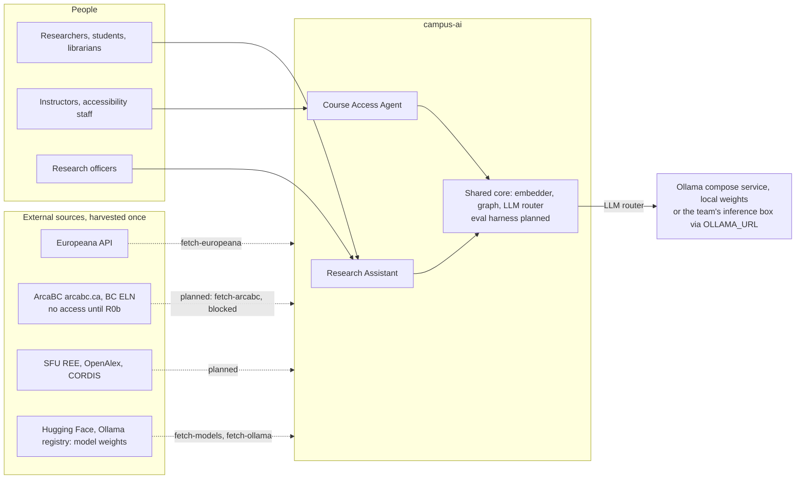
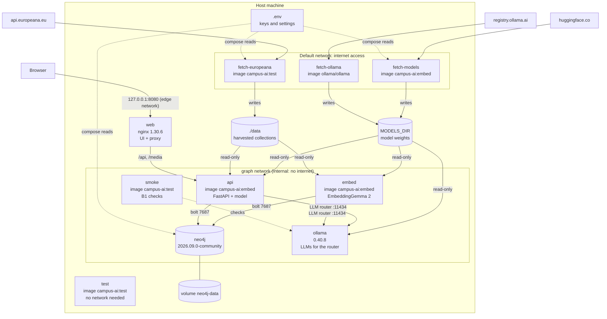
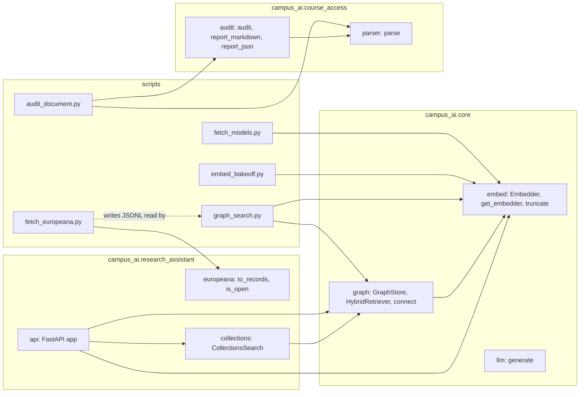
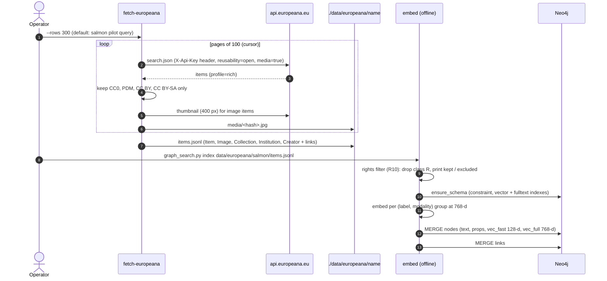
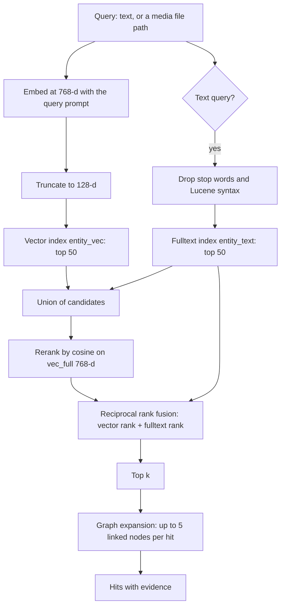
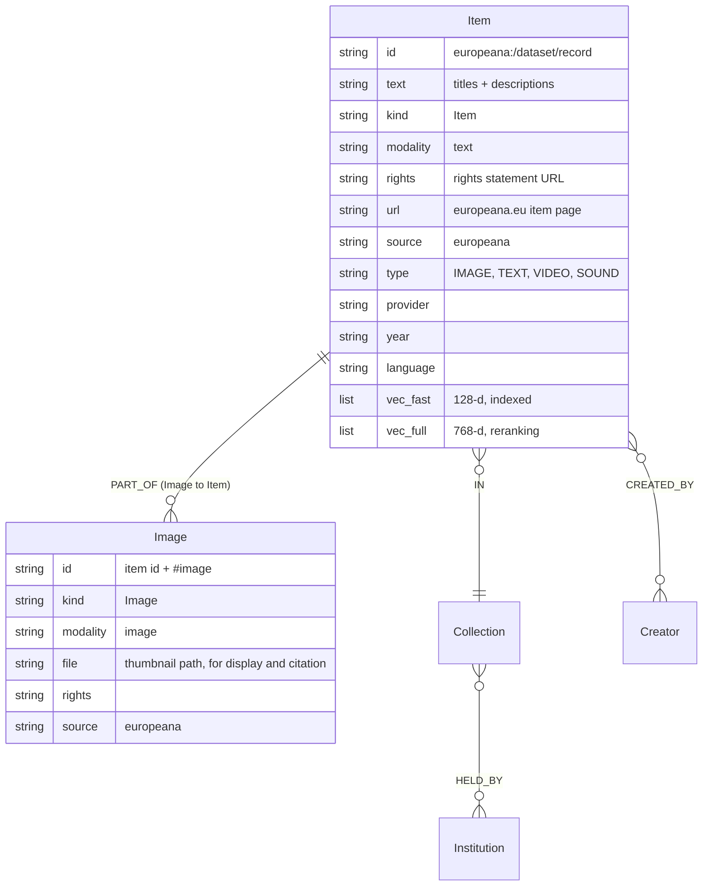
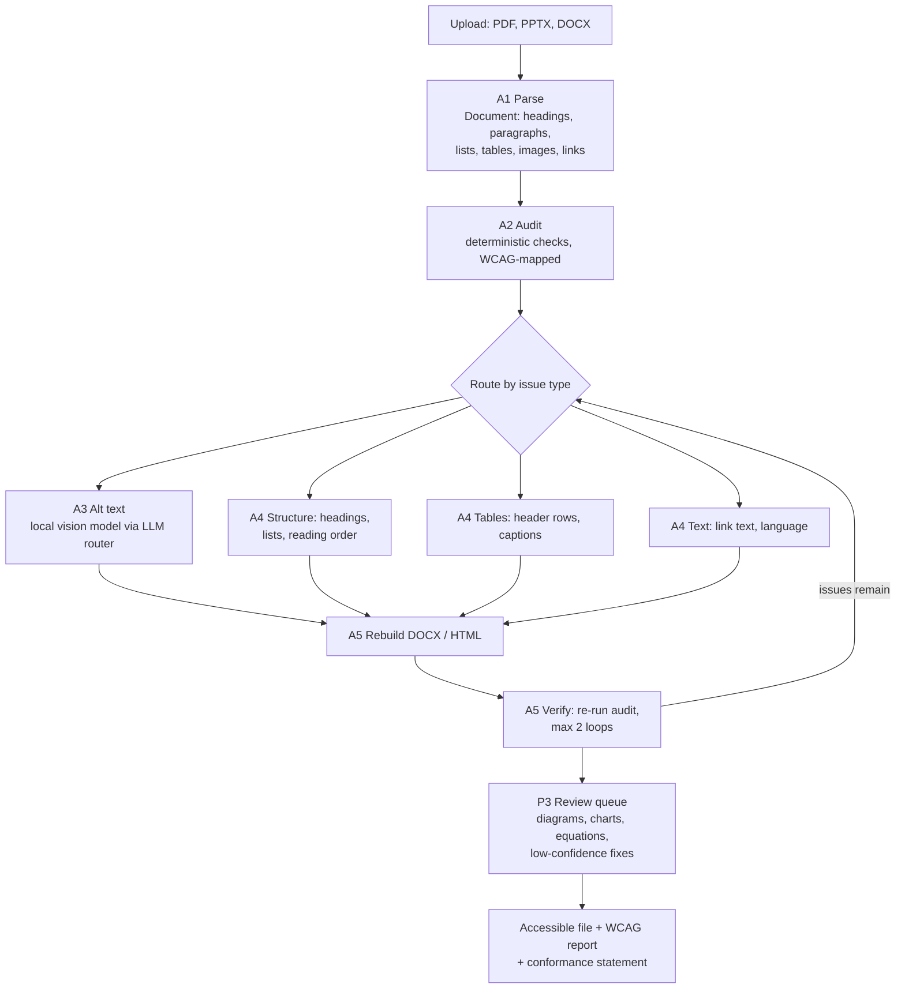

# Architecture

This document describes how campus-ai is put together: the runtime, the
modules, how data flows, and the decisions behind them. For the product scope
and roadmap see [`plans/master_plan.md`](plans/master_plan.md); for module
internals see [`design.md`](design.md).

**Status (October 2026).** Shared core: built the embedder (P7), the graph
core (P5), the local-only LLM router (P1) with its data-class gate (P1b),
tracing (P2), the licence guard (P8), Ollama in compose (P9) and the
local-stack smoke test (B1, passed on the demo laptop). Research Assistant:
built the Europeana loader (R8), collections search with its web UI (R9) and
the rights filter ahead of indexing (R10). Course Access Agent: built end to
end, parser, audit, workers, rebuild and verify (A1-A5) with the review queue
(P3) in the web app (section 11). Still planned: MCP servers (P4), eval
harness (P6), reranker (R3) and the ArcaBC loader (R7, blocked on R0b).
Diagrams mark planned parts with dashed lines.

## 1. System context

campus-ai is two products on one shared core:

- **Course Access Agent**: makes course materials accessible (WCAG 2.2).
- **Research Assistant**: finds experts, EU partners, Horizon calls and
  sources across BC (ArcaBC) and EU (Europeana) collections.



Every external source is reached only by a dedicated **fetch** step that
writes to local disk. Everything that processes data afterwards runs offline.
The LLM router calls Ollama at `OLLAMA_HOST`: in compose, the `ollama`
service (`http://ollama:11434`), which serves weights that the one-time
`fetch-ollama` job pulled into `MODELS_DIR/ollama`.

**ArcaBC** (https://arcabc.ca) is BC ELN's collection site, the BC counterpart
of Europeana: one aggregated source, not many repositories. Its loader (R7)
will mirror the Europeana loader, a single `fetch-arcabc` step writing the same
JSONL records, so indexing, search and the UI need no changes for it. Until BC
ELN grants permission (R0b), nothing in this repo may fetch, scrape or index
arcabc.ca.

## 2. Principles that shape the architecture

The two prime directives come first and override everything else (full text
in [`AGENTS.md`](../AGENTS.md)):

| Prime directive | Consequence in the code |
|---|---|
| **1. Open source only, no paid licences, ever** | Every Python package, image, tool and model weight is under an OSI-approved licence; permissive preferred, no AGPL. campus-ai is Apache-2.0. Checked: all 61 non-NVIDIA packages in the `embed` image are open source; the 16 NVIDIA CUDA packages are a named exception (free GPU vendor runtime, optional). Deployments need only Docker Engine + Compose or Podman; Docker Desktop is the other named exception, as a developer tool on Windows workstations |
| **2. Everything runs offline** | Every model runs locally from open weights on hardware we control: the embedder in the `embed`/`api` containers, language and vision models on Ollama through the LLM router (`campus_ai/core/llm/`, Ollama is its only backend). No cloud model APIs (no Claude, OpenAI, Gemini, Bedrock). The model containers (`embed`, `api`, `ollama`) can't reach the internet at all (internal network) |

| Principle | Consequence in the code |
|---|---|
| Portable: rebuilds from the repo on any machine | Everything runs in Docker Compose; dependencies are locked in `uv.lock`; images and Neo4j are pinned |
| Model register (D10) | The router uses only models listed in `MODEL_LICENCES` (`campus_ai/core/llm/config.py`) and refuses any other; defaults `gemma4:12b` (reasoning, vision) and `gemma4:e4b` (classification), all Apache-2.0. `tests/test_licences.py` checks these and the embedder weights |
| Offline models | All weights live in a host directory (`MODELS_DIR`) mounted read-only; `HF_HUB_OFFLINE=1`; Ollama runs with `OLLAMA_NO_CLOUD=1` and can't pull; nothing downloads at runtime |
| Network isolation | The model containers (`embed`, `api`, `ollama`) sit on an `internal` Docker network that reaches only Neo4j and each other; the B1 smoke test checks it has no internet route |
| Fetch and process are separate | `fetch-models`, `fetch-ollama` and `fetch-europeana` are the only services with internet access; they write files, never the graph |
| Simple codebase | Small modules in `campus_ai/core/`; one JSONL format feeds the indexer from any source |
| Evidence for every answer | The retriever returns each hit with its linked nodes (collection, holder, creator) and every item keeps its rights statement and source URL |
| Data rights | The rights filter (R10) classes every harvested record P or R before indexing: only CC0, PDM, CC BY and CC BY-SA items without access limits or TK Labels are embedded; class R stays a metadata link in the JSONL. Harvested data is never committed or baked into images. Behind it, the data-class gate (P1b) makes every router call and every embedding declare its class (P/I/S/R) and refuses R before any model sees it |
| Traceable model calls | Every router call writes a metadata-only JSONL trace record (P2: model, host, data class, tokens, latency, outcome), never prompts or outputs |

## 3. Runtime: containers and networks



| Service | Image | Network | Mounts | Purpose |
|---|---|---|---|---|
| `test` | `campus-ai:test` (base deps only) | default | none | Unit tests; models, Neo4j and HTTP are mocked |
| `embed` | `campus-ai:embed` (adds PyTorch, sentence-transformers, PyAV) | `graph` (internal) | `MODELS_DIR:/models:ro`, `./data:/app/data:ro` | Bake-off, indexing, search, eval |
| `neo4j` | `neo4j:2026.09.0-community` | `graph` (internal) | volume `neo4j-data` | Graph, vector and fulltext indexes |
| `fetch-models` | `campus-ai:embed` | default | `MODELS_DIR:/models` (rw) | One-time weight download (profile `fetch`) |
| `ollama` | `ollama/ollama:0.40.8` (MIT) | `graph` (internal) | `MODELS_DIR:/models:ro` | Serves the router's language and vision models from `MODELS_DIR/ollama`; port 11434 inside the network only (P9) |
| `fetch-ollama` | `ollama/ollama:0.40.8` | default | `MODELS_DIR:/models` (rw) | One-time pull of the router's default models, or the models given as arguments, into `MODELS_DIR/ollama` (profile `fetch`) |
| `smoke` | `campus-ai:test` | `graph` (internal) | `./evals/smoke` (rw) | Local-stack smoke test (B1): services up, no internet, router answers; report with timings (profile `smoke`) |
| `fetch-europeana` | `campus-ai:test` | default | `./data:/app/data` (rw) | Harvest Europeana items and thumbnails (profile `fetch`) |
| `api` | `campus-ai:embed` | `graph` (internal) | `MODELS_DIR:/models:ro`, `./data:/app/data:ro` | Collections search API (FastAPI, port 8000 inside the network only) |
| `web` | `nginx:1.30.6-alpine` | `graph` + `edge` | `web/static`, `web/nginx.conf` (ro) | Serves the UI and proxies `/api` and `/media` to `api`; the only published port, `127.0.0.1:${WEB_PORT:-8080}` |

`web` joins the ordinary `edge` network because a container on an internal
network can't publish a port. It runs only nginx, with no model, key or data,
so the services that hold them stay without internet access.

`embed`, `api` and `smoke` get `OLLAMA_HOST` (the `ollama` service, or
`OLLAMA_URL` from `.env` for the team's inference box; not the shell's
`OLLAMA_HOST`, which a native Ollama install exports) and the optional
`CAMPUS_AI_MODEL_*` overrides from `.env`. Start `ollama`
with `docker compose up -d ollama`; `api` doesn't wait for it, since nothing
in `api` calls the router yet. Ollama reads its weights read-only, so it never
prunes them (`OLLAMA_NOPRUNE=1`), and its cloud models are off
(`OLLAMA_NO_CLOUD=1`). It needs `MODELS_DIR/ollama` to exist, so run
`fetch-ollama` once before starting it.

Overlay files:
- `compose.gpu.yaml` gives `embed`, `api` and `ollama` the host's NVIDIA
  GPUs (opt in per machine).
- `.claude/compose.cloud.yaml` routes builds and fetches through the TLS
  proxy of Claude Code cloud sessions (development only, not part of the
  product). Use it only there.

Neo4j publishes no ports, so it is reachable only from containers on the
`graph` network. Use `docker compose exec neo4j cypher-shell` to inspect it.

## 4. Code structure

```text
campus_ai/
  core/
    embed/        Embedder interface, EmbeddingGemma 2 + e5 baseline, media decoding   (P7)
    graph/        GraphStore (writer + indexes), HybridRetriever, stop words            (P5)
    llm/          LLM router: generate(), Ollama backend, MODEL_LICENCES allowlist      (P1)
    data_classes.py  P/I/S/R data-class gate before any model or embedding           (P1b)
    tracing.py    per-run JSONL trace of model and tool calls                           (P2)
  course_access/
    parser.py     PDF/PPTX/DOCX -> Document                                             (A1)
    audit.py      deterministic WCAG checks, Markdown/JSON report                       (A2)
  research_assistant/
    europeana.py  Europeana record -> graph records                                     (R8)
    rights.py     rights filter: data class P or R per record, before indexing          (R10)
    collections.py  search service: cards, citations, similar pictures                  (R9)
    api.py        FastAPI app for collections search                                    (R9)
web/
  static/         UI: index.html, app.js, styles.css (no build step)                    (R9)
  nginx.conf      static files + proxy to api                                           (R9)
scripts/
  fetch_models.py      download embedder weights into MODELS_DIR
  embed_bakeoff.py     recall@k per embedder on a JSONL set (decision D7)
  graph_search.py      index / search / eval against Neo4j; rights (filter report only)
  fetch_europeana.py   harvest Europeana into data/europeana/<name>/
  audit_document.py    audit one course document, print the report (A2)
evals/embed/      sample bake-off set
evals/rights/     rights filter fixture (synthetic Europeana and ArcaBC-shaped records)
tests/            unittest suites, external services mocked
```



Dependencies point inwards: scripts and products use `core`; `core` never
imports a product. The alt-text worker (A3) is the LLM router's first caller
and the only core module Course Access uses so far. The Europeana loader doesn't
import the graph at all. It writes JSONL, which keeps the networked fetch step free of model and
database code.

## 5. Data flow

### 5.1 Ingest



### 5.2 Query



Planned: a reranker (Qwen3-Reranker-4B in the `embed` service, card R3,
bake-off B2) after fusion, and a model-id property on every vector index (R3).

### 5.3 Collections search (R9)

The browser talks only to `web`; nginx forwards `/api/` and `/media/` to
`api`, which serves `campus_ai/research_assistant/api.py`:

| Endpoint | Returns |
|---|---|
| `GET /api/health` | Status and the number of indexed items |
| `GET /api/search?q=...&k=12` | `pictures` (Image nodes, mapped to their items) and `texts` (items without a picture), ranked separately |
| `POST /api/search/image` (form field `file`) | Pictures similar to an uploaded image, with a `match` of `same`, `close` or `none` |
| `GET /api/items/{id}` | One item with APA, Chicago and BibTeX citations and up to 4 similar pictures |
| `GET /media/{path}` | Image files in a `media/` folder under `data/` only |

## 6. Graph model

All searchable nodes share one label, `Entity`, which carries the unique `id`
constraint and both indexes. Each node also has a domain label, copied to its
`kind` property so vector search can filter by it inside the index.



| Index | Type | On | Used for |
|---|---|---|---|
| `entity_id` | uniqueness constraint | `Entity.id` | MERGE on re-index |
| `entity_vec` | vector, cosine, 128-d, filterable by `kind` | `Entity.vec_fast` | Candidate search, optionally within labels |
| `entity_text` | fulltext (Lucene) | `Entity.text` | Keyword candidates |

The research graph (section 4.2 of the master plan) uses the same `Entity`
convention, so one retriever searches people, projects and collections
together. R1 fills its first part from OpenAlex (`fetch-openalex`, then
`graph_search.py index data/openalex/<name>/records.jsonl`):

| Node | id | text (embedded) | Links out |
|---|---|---|---|
| `Researcher` | `openalex:A…` | name, institution, top topics, recent titles | `AFFILIATED_WITH` Institution, `AUTHORED` Publication, `WORKS_ON {count}` Topic, `CONTRIBUTES_TO {count}` SDG, `COAUTHORED_WITH {count}` Researcher |
| `Publication` | `openalex:W…` | title + abstract | `ABOUT {score}` Topic, `SUPPORTS {score}` SDG |
| `Topic` | `openalex:T…` | name (subfield, field) | |
| `SDG` | `openalex:sdg:n` | UN goal name | |
| `Institution` | ROR URL | name | |

Only authors affiliated with the harvested institution become researchers;
their text holds public facts from their publications and nothing inferred
about the person. Project and Call nodes come with R2; REE profile fields
with R0.

## 7. Key decisions

| Decision | Choice | Why | Alternatives considered |
|---|---|---|---|
| Licences (D8) | OSI open source only; permissive preferred; campus-ai Apache-2.0 | Prime directive 1: no paid licences, ever | Commercial licences (e.g. PyMuPDF's Artifex licence): rejected. Docker Desktop: allowed only as a Windows developer tool, never required to run the product |
| Model hosting (D2) | Local open-weight models only, in containers | Prime directive 2: everything offline | Hosted APIs (Claude, Bedrock and others): rejected |
| Embedder (D7) | EmbeddingGemma 2, local weights | One space for text, image, audio, video; Apache 2.0; Matryoshka sizes; multilingual | vLLM and Ollama don't serve it yet; e5-small kept as text baseline |
| Vector sizes | 128-d indexed, 768-d stored | Small index for fast candidates, full precision for the final order | Index at 768-d: larger, slower; 128-d only: less accurate |
| Fusion | Reciprocal rank fusion, k=60 | No score calibration between cosine and Lucene; robust | Weighted score sum needs tuning per corpus |
| Fulltext analyzer | Language-neutral, stop words removed at query time | Corpus is multilingual; Lucene's analyzer holds one language's stop words | Per-language indexes: more schema for little gain at this size |
| LLM router (P1, D10) | Ollama only, at `OLLAMA_HOST`; models allowed only from `MODEL_LICENCES`; defaults Gemma 4 | One local backend keeps the router small; the allowlist enforces D8 for weights | Cloud backends (Claude, Bedrock and others): removed (D2) |
| Data-class gate (P1b) | Required `data_class` argument on `generate` and `Embedder.embed`; R refused there | The two model entry points are the only places data reaches a model, so one check each covers every caller | A check per product: easy to miss one |
| Tracing (P2) | JSONL file per run, standard library, metadata fields only | Inspectable, no service to run, cannot leak content | A tracing service or OpenTelemetry stack: more to run for no gain yet |
| Graph store | Neo4j Community in compose | Vector, fulltext and graph traversal in one store; matches the plan's graph-RAG pattern | Separate vector DB + graph: two stores to keep in sync |
| Isolation | Internal Docker network | Models and data can't reach the internet even if code tries | Disabling all networking would also cut off Neo4j |
| Loader output | JSONL files, then index | Fetch needs no model; harvests are reproducible and inspectable; one indexer for all sources | Writing to Neo4j during fetch would put models on an internet-connected container |
| Europeana media | 400 px thumbnails via `api.europeana.eu` | One host, stable, enough for image embeddings; full-size media is spread over hundreds of provider hosts | Full-size downloads: later, per provider |
| Secrets | `.env` (gitignored); API key sent only as a header | Keeps keys out of git, URLs and logs | — |

## 8. Security, privacy and rights

- **Secrets.** `EUROPEANA_API_KEY`, `HF_TOKEN` and `NEO4J_PASSWORD` live in
  `.env`, which git ignores. The Europeana key travels only in the
  `X-Api-Key` header to `api.europeana.eu`.
- **Network.** Only the two `fetch-*` services and the `web` proxy reach a
  non-internal network. `embed`, `api` and `neo4j` are internal only; Neo4j
  has no published ports, and `web` publishes on localhost only.
- **Web.** The UI sets a strict Content-Security-Policy (same-origin scripts,
  styles and images, plus `blob:` images for the upload preview), renders
  record text with `textContent` only, and loads no fonts or scripts from
  CDNs. `/media` serves only image files in a harvest's `media/` folder,
  never JSONL or other data. Image uploads are
  limited to 10 MB and to JPEG, PNG, WebP and GIF, and are deleted after the
  search.
- **Rights.** The loader keeps only CC0, Public Domain Mark, CC BY and
  CC BY-SA items, and stores each item's rights URL and source page on the
  node so answers can attribute them.
- **Data at rest.** Harvested data (`data/europeana/`), weights (`models/`)
  and `.env` are excluded from git and from Docker build contexts.
- **Models.** All local (prime directive 2), so no document, query or record
  is ever sent to a model provider. The LLM router reaches only the Ollama
  host in `OLLAMA_HOST` (the `ollama` compose service, or the team's
  inference box via `OLLAMA_URL`).
- **Data classes.** Every LLM router call and every embedding declares its
  class (P1b: P/I/S/R); class R is refused before any model call or
  embedding. Each router call writes a trace record of model, host, class,
  tokens, latency and outcome to `CAMPUS_AI_TRACE_DIR` (P2), never content.
- **Planned.** The rights and
  governance filter ahead of collections indexing (R10: Europeana
  `edm:rights`, ArcaBC access flags and TK Labels); GDPR handling for EU
  researcher data and OCAP® for Indigenous materials (master plan, section
  4.4).

## 9. Resilience

- `neo4j`, `ollama`, `api` and `web` have `restart: unless-stopped`: they come back
  after a crash and when Docker starts (e.g. after a reboot, if the Docker engine
  starts with Windows), until you stop them with `docker compose stop`.
- Health checks on all four. `api` is restarted by Compose when Neo4j is, and
  its database driver also reconnects on its own.
- nginx looks up `api` through Docker's DNS on every request (cached 10 s), so
  a recreated `api` container with a new address is found without restarting
  `web`.
- Each image is built by one service only (`test`, `embed`); `api`,
  `fetch-models` and `fetch-europeana` reuse the image with
  `pull_policy: never`. Building one image from two services in parallel
  corrupted it, so run `docker compose build` before `up`.
- Measured: a crashed `api` serves again in about 25 s (model reload); after a
  Neo4j restart, search works again within seconds.

## 10. Scaling and limits

- Indexing is CPU-bound without a GPU. Add `compose.gpu.yaml` on NVIDIA
  machines; the embedder then runs in bfloat16.
- Neo4j Community is single-instance. That's fine for the pilot scale, which
  is thousands of nodes.
- Changing the embedder or its vector sizes means rebuilding the graph;
  `ensure_schema` refuses a mismatched index.
- See [`design.md`](design.md) section 7 for known limitations.

## 11. Course Access Agent

The second product. It takes a course document (PDF, PPTX or DOCX), finds
what fails WCAG 2.2 AA, fixes what it safely can, and sends the rest to a
person. Output: an accessible DOCX or HTML version, an issue report mapped to
WCAG success criteria, and a short conformance statement (master plan,
section 3). It shares the LLM router, review queue, eval harness and tracing
with the Research Assistant, but not the graph: course materials are never
indexed into the shared graph.

### 11.1 Status

| Card | What | State |
|---|---|---|
| A1 | Document parser: PDF/PPTX/DOCX into one structure | Built on open-source, permissively licensed libraries (python-docx, python-pptx, pdfplumber); 7 tests. Supersedes PR #4, which used PyMuPDF |
| A2 | Deterministic audit + WCAG-mapped report | Built: 15 rules over 7 WCAG 2.2 criteria, Markdown and JSON reports, and a "not checked" list; no model involved |
| A3 | Alt-text worker (local vision model, confidence score) | Built: proposals for the images the audit flags, through the LLM router (task `vision`); charts, diagrams, equations, images of text, decorative calls and low-confidence answers always go to review; `scripts/alt_text.py` prints the review sheet. Probe run with `gemma4:e2b`: 6/6 kinds right (`evals/course_access/`). B3 on the gold set pending |
| A4 | Structure, table and text workers | Built: rules in code for lists, heading levels, slide titles, header rows, layout tables, titles and link text from context; the model only for the document language and for link text the context does not give; every proposal carries confidence, review flag and evidence. `scripts/propose_fixes.py`; corpus run in `evals/course_access/` |
| A5 | Rebuild accessible DOCX/HTML + verify loop | Built: approved proposals applied to the parsed document, accessible DOCX and HTML written, the DOCX audited again with the same checks, and an accessibility statement with found, applied, waiting, remaining and introduced. `scripts/remediate.py` runs A1-A5 end to end; corpus run in `evals/course_access/` |
| A6 | Gold set (40 documents) and eval metrics | Planned; needs P6 and the documents |
| P3 | Review queue (approve / edit / reject) | Built: the `course-access` service behind `web` (`/review/`); jobs live in the `course-access-work` volume on this machine; approved proposals and undisputed rule-based ones are applied at rebuild, rejected and waiting ones never |

### 11.2 Pipeline

Solid boxes exist; dashed boxes are planned.



Principles specific to this product (master plan 3.2):
- **Never change academic content**, only structure and descriptions.
- **Checkable things are checked by code** (A2), and every fix is re-checked
  by the same checker that found the issue (A5). LLMs are used only for
  judgement: alt text, reading order, link wording.
- **People approve meaning.** Every chart, diagram and equation, and every
  fix below the confidence threshold, goes to the review queue; nothing is
  published automatically.

### 11.3 Runtime (planned)

Today A1 and A2 run as a script in the `test` image
(`scripts/audit_document.py`; see `design.md` section 9.2). Following the
rules in section 2, Course Access will become one more compose service.
Parsing, auditing and rebuilding are local and deterministic. The only model
calls are alt text and other judgement steps, and they go through the LLM
router (P1) to a local open-weight vision model served by Ollama on hardware
we control, the `ollama` compose service (P9) (prime directive 2; model chosen by
bake-off B3, D9). No
document ever leaves the machine. Documents are processed and returned; the
service keeps no copy beyond what the review queue needs, and nothing enters
the search graph.

### 11.4 Open items

| Item | Why it matters |
|---|---|
| PyMuPDF replaced (D8) | Done: A1 reads PDFs with pdfplumber (MIT). PDF reading order is now by position on the page rather than content-stream order |
| Scanned PDFs | A1 reads text layers only; image-only scans give no text. **OCR is next phase** (card A7), with an open-source offline engine |
| Untagged PDFs | Carry no heading or list semantics, so A1 returns them as paragraphs; A4 must infer structure |
| Checkers | The plan names axe-core (via Playwright) and veraPDF (Java). Confirm their licences and that they run offline; both add large runtimes to the image |
| **Vision model** (D9) | A local open-weight vision-language model under an OSI-approved licence, chosen by bake-off B3 on the gold set; register candidates `gemma4:12b` (router default) or `qwen3-vl:8b`. Local models may describe complex figures less well than hosted ones, so confidence thresholds and human review matter more |
| LLM router | Done: Ollama is the only backend (the `ollama` compose service, or the team's inference box via `OLLAMA_URL`); models must be in its open-licence allowlist; defaults are Gemma 4 (Apache-2.0) |
| Gold set | 40 real course documents labelled by an accessibility specialist (D6). 20 openly licensed ones (CC BY, CC BY-SA) are collected by `fetch-course-docs` into `DATA_DIR/course_access`, with a manifest; none labelled yet |

Module details for A1 and A2 are in [`design.md`](design.md#9-course-access-agent).
