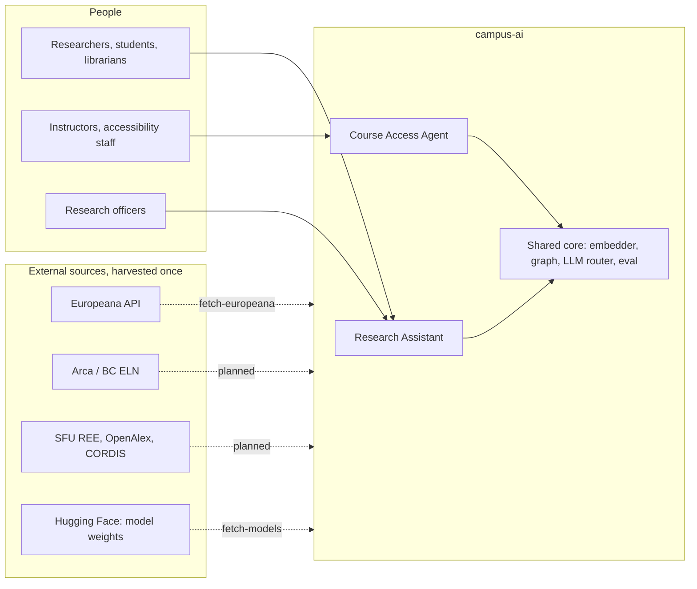
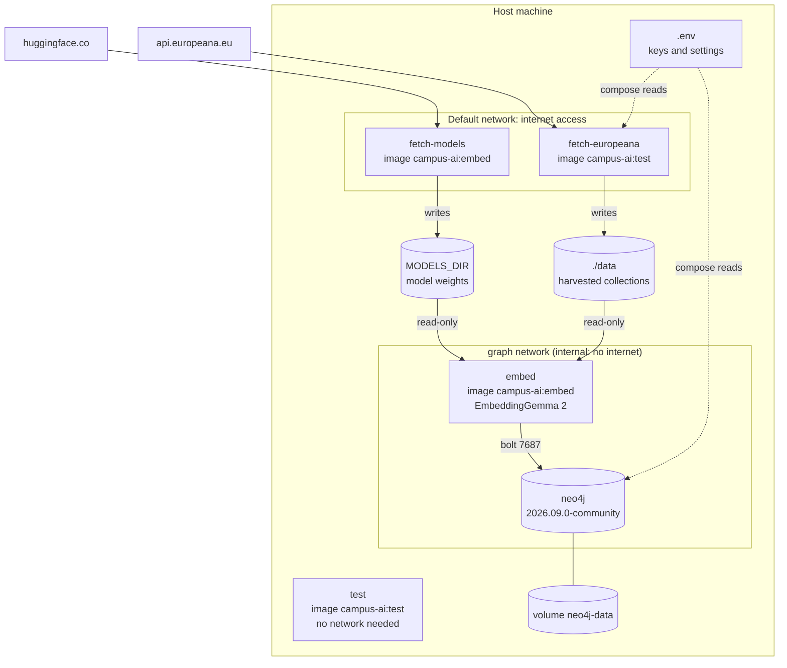
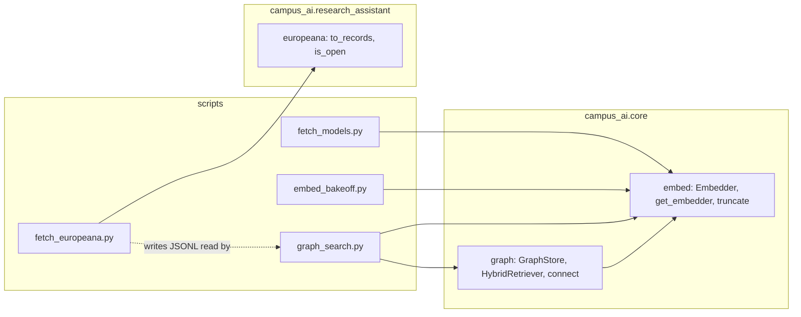
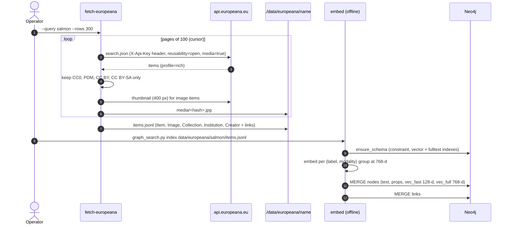
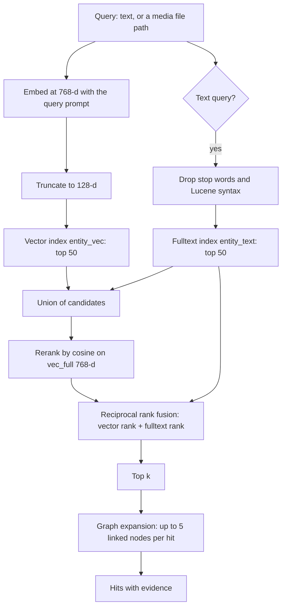
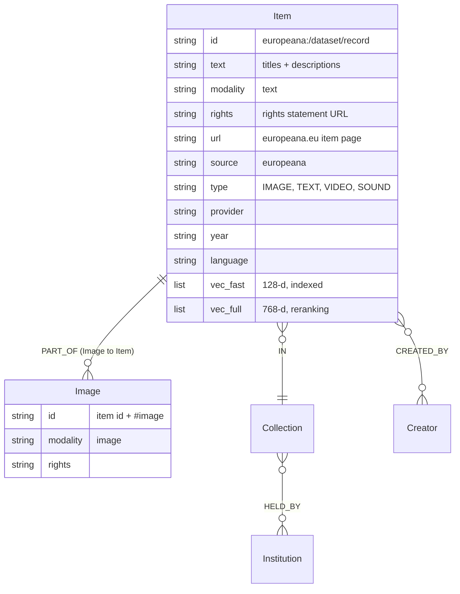

# Architecture

This document describes how campus-ai is put together: the runtime, the
modules, how data flows, and the decisions behind them. For the product scope
and roadmap see [`plans/master_plan.md`](plans/master_plan.md); for module
internals see [`design.md`](design.md).

**Status (October 2026).** Built: the embedder (P7), the graph core (P5) and
the Europeana loader (R8). Planned: LLM router, eval harness, tracing,
review UI, MCP servers, and both product agents. Diagrams mark planned parts
with dashed lines.

## 1. System context

campus-ai is two products on one shared core:

- **Course Access Agent**: makes course materials accessible (WCAG 2.2).
- **Research Assistant**: finds experts, EU partners, Horizon calls and
  sources across BC (Arca) and EU (Europeana) collections.



Every external source is reached only by a dedicated **fetch** step that
writes to local disk. Everything that processes data afterwards runs offline.

## 2. Principles that shape the architecture

| Principle | Consequence in the code |
|---|---|
| Portable: rebuilds from the repo on any machine | Everything runs in Docker Compose; dependencies are locked in `uv.lock`; images and Neo4j are pinned |
| Offline models | Weights live in a host directory (`MODELS_DIR`) mounted read-only; `HF_HUB_OFFLINE=1`; nothing downloads at runtime |
| Network isolation | Model containers sit on an `internal` Docker network that reaches only Neo4j |
| Fetch and process are separate | `fetch-models` and `fetch-europeana` are the only services with internet access; they write files, never the graph |
| Simple codebase | Small modules in `campus_ai/core/`; one JSONL format feeds the indexer from any source |
| Evidence for every answer | The retriever returns each hit with its linked nodes (collection, holder, creator) and every item keeps its rights statement and source URL |
| Data rights | Only openly licensed Europeana items are kept; harvested data is never committed or baked into images |

## 3. Runtime: containers and networks



| Service | Image | Network | Mounts | Purpose |
|---|---|---|---|---|
| `test` | `campus-ai:test` (base deps only) | default | none | Unit tests; models, Neo4j and HTTP are mocked |
| `embed` | `campus-ai:embed` (adds PyTorch, sentence-transformers, PyAV) | `graph` (internal) | `MODELS_DIR:/models:ro`, `./data:/app/data:ro` | Bake-off, indexing, search, eval |
| `neo4j` | `neo4j:2026.09.0-community` | `graph` (internal) | volume `neo4j-data` | Graph, vector and fulltext indexes |
| `fetch-models` | `campus-ai:embed` | default | `MODELS_DIR:/models` (rw) | One-time weight download (profile `fetch`) |
| `fetch-europeana` | `campus-ai:test` | default | `./data:/app/data` (rw) | Harvest Europeana items and thumbnails (profile `fetch`) |

Overlay files:
- `compose.gpu.yaml` gives `embed` the host's NVIDIA GPUs (opt in per machine).
- `.claude/compose.cloud.yaml` routes builds and fetches through the TLS
  proxy of Claude Code cloud sessions. Use it only there.

Neo4j publishes no ports, so it is reachable only from containers on the
`graph` network. Use `docker compose exec neo4j cypher-shell` to inspect it.

## 4. Code structure

```text
campus_ai/
  core/
    embed/        Embedder interface, EmbeddingGemma 2 + e5 baseline, media decoding   (P7)
    graph/        GraphStore (writer + indexes), HybridRetriever, stop words            (P5)
  research_assistant/
    europeana.py  Europeana record -> graph records                                     (R8)
  course_access/  (planned)
scripts/
  fetch_models.py      download weights into MODELS_DIR
  embed_bakeoff.py     recall@k per embedder on a JSONL set (decision D7)
  graph_search.py      index / search / eval against Neo4j
  fetch_europeana.py   harvest Europeana into data/europeana/<name>/
evals/embed/      sample bake-off set
tests/            unittest suites, external services mocked
```



Dependencies point inwards: scripts and products use `core`; `core` never
imports a product. The Europeana loader doesn't import the graph at all.
It writes JSONL, which keeps the networked fetch step free of model and
database code.

## 5. Data flow

### 5.1 Ingest



### 5.2 Query



## 6. Graph model

All searchable nodes share one label, `Entity`, which carries the unique `id`
constraint and both indexes. Each node also has a domain label.



| Index | Type | On | Used for |
|---|---|---|---|
| `entity_id` | uniqueness constraint | `Entity.id` | MERGE on re-index |
| `entity_vec` | vector, cosine, 128-d | `Entity.vec_fast` | Candidate search |
| `entity_text` | fulltext (Lucene) | `Entity.text` | Keyword candidates |

The planned research graph (section 4.2 of the master plan: Researcher,
Publication, Project, Call, Topic) uses the same `Entity` convention, so one
retriever searches people, projects and collections together.

## 7. Key decisions

| Decision | Choice | Why | Alternatives considered |
|---|---|---|---|
| Embedder (D7) | EmbeddingGemma 2, local weights | One space for text, image, audio, video; Apache 2.0; Matryoshka sizes; multilingual | vLLM and Ollama don't serve it yet; e5-small kept as text baseline |
| Vector sizes | 128-d indexed, 768-d stored | Small index for fast candidates, full precision for the final order | Index at 768-d: larger, slower; 128-d only: less accurate |
| Fusion | Reciprocal rank fusion, k=60 | No score calibration between cosine and Lucene; robust | Weighted score sum needs tuning per corpus |
| Fulltext analyzer | Language-neutral, stop words removed at query time | Corpus is multilingual; Lucene's analyzer holds one language's stop words | Per-language indexes: more schema for little gain at this size |
| Graph store | Neo4j Community in compose | Vector, fulltext and graph traversal in one store; matches the plan's graph-RAG pattern | Separate vector DB + graph: two stores to keep in sync |
| Isolation | Internal Docker network | Models and data can't reach the internet even if code tries | Disabling all networking would also cut off Neo4j |
| Loader output | JSONL files, then index | Fetch needs no model; harvests are reproducible and inspectable; one indexer for all sources | Writing to Neo4j during fetch would put models on an internet-connected container |
| Europeana media | 400 px thumbnails via `api.europeana.eu` | One host, stable, enough for image embeddings; full-size media is spread over hundreds of provider hosts | Full-size downloads: later, per provider |
| Secrets | `.env` (gitignored); API key sent only as a header | Keeps keys out of git, URLs and logs | — |

## 8. Security, privacy and rights

- **Secrets.** `EUROPEANA_API_KEY`, `HF_TOKEN` and `NEO4J_PASSWORD` live in
  `.env`, which git ignores. The Europeana key travels only in the
  `X-Api-Key` header to `api.europeana.eu`.
- **Network.** Only the two `fetch-*` services reach the internet. `embed`
  and `neo4j` are on an internal network; Neo4j has no published ports.
- **Rights.** The loader keeps only CC0, Public Domain Mark, CC BY and
  CC BY-SA items, and stores each item's rights URL and source page on the
  node so answers can attribute them.
- **Data at rest.** Harvested data (`data/europeana/`), weights (`models/`)
  and `.env` are excluded from git and from Docker build contexts.
- **Planned.** GDPR handling for EU researcher data, OCAP® for Indigenous
  materials, and in-region LLM routing (master plan, sections 4.4 and 2).

## 9. Scaling and limits

- Indexing is CPU-bound without a GPU. Add `compose.gpu.yaml` on NVIDIA
  machines; models then run in bfloat16.
- Neo4j Community is single-instance. That's fine for the pilot scale, which
  is thousands of nodes.
- Changing the embedder or its vector sizes means rebuilding the graph;
  `ensure_schema` refuses a mismatched index.
- See [`design.md`](design.md) section 7 for known limitations.
