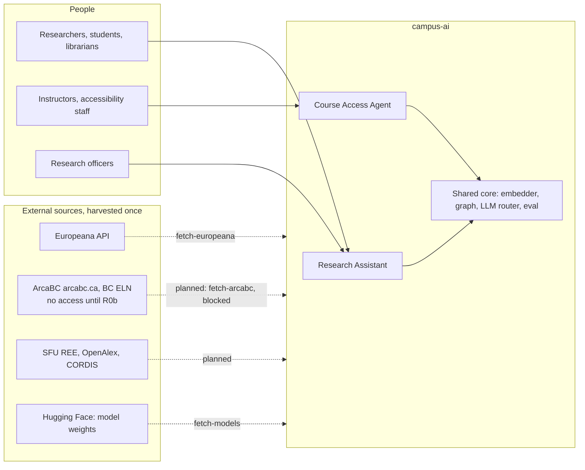
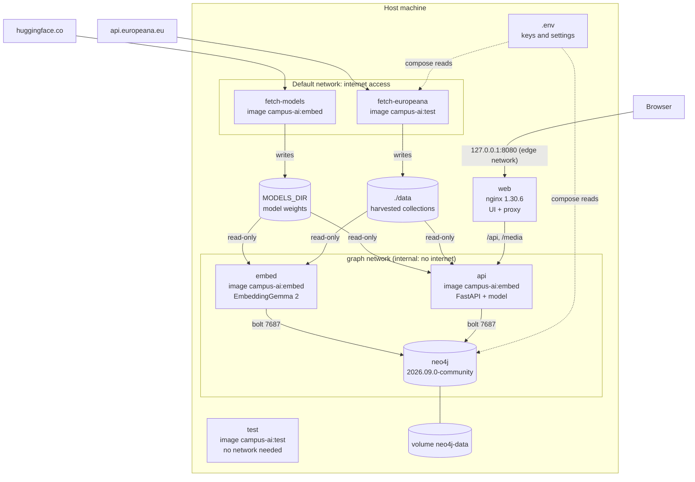
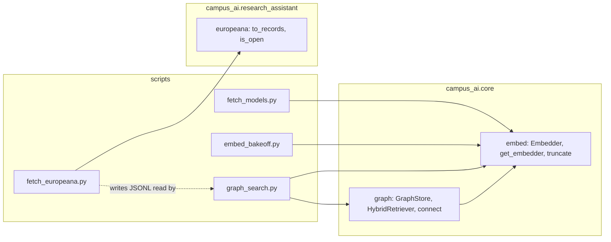
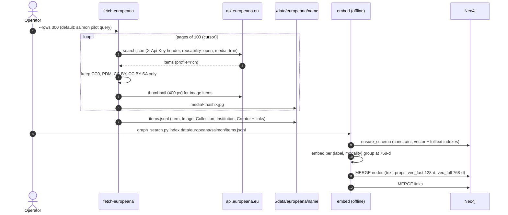
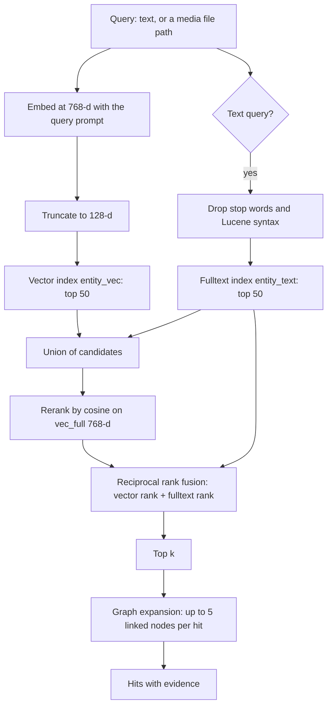
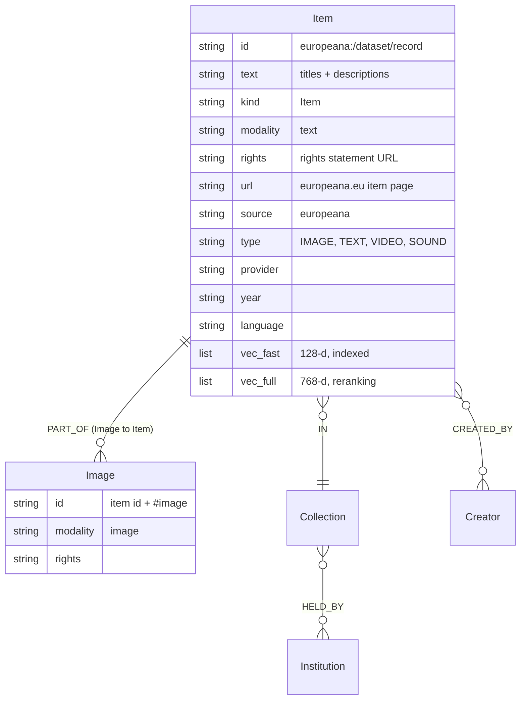
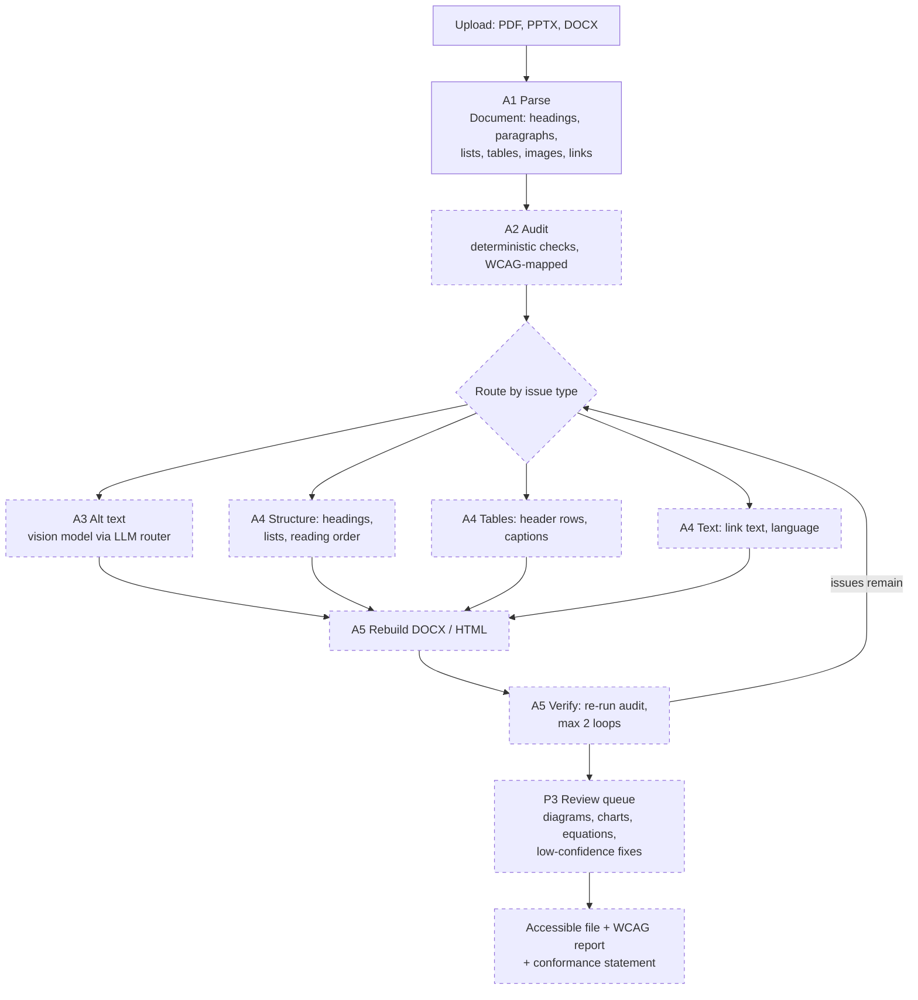

# Architecture

This document describes how campus-ai is put together: the runtime, the
modules, how data flows, and the decisions behind them. For the product scope
and roadmap see [`plans/master_plan.md`](plans/master_plan.md); for module
internals see [`design.md`](design.md).

**Status (October 2026).** Research Assistant: built the embedder (P7), the
graph core (P5), the Europeana loader (R8) and collections search with its
web UI (R9). Course Access Agent: the document parser (A1) is built on its own
branch; the rest is planned (section 11). Shared and still planned: eval
harness, tracing, review UI, MCP servers; the LLM router (P1) is on an
unmerged branch. Diagrams mark planned parts with dashed lines.

## 1. System context

campus-ai is two products on one shared core:

- **Course Access Agent**: makes course materials accessible (WCAG 2.2).
- **Research Assistant**: finds experts, EU partners, Horizon calls and
  sources across BC (ArcaBC) and EU (Europeana) collections.



Every external source is reached only by a dedicated **fetch** step that
writes to local disk. Everything that processes data afterwards runs offline.

**ArcaBC** (https://arcabc.ca) is BC ELN's collection site, the BC counterpart
of Europeana: one aggregated source, not many repositories. Its loader (R7)
will mirror the Europeana loader, a single `fetch-arcabc` step writing the same
JSONL records, so indexing, search and the UI need no changes for it. Until BC
ELN grants permission (R0b), nothing in this repo may fetch, scrape or index
arcabc.ca.

## 2. Principles that shape the architecture

| Principle | Consequence in the code |
|---|---|
| Portable: rebuilds from the repo on any machine | Everything runs in Docker Compose; dependencies are locked in `uv.lock`; images and Neo4j are pinned |
| Offline models | Weights live in a host directory (`MODELS_DIR`) mounted read-only; `HF_HUB_OFFLINE=1`; nothing downloads at runtime |
| Network isolation | Model containers sit on an `internal` Docker network that reaches only Neo4j |
| Fetch and process are separate | `fetch-models` and `fetch-europeana` are the only services with internet access; they write files, never the graph |
| Simple codebase | Small modules in `campus_ai/core/`; one JSONL format feeds the indexer from any source |
| Evidence for every answer | The retriever returns each hit with its linked nodes (collection, holder, creator) and every item keeps its rights statement and source URL |
| Data rights | Only openly licensed Europeana items are kept; harvested data is never committed or baked into images |

## 3. Runtime: containers and networks



| Service | Image | Network | Mounts | Purpose |
|---|---|---|---|---|
| `test` | `campus-ai:test` (base deps only) | default | none | Unit tests; models, Neo4j and HTTP are mocked |
| `embed` | `campus-ai:embed` (adds PyTorch, sentence-transformers, PyAV) | `graph` (internal) | `MODELS_DIR:/models:ro`, `./data:/app/data:ro` | Bake-off, indexing, search, eval |
| `neo4j` | `neo4j:2026.09.0-community` | `graph` (internal) | volume `neo4j-data` | Graph, vector and fulltext indexes |
| `fetch-models` | `campus-ai:embed` | default | `MODELS_DIR:/models` (rw) | One-time weight download (profile `fetch`) |
| `fetch-europeana` | `campus-ai:test` | default | `./data:/app/data` (rw) | Harvest Europeana items and thumbnails (profile `fetch`) |
| `api` | `campus-ai:embed` | `graph` (internal) | `MODELS_DIR:/models:ro`, `./data:/app/data:ro` | Collections search API (FastAPI, port 8000 inside the network only) |
| `web` | `nginx:1.30.6-alpine` | `graph` + `edge` | `web/static`, `web/nginx.conf` (ro) | Serves the UI and proxies `/api` and `/media` to `api`; the only published port, `127.0.0.1:${WEB_PORT:-8080}` |

`web` joins the ordinary `edge` network because a container on an internal
network can't publish a port. It runs only nginx, with no model, key or data,
so the services that hold them stay without internet access.

Overlay files:
- `compose.gpu.yaml` gives `embed` the host's NVIDIA GPUs (opt in per machine).
- `.claude/compose.cloud.yaml` routes builds and fetches through the TLS
  proxy of Claude Code cloud sessions. Use it only there.

Neo4j publishes no ports, so it is reachable only from containers on the
`graph` network. Use `docker compose exec neo4j cypher-shell` to inspect it.

## 4. Code structure

```text
campus_ai/
  core/
    embed/        Embedder interface, EmbeddingGemma 2 + e5 baseline, media decoding   (P7)
    graph/        GraphStore (writer + indexes), HybridRetriever, stop words            (P5)
  research_assistant/
    europeana.py  Europeana record -> graph records                                     (R8)
    collections.py  search service: cards, citations, similar pictures                  (R9)
    api.py        FastAPI app for collections search                                    (R9)
web/
  static/         UI: index.html, app.js, styles.css (no build step)                    (R9)
  nginx.conf      static files + proxy to api                                           (R9)
  course_access/  (planned)
scripts/
  fetch_models.py      download weights into MODELS_DIR
  embed_bakeoff.py     recall@k per embedder on a JSONL set (decision D7)
  graph_search.py      index / search / eval against Neo4j
  fetch_europeana.py   harvest Europeana into data/europeana/<name>/
evals/embed/      sample bake-off set
tests/            unittest suites, external services mocked
```



Dependencies point inwards: scripts and products use `core`; `core` never
imports a product. The Europeana loader doesn't import the graph at all.
It writes JSONL, which keeps the networked fetch step free of model and
database code.

## 5. Data flow

### 5.1 Ingest



### 5.2 Query



## 6. Graph model

All searchable nodes share one label, `Entity`, which carries the unique `id`
constraint and both indexes. Each node also has a domain label, copied to its
`kind` property so vector search can filter by it inside the index.



| Index | Type | On | Used for |
|---|---|---|---|
| `entity_id` | uniqueness constraint | `Entity.id` | MERGE on re-index |
| `entity_vec` | vector, cosine, 128-d, filterable by `kind` | `Entity.vec_fast` | Candidate search, optionally within labels |
| `entity_text` | fulltext (Lucene) | `Entity.text` | Keyword candidates |

The planned research graph (section 4.2 of the master plan: Researcher,
Publication, Project, Call, Topic) uses the same `Entity` convention, so one
retriever searches people, projects and collections together.

## 7. Key decisions

| Decision | Choice | Why | Alternatives considered |
|---|---|---|---|
| Embedder (D7) | EmbeddingGemma 2, local weights | One space for text, image, audio, video; Apache 2.0; Matryoshka sizes; multilingual | vLLM and Ollama don't serve it yet; e5-small kept as text baseline |
| Vector sizes | 128-d indexed, 768-d stored | Small index for fast candidates, full precision for the final order | Index at 768-d: larger, slower; 128-d only: less accurate |
| Fusion | Reciprocal rank fusion, k=60 | No score calibration between cosine and Lucene; robust | Weighted score sum needs tuning per corpus |
| Fulltext analyzer | Language-neutral, stop words removed at query time | Corpus is multilingual; Lucene's analyzer holds one language's stop words | Per-language indexes: more schema for little gain at this size |
| Graph store | Neo4j Community in compose | Vector, fulltext and graph traversal in one store; matches the plan's graph-RAG pattern | Separate vector DB + graph: two stores to keep in sync |
| Isolation | Internal Docker network | Models and data can't reach the internet even if code tries | Disabling all networking would also cut off Neo4j |
| Loader output | JSONL files, then index | Fetch needs no model; harvests are reproducible and inspectable; one indexer for all sources | Writing to Neo4j during fetch would put models on an internet-connected container |
| Europeana media | 400 px thumbnails via `api.europeana.eu` | One host, stable, enough for image embeddings; full-size media is spread over hundreds of provider hosts | Full-size downloads: later, per provider |
| Secrets | `.env` (gitignored); API key sent only as a header | Keeps keys out of git, URLs and logs | — |

## 8. Security, privacy and rights

- **Secrets.** `EUROPEANA_API_KEY`, `HF_TOKEN` and `NEO4J_PASSWORD` live in
  `.env`, which git ignores. The Europeana key travels only in the
  `X-Api-Key` header to `api.europeana.eu`.
- **Network.** Only the two `fetch-*` services and the `web` proxy reach a
  non-internal network. `embed`, `api` and `neo4j` are internal only; Neo4j
  has no published ports, and `web` publishes on localhost only.
- **Web.** The UI sets a strict Content-Security-Policy (same-origin scripts,
  styles and images only), renders record text with `textContent` only, and
  loads no fonts or scripts from CDNs. `/media` serves only image files in a
  harvest's `media/` folder, never JSONL or other data. Image uploads are
  limited to 10 MB and to JPEG, PNG, WebP and GIF, and are deleted after the
  search.
- **Rights.** The loader keeps only CC0, Public Domain Mark, CC BY and
  CC BY-SA items, and stores each item's rights URL and source page on the
  node so answers can attribute them.
- **Data at rest.** Harvested data (`data/europeana/`), weights (`models/`)
  and `.env` are excluded from git and from Docker build contexts.
- **Planned.** GDPR handling for EU researcher data, OCAP® for Indigenous
  materials, and in-region LLM routing (master plan, sections 4.4 and 2).

## 9. Resilience

- `neo4j`, `api` and `web` have `restart: unless-stopped`: they come back
  after a crash and when Docker starts (e.g. after a reboot, if Docker Desktop
  starts with Windows), until you stop them with `docker compose stop`.
- Health checks on all three. `api` is restarted by Compose when Neo4j is, and
  its database driver also reconnects on its own.
- nginx looks up `api` through Docker's DNS on every request (cached 10 s), so
  a recreated `api` container with a new address is found without restarting
  `web`.
- Each image is built by one service only (`test`, `embed`); `api`,
  `fetch-models` and `fetch-europeana` reuse the image with
  `pull_policy: never`. Building one image from two services in parallel
  corrupted it, so run `docker compose build` before `up`.
- Measured: a crashed `api` serves again in about 25 s (model reload); after a
  Neo4j restart, search works again within seconds.

## 10. Scaling and limits

- Indexing is CPU-bound without a GPU. Add `compose.gpu.yaml` on NVIDIA
  machines; models then run in bfloat16.
- Neo4j Community is single-instance. That's fine for the pilot scale, which
  is thousands of nodes.
- Changing the embedder or its vector sizes means rebuilding the graph;
  `ensure_schema` refuses a mismatched index.
- See [`design.md`](design.md) section 7 for known limitations.

## 11. Course Access Agent

The second product. It takes a course document (PDF, PPTX or DOCX), finds
what fails WCAG 2.2 AA, fixes what it safely can, and sends the rest to a
person. Output: an accessible DOCX or HTML version, an issue report mapped to
WCAG success criteria, and a short conformance statement (master plan,
section 3). It shares the LLM router, review queue, eval harness and tracing
with the Research Assistant, but not the graph: course materials are never
indexed into the shared graph.

### 11.1 Status

| Card | What | State |
|---|---|---|
| A1 | Document parser: PDF/PPTX/DOCX into one structure | Built on branch `a1-document-parser` (PR #4, 7 tests). **Not merged** into this line yet |
| A2 | Deterministic audit + WCAG-mapped report | Planned |
| A3 | Alt-text worker (vision model, confidence score) | Planned; needs the LLM router (P1, PR #2, not merged) |
| A4 | Structure, table and text workers | Planned |
| A5 | Rebuild accessible DOCX/HTML + verify loop | Planned |
| A6 | Gold set (40 documents) and eval metrics | Planned; needs P6 and the documents |
| P3 | Review queue (approve / edit / reject) | Planned |

### 11.2 Pipeline

Solid boxes exist; dashed boxes are planned.



Principles specific to this product (master plan 3.2):
- **Never change academic content**, only structure and descriptions.
- **Checkable things are checked by code** (A2), and every fix is re-checked
  by the same checker that found the issue (A5). LLMs are used only for
  judgement: alt text, reading order, link wording.
- **People approve meaning.** Every chart, diagram and equation, and every
  fix below the confidence threshold, goes to the review queue; nothing is
  published automatically.

### 11.3 Runtime (planned)

Following the rules in section 2, Course Access will be one more compose
service in its own image. Parsing, auditing and rebuilding are local and
deterministic. The only model calls are alt text and other judgement steps,
and they go through the LLM router (P1): Claude in the customer's region
(Canada for BC, EU for EU institutions) or a local model for sensitive
material. Documents are processed and returned; the service keeps no copy
beyond what the review queue needs, and nothing enters the search graph.

### 11.4 Open items

| Item | Why it matters |
|---|---|
| **PyMuPDF licence** | A1 reads PDFs with PyMuPDF, which is AGPL-3.0 or a paid Artifex licence. For a product sold to institutions this needs a decision: buy the licence, keep the service unexposed to AGPL obligations after legal review, or switch PDF libraries |
| Scanned PDFs | A1 reads text layers only; image-only scans give no text. OCR is not in the plan yet |
| Untagged PDFs | Carry no heading or list semantics, so A1 returns them as paragraphs; A4 must infer structure |
| Checkers | The plan names axe-core (via Playwright) and veraPDF (Java). Both add large runtimes to the image; confirm before A2 |
| Vision model and region | Depends on D2 and on which Claude models are available in-region (master plan section 2) |
| Gold set | 40 real course documents labelled by an accessibility specialist (D6); none collected yet |

Module details for A1 are in [`design.md`](design.md#9-course-access-agent).
