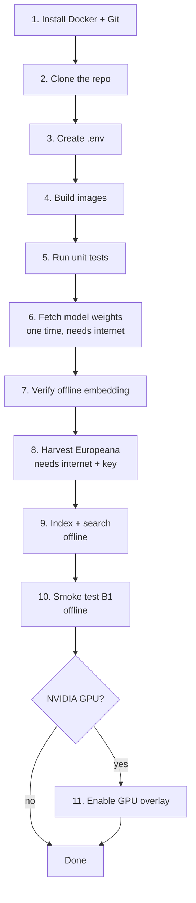

# Build guide: from a fresh machine

This guide takes a new machine to a working stack: tests passing, models
fetched, a Europeana collection indexed and searchable. Everything runs in
Docker, so you don't need Python on the host.



## 0. Requirements

| | Minimum | Recommended |
|---|---|---|
| OS | Linux x86-64, macOS (Apple silicon or Intel), Windows 10/11 with WSL 2 | Ubuntu 24.04 or newer |
| CPU / RAM | 4 cores / 12 GB free for Docker (embedding peaks near 8 GB) | 8+ cores / 16 GB+; the router's language models need more, which the B1 smoke test measures |
| Free disk | 25 GB | 40 GB |
| GPU | none | NVIDIA with bfloat16 support (Ampere or newer) |
| Network | Internet for steps 2, 4, 6 and 8 only | — |

Disk use after setup:

| Item | Size |
|---|---|
| `campus-ai:embed` image (PyTorch etc.) | ~10 GB |
| `campus-ai:test` image | ~0.4 GB |
| `neo4j` image | ~1.1 GB |
| Model weights (EmbeddingGemma 2 1.5 GB, e5-small 0.5 GB) | ~2 GB |
| 300 Europeana items with thumbnails | ~11 MB |
| Build cache during the first build | 2–5 GB, reclaimable |

## 1. Install Docker and Git

You need Docker Engine 24+ with the Compose v2 plugin. This repo is tested
with Docker 29.8 and Compose v5.6.

**Prime directive 1: open source only, no paid licences.** Docker Engine,
the Docker CLI and Compose are open source (Apache-2.0), and they are all a
deployment needs. Podman (Apache-2.0) with `podman compose` also works.
Docker Desktop is proprietary; it is a named exception for development on
Windows workstations only, and nothing in the repo may depend on
Desktop-only features.

**Ubuntu / Debian**

```bash
curl -fsSL https://get.docker.com | sudo sh
sudo usermod -aG docker "$USER"     # then log out and back in
sudo apt-get install -y git
docker compose version              # must print v2 or later
```

**macOS.** Use Colima (MIT), a small VM that runs the open-source Docker
Engine, with the open-source Docker CLI and Compose plugin from Homebrew:

```bash
brew install colima docker docker-compose git
colima start --cpu 4 --memory 12 --disk 60
docker compose version
```

(If `docker compose` isn't found, follow Homebrew's note to add the plugin
directory to `~/.docker/config.json`.) macOS has no GPU passthrough to
containers, so models run on the CPU.

**Windows development workstation: Docker Desktop.** Install WSL 2
(`wsl --install`), then Docker Desktop with the WSL 2 backend, and Git for
Windows. In Settings > Resources, allow 12+ GB memory. Run the commands in
this guide from PowerShell in the repo folder. Docker Desktop passes an NVIDIA
GPU through WSL 2 (step 11). This is how the project is mostly developed.

**Windows without Docker Desktop** (servers, or if you prefer it): run the
open-source Docker Engine inside WSL 2:

```powershell
wsl --install -d Ubuntu      # then restart and create your Linux user
```

Inside the Ubuntu shell, follow the Ubuntu steps above. Clone the repo inside
the Linux file system (e.g. `~/campus-ai`, not `/mnt/c/...`) for speed, and
run every command in this guide from that shell. Allow WSL enough memory in
`%UserProfile%\.wslconfig`:

```ini
[wsl2]
memory=12GB
```

**Servers and deployments** use Docker Engine (Linux) or Podman, never Docker
Desktop.

Check that Docker works:

```bash
docker run --rm hello-world
```

## 2. Clone the repository

The repository is private. Authenticate with the GitHub CLI
(`gh auth login`), with a personal access token, or with SSH:

```bash
git clone https://github.com/teamworxai/campus-ai.git
cd campus-ai
```

To get work in progress that isn't merged yet, check out its branch, e.g.
`git checkout r8-europeana`.

## 3. Create `.env`

```bash
cp .env.example .env
```

Edit `.env`:

| Key | Needed for | Value |
|---|---|---|
| `MODELS_DIR` | all model work | Host folder for weights. Empty means `./models`. Share it across projects, e.g. `C:/models` on Windows or `/srv/models` on Linux |
| `HF_TOKEN` | optional | Only if Hugging Face rate-limits you. The models aren't gated |
| `DATA_DIR`, `NEO4J_DATA` | optional | Put harvests and the graph on another drive; see below |
| `NEO4J_PASSWORD` | optional | Set it **before** Neo4j first starts; empty means `campus-ai-local`. Neo4j has no published ports |
| `EUROPEANA_API_KEY` | step 8 | Free from https://pro.europeana.eu/page/get-api |
| `COMPOSE_FILE` | step 11 | GPU overlay; leave commented on machines without NVIDIA |
| `OLLAMA_URL`, `CAMPUS_AI_MODEL_*` | optional | Leave empty to use the `ollama` service and the router's default models; see `.env.example`. A shell `OLLAMA_HOST` (native Ollama installs export one) is ignored |

`.env` is gitignored. Never commit it.

### Keep large files on another drive (e.g. D:)

Everything big can live off the system drive:

| What | Size | Where it goes |
|---|---|---|
| Docker images, build cache, the Neo4j volume | ~12 GB and growing | Docker Desktop: Settings > Resources > Advanced > **Disk image location**, e.g. `D:\Docker`. Docker Engine on Linux: `data-root` in `/etc/docker/daemon.json`. Engine in WSL: move the whole WSL distro to D: with `wsl --export` / `wsl --import`, or `wsl --manage <distro> --move D:\WSL` on current WSL. Do this first: it moves all three at once and keeps Neo4j at full speed |
| Model weights | ~2 GB embedders, plus several GB per Ollama model | `MODELS_DIR=D:/models` |
| Harvested collections and thumbnails | grows per collection | `DATA_DIR=D:/campus-ai/data` |
| Neo4j data, if you want it outside Docker | grows with the index | `NEO4J_DATA=D:/campus-ai/neo4j` (optional; a folder on a Windows drive is slower than the volume) |

Use forward slashes in `.env`. Create the folders first. Changing `DATA_DIR`
means harvesting again or copying the old `data/` folder over; changing
`NEO4J_DATA` starts an empty graph, so index again. Inside WSL, Windows
drives appear as `/mnt/d/...`, so use `MODELS_DIR=/mnt/d/models` there; with Docker
Desktop, use `D:/models` as usual.

## 4. Build the images

```bash
docker compose build
```

This builds `campus-ai:test` (about 1 minute) and `campus-ai:embed` (about
5–15 minutes, which downloads PyTorch). Dependencies come from `uv.lock`,
so every machine gets the same versions.

**Behind a TLS-inspecting corporate proxy?** The Dockerfile accepts the
proxy's CA certificate as an optional build secret named `ca`. Copy the
pattern in `.claude/compose.cloud.yaml`: a `secrets: ca: file:
<path to CA bundle>` entry, plus `build: secrets: [ca]` and the
`HTTPS_PROXY` build args on each service. Pass the same CA to the
`fetch-*` services via `SSL_CERT_FILE`.

## 5. Run the unit tests

```bash
docker compose run --rm test
```

Expect `Ran 115 tests` and `OK (skipped=4)`. The four skipped tests need
PyAV (embed image) or Neo4j, and run in step 7.

## 6. Fetch model weights (one time)

```bash
docker compose run --rm fetch-models
```

This downloads EmbeddingGemma 2 and the e5-small baseline (about 2 GB) into
`MODELS_DIR`, using the layout `<org>/<model>`. It is the only step that
downloads models.

Then fetch the language and vision models that the LLM router uses, served by
the `ollama` service:

```bash
docker compose run --rm fetch-ollama
```

This pulls the router's default models (`DEFAULT_MODELS` in
`campus_ai/core/llm/config.py`; several GB) into `MODELS_DIR/ollama`. To fetch
other models, name them, e.g. `docker compose run --rm fetch-ollama qwen3-vl:8b`;
each must be in `MODEL_LICENCES`. The `ollama` service then reads that folder
read-only from the internal network, so it can't download anything itself.

**Air-gapped machine.** Run both steps on a connected machine, then copy the
`MODELS_DIR` folder over (USB, `rsync`, `scp`). Keep the same layout:
`google/embeddinggemma-2/`, `intfloat/multilingual-e5-small/`, `ollama/`.

## 7. Verify offline embedding and the graph

```bash
docker compose run --rm embed                                 # bake-off on the sample set
docker compose run --rm embed python -m unittest discover -s tests   # all tests, incl. Neo4j
docker compose run --rm embed python scripts/graph_search.py index evals/embed/sample_bakeoff.jsonl
docker compose run --rm embed python scripts/graph_search.py eval evals/embed/sample_bakeoff.jsonl
```

Expected:
- The bake-off prints recall@10 for `embeddinggemma-2` and `e5-small`.
- The unit tests report `OK` with no skips.
- The eval prints `embeddinggemma-2 hybrid: recall@10 all=1.000, en=1.000, fr=1.000 (5 queries)`.

The first `embed` run starts Neo4j and waits for its health check, which
takes about 20 seconds.

**Optional: prove that the embed container is offline.**

```bash
docker compose run --rm embed python -c "import socket; socket.create_connection(('huggingface.co', 443), 3)"
# fails with socket.gaierror: no route out of the internal network
```

## 8. Harvest a Europeana collection

```bash
docker compose run --rm fetch-europeana --rows 300
```

This takes about 2 minutes and writes `data/europeana/salmon/items.jsonl`
plus thumbnails. Options are in the [user guide](user_guide.md#1-harvest-from-europeana).

## 9. Index and search

```bash
docker compose run --rm embed python scripts/graph_search.py index data/europeana/salmon/items.jsonl
docker compose run --rm embed python scripts/graph_search.py search "salmon fishing boats" -k 5
docker compose run --rm embed python scripts/graph_search.py search "a fish on a plate" --label Image -k 5
```

On 4 CPU cores without a GPU, indexing the default harvest (151 items, 94
images, 376 nodes) took 17 minutes; 300 items with 295 images took 45. A GPU
is much faster. Results list
items and images with their linked collection, institution and creator.

Then start the web app and open http://localhost:8080:

```bash
docker compose up -d web
```

## 10. Local-stack smoke test (B1)

Run this on every machine that will demo or host the stack (bake-off B1, the
demo laptop first). It needs steps 6 and 9 done.

```bash
docker compose up -d web ollama
docker compose run --rm smoke --label demo-laptop
```

From inside the internal `graph` network it checks that Neo4j, `api`, `web`
and Ollama answer, that the network has no route to the internet, that
Ollama has the router's models, and that the LLM router answers a short
prompt for each task (reasoning, vision, classification). It prints a table
and writes it to `evals/smoke/<date>-<label>.md`, with the time each check
took and how much of each loaded model sits in GPU memory. It exits non-zero
if any check fails.

The first router call per model includes loading it, so it is the slowest;
repeat the run for warm timings. Commit the report: it is B1's evidence and
the input for sizing hardware. On Linux the report is owned by root; `sudo
chown` it if needed.

## 11. Optional: NVIDIA GPU

The GPU is optional: everything works on the CPU. Using an NVIDIA GPU needs
NVIDIA's driver and CUDA runtime libraries, which are free but proprietary.
They are a named exception to prime directive 1 (free GPU vendor
runtimes). The NVIDIA Container Toolkit itself is Apache-2.0.

1. Install the NVIDIA driver (on Windows: the normal Windows driver; WSL 2
   uses it). Docker Desktop then needs nothing more. For Docker Engine on
   Linux or inside WSL, also install the NVIDIA Container Toolkit:
   https://docs.nvidia.com/datacenter/cloud-native/container-toolkit/latest/install-guide.html
2. Check: `docker run --rm --gpus all ubuntu nvidia-smi`.
3. In `.env`, set `COMPOSE_FILE=compose.yaml;compose.gpu.yaml` with Docker
   Desktop on Windows, or `compose.yaml:compose.gpu.yaml` on Linux and WSL.
4. Run `docker compose run --rm embed`. Models now run in bfloat16 on the GPU.
   Ollama uses the GPU too; the smoke test (step 10) shows how much of each
   model is in GPU memory.

macOS has no GPU passthrough to Docker, so models run on the CPU there.

## Verification checklist

- [ ] `docker compose version` prints v2+
- [ ] `docker compose run --rm test` → `OK (skipped=4)`
- [ ] `MODELS_DIR` contains `google/embeddinggemma-2`, `intfloat/multilingual-e5-small` and `ollama/`
- [ ] `docker compose run --rm embed python -m unittest discover -s tests` → `OK`
- [ ] Sample eval → `recall@10 all=1.000`
- [ ] `data/europeana/<name>/items.jsonl` exists after a harvest
- [ ] `search` returns Items and Images with linked evidence
- [ ] http://localhost:8080 shows pictures for "salmon fishing on rivers"
- [ ] `docker compose run --rm smoke` → all checks pass; report in `evals/smoke/`
- [ ] `git status` shows no `.env`, `models/` or `data/europeana/` files

## Updating and cleaning up

```bash
git pull
docker compose build                 # rebuilds only changed layers
docker compose down                  # stop containers, keep the graph
docker compose down -v               # also delete the graph volume
docker builder prune -f              # free build cache
docker image rm campus-ai:embed campus-ai:test   # remove the project images
```

## For maintainers: changing dependencies

```bash
docker run --rm -v "$PWD":/app -w /app python:3.13-slim sh -c "pip install uv && uv add <package> && uv lock"
docker compose build
```

Commit `pyproject.toml` and `uv.lock` together.
