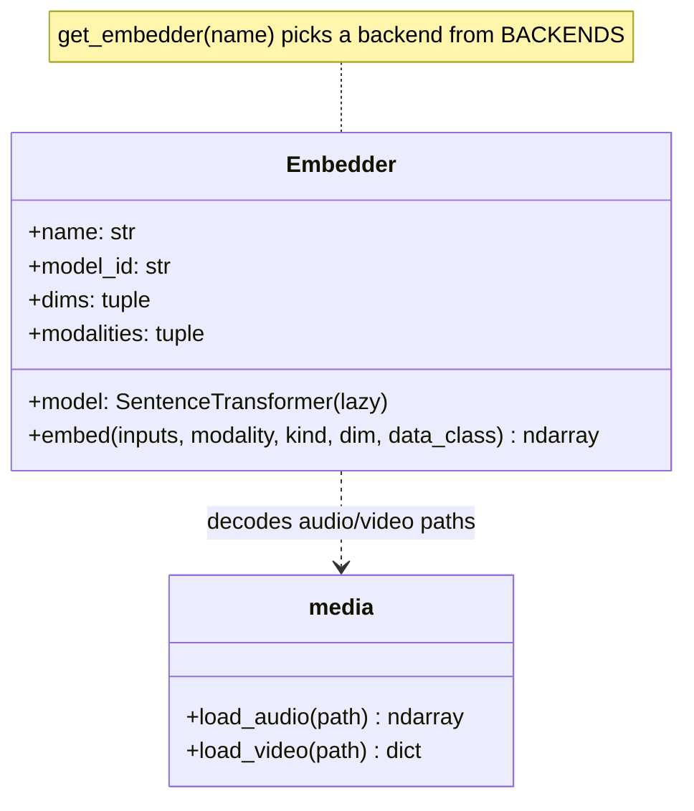
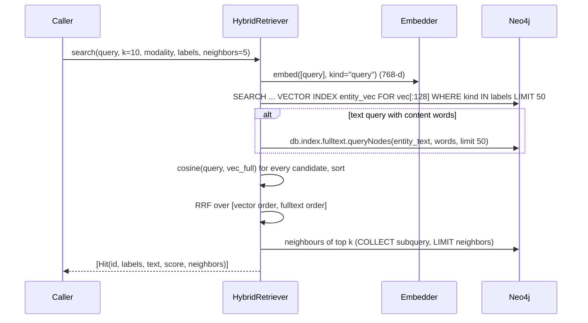
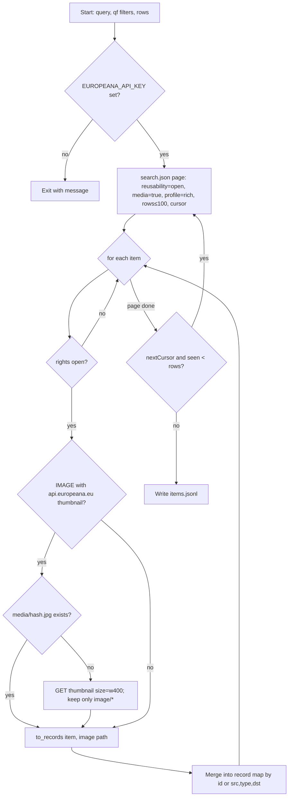
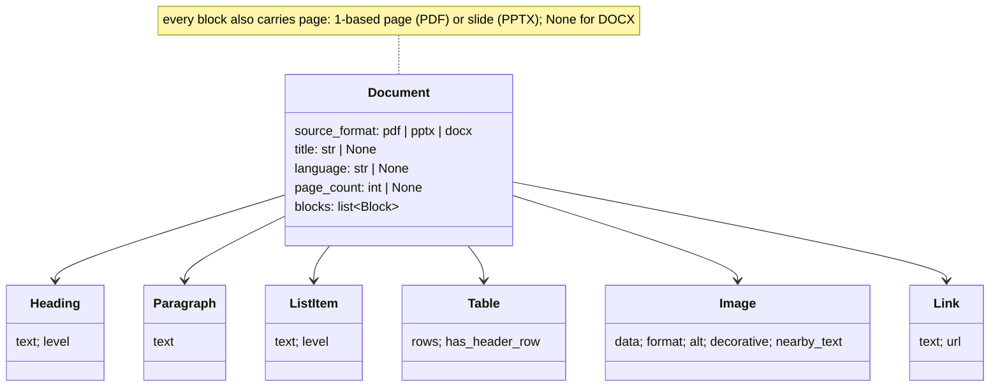

# Design

Module-level design of the built parts: embedder (P7), graph core (P5),
Europeana loader (R8), collections search (R9), LLM router (P1) with its
data-class gate (P1b), tracing (P2) and the Course Access parser and audit
(A1, A2). The system view is in
[`architecture.md`](architecture.md).

## 1. Embedder: `campus_ai/core/embed/`

### 1.1 Interface

```python
from campus_ai.core.embed import get_embedder, truncate

embedder = get_embedder()                       # "embeddinggemma-2" (default) or "e5-small"
vectors = embedder.embed(["text"], modality="text", kind="document", data_class="P")   # (n, 768) float32, unit length
query = embedder.embed(["ocean warming"], kind="query", data_class="P")
small = truncate(vectors, 128)                  # Matryoshka prefix, re-normalized
```

| Attribute | Meaning |
|---|---|
| `name` | Backend name (`embeddinggemma-2`, `e5-small`) |
| `model_id` | Hugging Face ID; weights load from `$MODELS_DIR/<model_id>` |
| `dims` | Supported sizes, full size first: `(768, 512, 256, 128)` for EmbeddingGemma 2, `(384,)` for e5 |
| `modalities` | `text`, `image`, `audio`, `video` for EmbeddingGemma 2; `text` for e5 |
| `query_kwargs` / `document_kwargs` | Task prompts applied to text (`SearchQuery` / `Document`) |



### 1.2 Behaviour

- **Data class.** Every call declares `data_class` (P, I, S or R, keyword
  only, no default). Class R raises `RestrictedDataError` before the model
  loads or sees any input (P1b, section 11).
- **Lazy loading.** The model loads on first `embed`, from local files only.
  A missing directory raises `FileNotFoundError` with the fetch command.
- **Precision.** bfloat16 on GPUs that support it, else float32. Never
  float16, because EmbeddingGemma 2 overflows in it.
- **Inputs.** Text is passed as strings. Images are file paths or PIL images.
  Audio and video file paths are decoded with PyAV, which bundles FFmpeg:
  audio as mono 16 kHz, video at 1 frame per second.
- **Context.** 8,192 tokens per input: about 29 images, 58 s of video or
  327 s of audio. Split longer media before embedding.
- **Output.** Unit-length float32 vectors. `truncate` keeps a prefix and
  re-normalizes it, which is valid for Matryoshka-trained models.

### 1.3 Bake-off (decision D7)

`scripts/embed_bakeoff.py` embeds a JSONL set with each backend and reports
recall@k overall and per query language. Keep the e5 baseline if EmbeddingGemma 2
loses on the gold set.

## 2. Graph store: `campus_ai/core/graph/store.py`

### 2.1 Types

```python
@dataclass
class Node:
    id: str                  # globally unique, e.g. "europeana:/916105/bhm_photo_1"
    label: str               # domain label, e.g. "Item"; plain identifier only
    text: str = ""           # fulltext-indexed; caption or metadata for media
    modality: str = "text"
    content: Any = None      # what gets embedded; defaults to text; a file path for media
    props: dict = {}         # extra properties (rights, url, source, ...)
    data_class: str = "P"    # P/I/S/R; R is refused before embedding

@dataclass
class Link:
    src: str; type: str; dst: str; props: dict = {}
```

### 2.2 Operations

| Method | What it does |
|---|---|
| `ensure_schema()` | Creates the `entity_id` constraint, the 128-d `entity_vec` vector index (with `kind` as a filter property) and the `entity_text` fulltext index if they don't exist, then waits for them to come online. Refuses if an existing vector index has another size |
| `upsert(nodes)` | Groups nodes by `(label, modality, data_class)`, embeds each group once at full size, then `MERGE`s by `id` and sets the label, `kind`, props, `text`, `modality`, `file` (the media path; null for text), `vec_fast` (prefix) and `vec_full` |
| `link(links)` | Groups by type and `MERGE`s relationships between existing nodes. Links to unknown ids are skipped silently |

Labels and relationship types can't be Cypher parameters, so `name()` accepts
only plain identifiers (`[A-Za-z_][A-Za-z0-9_]*`). This prevents injection.

Upserts are idempotent: re-indexing a file replaces each node's vectors and
text, and leaves its links in place.

## 3. Hybrid retriever: `campus_ai/core/graph/retriever.py`



**Scoring.** Each list contributes `1 / (60 + rank)`. A node first in both
lists scores 2/61 ≈ 0.0328; first in one list only, 1/61 ≈ 0.0164. Scores
order the results but aren't probabilities.

**Fulltext query building** (`fulltext_query`):
1. Lower-case, so `AND`, `OR` and `NOT` lose their Lucene meaning.
2. Keep word characters only. Quotes, wildcards, brackets and field prefixes
   are dropped.
3. Drop one-letter fragments (`d` from `d'archives`) and stop words in seven
   languages (`stopwords.py`: en, fr, de, es, it, pt, nl).

Media queries (`modality="image"` etc.) use only the vector side.

**Label filter.** Every node stores its label as `kind`, and the vector index
includes `kind` as a filter property, so `SEARCH … WHERE node.kind IN $labels`
returns the 50 nearest nodes *with* those labels. (An earlier version filtered
after the index's top 50; on a mixed graph, text items filled every slot and
`--label Image` came back empty.) Fulltext still filters after its top 50,
which matters little because media nodes have no text. `ensure_schema`
migrates graphs indexed before this change in place, without re-embedding.

**Hit.**

```python
Hit(id="europeana:/…", labels=["Entity", "Item"], text="…", score=0.0328,
    neighbors=[{"type": "IN", "outgoing": True, "id": "europeana:collection:…",
                "labels": [...], "text": "…"}],
    found_by=["meaning", "words"],   # vector index, fulltext index
    similarity=0.61)                 # cosine to the query at 768-d
```

Planned: a reranker step (Qwen3-Reranker-4B, card R3, bake-off B2).

## 4. Europeana loader (R8)

### 4.1 Fetch: `scripts/fetch_europeana.py`



- The API key goes in the `X-Api-Key` header, never in the URL.
- A failed thumbnail download is logged and the item is kept as text only.
- Re-runs reuse thumbnails already on disk, named by a hash of the item id.
- Shared nodes (collections, institutions, creators) are de-duplicated.

### 4.2 Mapping: `campus_ai/research_assistant/europeana.py`

| Europeana field (search, `profile=rich`) | Graph |
|---|---|
| `id` | `Item.id = "europeana:" + id` |
| `title` + `dcDescription` (de-duplicated, whitespace-normalized, ≤ 2,000 chars) | `Item.text` (embedded and fulltext-indexed) |
| `rights[0]` | `Item.rights`, `Image.rights`; item dropped unless open |
| `guid` (query string dropped: it carries tracking parameters and the API key) | `Item.url` |
| `type`, `provider`, `year`, `language` | `Item` props |
| thumbnail of `edmPreview` | `Image` node (`id` = item id + `#image`, `modality=image`, no text, `file` = thumbnail path), `PART_OF` its Item |
| `edmDatasetName[0]` | `Collection`, linked by `IN` |
| `dataProvider[0]` | `Institution`, linked from the Collection by `HELD_BY` |
| `dcCreator` (names only; URIs skipped) | `Creator`, linked by `CREATED_BY` |

Open rights: `creativecommons.org/publicdomain/zero/`, `/publicdomain/mark/`,
`/licenses/by/`, `/licenses/by-sa/`. NC and ND licences and
rightsstatements.org statements are excluded. This is the loader's own
filter; the shared rights and governance filter (R10) is planned.

**Why a separate Image node.** An Item's vector encodes its metadata text;
the Image's vector encodes the picture alone. A text query can then match a
photo on what it shows, even when the caption is in another language or
says nothing useful. Graph expansion links each Image hit back to its Item
for citation.

### 4.3 Collections search (R9): `collections.py`, `api.py`

`CollectionsSearch` wraps `HybridRetriever` (50 candidates) and returns
`Card`s with title, description, source, type, year, URL, rights, licence
label, collection, holder, creators and image:

- `pictures(query, k, modality)` searches `Image` nodes only, maps each hit
  to its Item (`id` before `#`), and marks items whose own text also matched
  the words.
- `texts(query, k)` searches `Item` nodes and keeps those without a picture.
- `item(id)` returns one card with APA, Chicago and BibTeX citations and up
  to 4 similar pictures.
- Image queries label each card "Same picture" (cosine ≥ 0.98), "Similar"
  (≥ 0.76) or "Not close"; the API's `match` field applies the same
  thresholds to the best hit. Thresholds were calibrated on the salmon pilot.

`api.py` exposes these as `GET /api/health`, `GET /api/search`,
`POST /api/search/image`, `GET /api/items/{id}` and `GET /media/{path}`
(architecture section 5.3). One lock serialises embedding; uploads are
checked for type (JPEG, PNG, WebP, GIF) and size (10 MB) and kept only in a
temporary file for the search.

## 5. File formats

One JSONL format feeds the indexer from any source, one record per line:

```json
{"id": "d1", "label": "Item", "modality": "text", "content": "Text to embed", "props": {"rights": "..."}}
{"id": "d2", "label": "Image", "modality": "image", "content": "media/photo.jpg", "text": "optional caption"}
{"src": "d2", "type": "PART_OF", "dst": "d1"}
{"query": "salmon fishing", "lang": "en", "relevant": ["d1", "d2"]}
```

- `label` defaults to `Item` and `modality` to `text`.
- Media `content` paths are relative to the JSONL file. Media `text` is a
  real caption or empty, never the file path.
- `query` lines are used by `eval` and by the bake-off, and ignored by `index`.

## 6. Testing strategy

| Suite | Covers | External services |
|---|---|---|
| `tests/test_embed*.py` | Backends, truncation, media decoding, bake-off | Model replaced by a deterministic fake |
| `tests/test_graph.py` | Schema, upsert grouping, linking, fusion, fulltext query building, retriever flow, JSONL loading | `FakeDriver` records Cypher; a bag-of-words fake model. Integration tests run against a real Neo4j when `NEO4J_URI` is set and the embed image is used |
| `tests/test_licences.py` | Prime directive 1: every installed package under an OSI licence (AGPL and proprietary fail; NVIDIA GPU runtimes are the named exception), every compose/Dockerfile image, every embedder model and every LLM router model (`MODEL_LICENCES`, defaults included) listed with an open licence | None; reads package metadata and repo files. Run in the `embed` image too, to cover PyTorch and CUDA |
| `tests/test_europeana.py` | Rights filter, mapping, de-duplication, cursor paging, key in header, thumbnail caching | HTTP `get` mocked |
| `tests/test_collections.py` | Cards, licence labels, citations, picture-match thresholds, search service, API endpoints and `/media` restrictions | `FakeDriver` and a fake retriever |
| `tests/test_llm_router.py` | Routing to `OLLAMA_HOST`, image blocks, open-licence allowlist, no cloud backends, data-class gate, one trace record per call | Ollama HTTP call mocked; traces in a temp directory |
| `tests/test_tracing.py` | Run files, metadata-only records, span outcomes and latency, data-class checks | None; traces in a temp directory |
| `tests/test_course_access_parser.py`, `tests/test_course_access_audit.py` | A1 parsing per format; A2 rules and reports | None; small documents built in the tests |
| `tests/test_package.py` | Every package imports | None |

`docker compose run --rm test` runs everything that needs no models (4
tests skip: 2 need PyAV, 2 need Neo4j). `docker compose run --rm embed
python -m unittest discover -s tests` also runs those.

## 7. Known limitations

- **Thumbnails only** for Europeana images. Full-size media, audio and video
  need each provider's host (and network allowlisting). VIDEO and SOUND
  items are indexed as text.
- **Mixed-modality ranking.** A text query scores text nodes higher than
  images, so search pictures and texts as separate lists (`labels`).
- **Item text mixes languages** when Europeana returns translated titles.
  This is fine for the multilingual embedder, but noisy for fulltext.
- **Fulltext label filter after top-n** (section 3) can drop keyword matches
  for a rare label; vector candidates are unaffected.
- **No Europeana gold set yet.** Recall on collections search waits for the
  labelled queries in master plan section 4.5.
- **Re-index on model change.** The vector index has one fixed size.
- **Links to missing nodes are skipped silently.** Index nodes before
  their links; one JSONL file does this automatically.

## 8. Extending

**Add a source loader.**
1. Write a pure mapping function (source record → JSONL records) in the
   product package, like `europeana.to_records`, and unit-test it.
2. Write a `scripts/fetch_<source>.py` that only fetches and writes
   `data/<source>/<name>/items.jsonl` plus media.
3. Add a `fetch-<source>` compose service with `profiles: [fetch]`, mounting
   `./data`. Add any new key to `.env.example`.
4. Index with `graph_search.py index`. No graph or model code is needed.

**Add an embedder backend.** Add a factory to `BACKENDS` in
`campus_ai/core/embed/embedder.py`, then fetch its weights. Run the bake-off.
Switching the graph to it needs a fresh graph (`docker compose down -v`).

## 9. Course Access Agent

The system view and status are in [`architecture.md`](architecture.md#11-course-access-agent).
A1 (parser) and A2 (audit) exist; A3-A7 are planned. A1 reads files with open-source, permissively licensed libraries only: python-docx and python-pptx (MIT) and pdfplumber on pdfminer.six (MIT). The first version (PR #4) used PyMuPDF, which is AGPL and was replaced under prime directive 1. Everything
here is bound by the prime directives (`AGENTS.md`): open-source libraries only,
and any model (alt text, OCR) runs locally from open weights.

### 9.1 Document parser (A1): `campus_ai/course_access/parser.py`

```python
from campus_ai.course_access.parser import parse

doc = parse("lecture-03.pptx")      # .pdf, .pptx or .docx; anything else raises ValueError
doc.source_format, doc.title, doc.language, doc.page_count
for block in doc.blocks:            # in reading order
    ...
```

The parser **only reads**. It never repairs: missing headings, alt text or
language come back as `None` or as no block, so the audit (A2) can flag them.



**Reading order per format** (the order a screen reader follows):

| Format | Order | Headings and lists | Images | Document language |
|---|---|---|---|---|
| DOCX | Body order of paragraphs and tables | From `Heading N` styles; lists from numbering or `List` styles, with nesting level | Inline drawings, with `descr` alt text and Office's decorative flag | Core properties, else the default style's language |
| PPTX | Slide order, then shape order on each slide; groups flattened | Title placeholders become level-1 headings; body placeholders are bullets unless `buNone` | Pictures, with `descr` alt text and decorative flag | Core properties, else the first text run's language |
| PDF (pdfplumber) | Per page, top to bottom then left to right: paragraphs (consecutive lines joined until a gap taller than a line, or a table or image in between), ruled tables, images | None: untagged PDFs carry no semantics, so text is paragraphs | Each image as a 150 dpi PNG of its area on the page (what a reader sees), with no alt text (not read from tags) | The catalog's `/Lang` |

Other rules:
- **Tables**: DOCX marks a header row with `tblHeader`; PPTX with the
  table's *first row* setting; PDF tables (ruled tables found by pdfplumber) never have one.
  Text inside a PDF table is emitted once, as the table.
- **Links** follow the block that contains them; PDF links come at the end
  of their page.
- **Images** get `nearby_text`: the text block just before and just after on
  the same page, the context the alt-text worker (A3) needs.

### 9.2 Audit (A2): `campus_ai/course_access/audit.py`

`audit(document)` returns `Issue`s in document order; `report_markdown` and
`report_json` render them. Deterministic only: no model.

| Rule | WCAG 2.2 | Level | Finds | Fixed by |
|---|---|---|---|---|
| `document-no-title` | 2.4.2 Page Titled | A | No title in the document properties | text worker |
| `document-no-language`, `document-bad-language` | 3.1.1 Language of Page | A | Language missing, or not a language tag | text worker |
| `no-headings` | 1.3.1 Info and Relationships | A | 5+ paragraphs and no headings (for PDFs: no heading markup) | structure worker |
| `heading-level-skipped` | 1.3.1 | A | A heading more than one level deeper than the previous one | structure worker |
| `slide-no-title`, `slide-title-duplicate` | 2.4.6 Headings and Labels | AA | PPTX slides without a title, or sharing one | structure worker |
| `image-missing-alt` | 1.1.1 Non-text Content | A | Image with no alt text and not marked decorative | alt-text worker |
| `image-placeholder-alt` | 1.1.1 | A | Alt text that is a file name or a word like "image" | alt-text worker |
| `table-no-header-row` | 1.3.1 | A | Table of 2+ rows without a marked header row | table worker |
| `link-no-text`, `link-vague-text`, `link-bare-url` | 2.4.4 Link Purpose (In Context) | A | Empty, "click here"-style or raw-URL link text | text worker |
| `fake-list` | 1.3.1 | A | Paragraphs typed as lists ("- ", "1. ", "a) ") instead of real list markup | structure worker |
| `page-image-only` | 1.4.5 Images of Text | AA | PDF page with images and no text (probably scanned) | person (OCR is A7) |

Every report ends with what the audit cannot check (contrast, accuracy of
existing alt text, meaningful sequence, PDF tags, language of parts,
equations and charts), so a short list is never read as conformance.

Run it:

```bash
docker compose run --rm -v "$PWD/samples:/samples:ro" test python scripts/audit_document.py /samples/lecture.pdf
docker compose run --rm -v "$PWD/samples:/samples:ro" test python scripts/audit_document.py /samples/lecture.pdf --json
```

### 9.3 Limits that the next cards must handle

| Limit | Handled by |
|---|---|
| No OCR: image-only (scanned) PDFs produce images and no text | Next phase: card A7, open-source offline OCR |
| Untagged PDF: no headings or lists; existing PDF tags and alt text are not read | A4 infers structure; A2 already reports `no-headings` and lists PDF tags under "not checked" |
| Reading order is the file's, which may be wrong (e.g. a PPTX text box added last) | A2 lists reading order (1.3.2) under "not checked"; planned: A4 proposes a fix for review |
| Equations, charts and SmartArt come through as images or plain text | Always routed to the review queue (master plan 3.2) |
| Reading order on complex PDF layouts (columns, sidebars) follows position, not the author's intent | Planned: A4 proposes an order for review (A2 has no column check yet) |

## 10. LLM router (P1): `campus_ai/core/llm/`

```python
from campus_ai.core.llm import generate

reply = generate([{"role": "user", "content": "..."}], task="vision", data_class="I", system=None)
reply.text, reply.model, reply.input_tokens, reply.output_tokens, reply.stop_reason
```

- **Tasks** (`config.TASKS`): `reasoning` and `vision` (default
  `gemma4:12b`, 16,000 output tokens), `classification` (`gemma4:e4b`,
  1,024). Override per task with `CAMPUS_AI_MODEL_<TASK>`.
- **Allowlist.** `config.model()` refuses any model not in `MODEL_LICENCES`
  (Gemma 4, Qwen 3, Qwen3-VL, Granite 3.3, Mistral Small 3.2, OLMo 2; all
  Apache-2.0). Gemma 3 is excluded: its Gemma Terms of Use are not an open
  licence. Adding a model needs a licence check and a D10 register row.
- **Backend.** `backends.ollama` posts to `$OLLAMA_HOST/api/chat`
  (default `http://localhost:11434`) with streaming off; text and base64
  image blocks become Ollama's `content` and `images`. There is no other
  backend.
- **Data class and trace.** Every call declares the class of its messages
  (section 11); class R is refused before any model call. Each call, refused
  or not, writes one `llm` trace record (section 12).
- **Runtime.** No compose service calls the router yet; Ollama in compose
  is card P9 (planned).

## 11. Data-class gate (P1b): `campus_ai/core/data_classes.py`

```python
from campus_ai.core.data_classes import DATA_CLASSES, RestrictedDataError, check

check("I")   # returns "I"; "R" raises RestrictedDataError, anything else ValueError
```

The classes are those of plan section 2: P public, I institutional, S
sensitive, R restricted. The two model entry points call `check` first:
`llm.generate(..., data_class=...)` and `Embedder.embed(..., data_class=...)`.
Both arguments are required, so no call can skip the gate. Above them,
`Node.data_class` and `HybridRetriever.search(data_class=...)` default to P,
which is what the graph holds today (open Europeana items);
`graph_search.py index` reads an optional `data_class` per JSONL record. The
rights filter (R10) will set class R on restricted items, which `upsert` then
refuses (it keeps them out of the graph; a metadata-only link path is R10's
job).

## 12. Tracing (P2): `campus_ai/core/tracing.py`

```python
from campus_ai.core import tracing

with tracing.run("audit-lecture-3"):              # one file per run
    with tracing.span("tool", tool="alt_text", data_class="I") as trace:
        trace["model"] = "gemma4:12b"             # add what the block learns
    tracing.record("tool", tool="rebuild", outcome="ok")
```

- **Where.** `$CAMPUS_AI_TRACE_DIR/<run id>.jsonl`, default `./traces`
  (git-ignored). Run ids are `<UTC timestamp>-<name>-<6 hex>`, e.g.
  `20261022T181500Z-audit-lecture-3-a1b2c3`; outside a `run()` block, calls
  share one id per process (`<UTC timestamp>-<pid>`).
- **Records.** One JSON object per line: `time` (UTC ISO), `run`, `event`,
  and only these metadata fields: `tool`, `task`, `model`, `host`,
  `data_class`, `input_tokens`, `output_tokens`, `latency_ms`, `outcome`
  (`ok`, `refused` for class R, `error`), `error` (exception type only).
  `record` refuses any other field, so prompts, documents and outputs (and
  so restricted content) never reach a trace.
- **Standard library only**; a lock keeps lines whole across threads.
