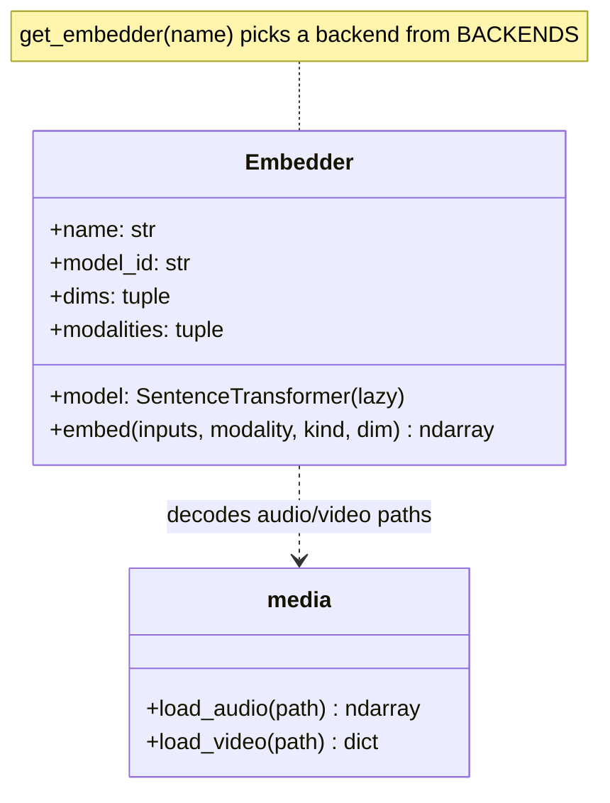
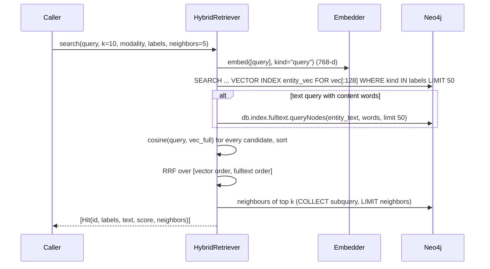
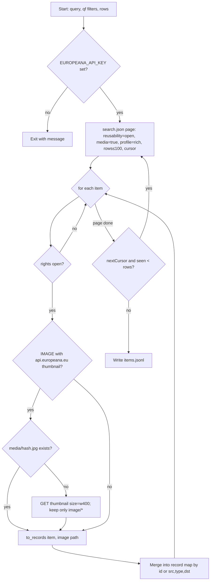

# Design

Module-level design of the built parts: embedder (P7), graph core (P5) and
Europeana loader (R8). The system view is in [`architecture.md`](architecture.md).

## 1. Embedder: `campus_ai/core/embed/`

### 1.1 Interface

```python
from campus_ai.core.embed import get_embedder, truncate

embedder = get_embedder()                       # "embeddinggemma-2" (default) or "e5-small"
vectors = embedder.embed(["text"], modality="text", kind="document")   # (n, 768) float32, unit length
query = embedder.embed(["ocean warming"], kind="query")
small = truncate(vectors, 128)                  # Matryoshka prefix, re-normalized
```

| Attribute | Meaning |
|---|---|
| `name` | Backend name (`embeddinggemma-2`, `e5-small`) |
| `model_id` | Hugging Face ID; weights load from `$MODELS_DIR/<model_id>` |
| `dims` | Supported sizes, full size first: `(768, 512, 256, 128)` |
| `modalities` | `text`, `image`, `audio`, `video` for EmbeddingGemma 2; `text` for e5 |
| `query_kwargs` / `document_kwargs` | Task prompts applied to text (`SearchQuery` / `Document`) |



### 1.2 Behaviour

- **Lazy loading.** The model loads on first `embed`, from local files only.
  A missing directory raises `FileNotFoundError` with the fetch command.
- **Precision.** bfloat16 on GPUs that support it, else float32. Never
  float16, because EmbeddingGemma 2 overflows in it.
- **Inputs.** Text is passed as strings. Images are file paths or PIL images.
  Audio and video file paths are decoded with PyAV, which bundles FFmpeg:
  audio as mono 16 kHz, video at 1 frame per second.
- **Context.** 8,192 tokens per input: about 29 images, 58 s of video or
  327 s of audio. Split longer media before embedding.
- **Output.** Unit-length float32 vectors. `truncate` keeps a prefix and
  re-normalizes it, which is valid for Matryoshka-trained models.

### 1.3 Bake-off (decision D7)

`scripts/embed_bakeoff.py` embeds a JSONL set with each backend and reports
recall@k overall and per query language. Keep the e5 baseline if EmbeddingGemma 2
loses on the gold set.

## 2. Graph store: `campus_ai/core/graph/store.py`

### 2.1 Types

```python
@dataclass
class Node:
    id: str                  # globally unique, e.g. "europeana:/916105/bhm_photo_1"
    label: str               # domain label, e.g. "Item"; plain identifier only
    text: str = ""           # fulltext-indexed; caption or metadata for media
    modality: str = "text"
    content: Any = None      # what gets embedded; defaults to text; a file path for media
    props: dict = {}         # extra properties (rights, url, source, ...)

@dataclass
class Link:
    src: str; type: str; dst: str; props: dict = {}
```

### 2.2 Operations

| Method | What it does |
|---|---|
| `ensure_schema()` | Creates the `entity_id` constraint, the 128-d `entity_vec` vector index (with `kind` as a filter property) and the `entity_text` fulltext index if they don't exist, then waits for them to come online. Refuses if an existing vector index has another size |
| `upsert(nodes)` | Groups nodes by `(label, modality)`, embeds each group once at full size, then `MERGE`s by `id` and sets the label, `kind`, props, text, `vec_fast` (prefix) and `vec_full` |
| `link(links)` | Groups by type and `MERGE`s relationships between existing nodes. Links to unknown ids are skipped silently |

Labels and relationship types can't be Cypher parameters, so `name()` accepts
only plain identifiers (`[A-Za-z_][A-Za-z0-9_]*`). This prevents injection.

Upserts are idempotent: re-indexing a file replaces each node's vectors and
text, and leaves its links in place.

## 3. Hybrid retriever: `campus_ai/core/graph/retriever.py`



**Scoring.** Each list contributes `1 / (60 + rank)`. A node first in both
lists scores 2/61 ≈ 0.0328; first in one list only, 1/61 ≈ 0.0164. Scores
order the results but aren't probabilities.

**Fulltext query building** (`fulltext_query`):
1. Lower-case, so `AND`, `OR` and `NOT` lose their Lucene meaning.
2. Keep word characters only. Quotes, wildcards, brackets and field prefixes
   are dropped.
3. Drop one-letter fragments (`d` from `d'archives`) and stop words in seven
   languages (`stopwords.py`: en, fr, de, es, it, pt, nl).

Media queries (`modality="image"` etc.) use only the vector side.

**Label filter.** Every node stores its label as `kind`, and the vector index
includes `kind` as a filter property, so `SEARCH … WHERE node.kind IN $labels`
returns the 50 nearest nodes *with* those labels. (An earlier version filtered
after the index's top 50; on a mixed graph, text items filled every slot and
`--label Image` came back empty.) Fulltext still filters after its top 50,
which matters little because media nodes have no text. `ensure_schema`
migrates graphs indexed before this change in place, without re-embedding.

**Hit.**

```python
Hit(id="europeana:/…", labels=["Entity", "Item"], text="…", score=0.0328,
    neighbors=[{"type": "IN", "outgoing": True, "id": "europeana:collection:…",
                "labels": [...], "text": "…"}])
```

## 4. Europeana loader (R8)

### 4.1 Fetch: `scripts/fetch_europeana.py`



- The API key goes in the `X-Api-Key` header, never in the URL.
- A failed thumbnail download is logged and the item is kept as text only.
- Re-runs reuse thumbnails already on disk, named by a hash of the item id.
- Shared nodes (collections, institutions, creators) are de-duplicated.

### 4.2 Mapping: `campus_ai/research_assistant/europeana.py`

| Europeana field (search, `profile=rich`) | Graph |
|---|---|
| `id` | `Item.id = "europeana:" + id` |
| `title` + `dcDescription` (de-duplicated, whitespace-normalized, ≤ 2,000 chars) | `Item.text` (embedded and fulltext-indexed) |
| `rights[0]` | `Item.rights`, `Image.rights`; item dropped unless open |
| `guid` | `Item.url` |
| `type`, `provider`, `year`, `language` | `Item` props |
| thumbnail of `edmPreview` | `Image` node (`modality=image`, no text), `PART_OF` its Item |
| `edmDatasetName[0]` | `Collection`, linked by `IN` |
| `dataProvider[0]` | `Institution`, linked from the Collection by `HELD_BY` |
| `dcCreator` (names only; URIs skipped) | `Creator`, linked by `CREATED_BY` |

Open rights: `creativecommons.org/publicdomain/zero/`, `/publicdomain/mark/`,
`/licenses/by/`, `/licenses/by-sa/`. NC and ND licences and
rightsstatements.org statements are excluded.

**Why a separate Image node.** An Item's vector encodes its metadata text;
the Image's vector encodes the picture alone. A text query can then match a
photo on what it shows, even when the caption is in another language or
says nothing useful. Graph expansion links each Image hit back to its Item
for citation.

## 5. File formats

One JSONL format feeds the indexer from any source, one record per line:

```json
{"id": "d1", "label": "Item", "modality": "text", "content": "Text to embed", "props": {"rights": "..."}}
{"id": "d2", "label": "Image", "modality": "image", "content": "media/photo.jpg", "text": "optional caption"}
{"src": "d2", "type": "PART_OF", "dst": "d1"}
{"query": "salmon fishing", "lang": "en", "relevant": ["d1", "d2"]}
```

- `label` defaults to `Item` and `modality` to `text`.
- Media `content` paths are relative to the JSONL file. Media `text` is a
  real caption or empty, never the file path.
- `query` lines are used by `eval` and by the bake-off, and ignored by `index`.

## 6. Testing strategy

| Suite | Covers | External services |
|---|---|---|
| `tests/test_embed*.py` | Backends, truncation, media decoding, bake-off | Model replaced by a deterministic fake |
| `tests/test_graph.py` | Schema, upsert grouping, linking, fusion, fulltext query building, retriever flow, JSONL loading | `FakeDriver` records Cypher; a bag-of-words fake model. Integration tests run against a real Neo4j when `NEO4J_URI` is set and the embed image is used |
| `tests/test_europeana.py` | Rights filter, mapping, de-duplication, cursor paging, key in header, thumbnail caching | HTTP `get` mocked |

`docker compose run --rm test` runs everything that needs no models (3
integration tests skip). `docker compose run --rm embed python -m unittest
discover -s tests` also runs the Neo4j integration tests.

## 7. Known limitations

- **Thumbnails only** for Europeana images. Full-size media, audio and video
  need each provider's host (and network allowlisting). VIDEO and SOUND
  items are indexed as text.
- **Item text mixes languages** when Europeana returns translated titles.
  This is fine for the multilingual embedder, but noisy for fulltext.
- **Fulltext label filter after top-n** (section 3) can drop keyword matches
  for a rare label; vector candidates are unaffected.
- **No Europeana gold set yet.** Recall on collections search waits for the
  labelled queries in master plan section 4.5.
- **Re-index on model change.** The vector index has one fixed size.
- **Links to missing nodes are skipped silently.** Index nodes before
  their links; one JSONL file does this automatically.

## 8. Extending

**Add a source loader.**
1. Write a pure mapping function (source record → JSONL records) in the
   product package, like `europeana.to_records`, and unit-test it.
2. Write a `scripts/fetch_<source>.py` that only fetches and writes
   `data/<source>/<name>/items.jsonl` plus media.
3. Add a `fetch-<source>` compose service with `profiles: [fetch]`, mounting
   `./data`. Add any new key to `.env.example`.
4. Index with `graph_search.py index`. No graph or model code is needed.

**Add an embedder backend.** Add a factory to `BACKENDS` in
`campus_ai/core/embed/embedder.py`, then fetch its weights. Run the bake-off.
Switching the graph to it needs a fresh graph (`docker compose down -v`).
