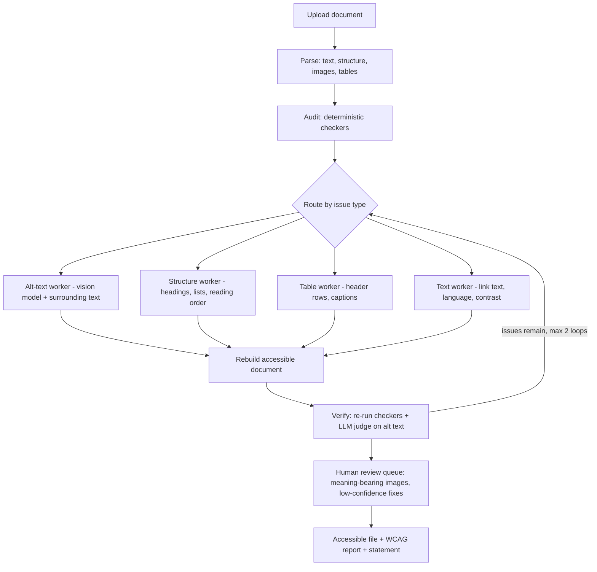
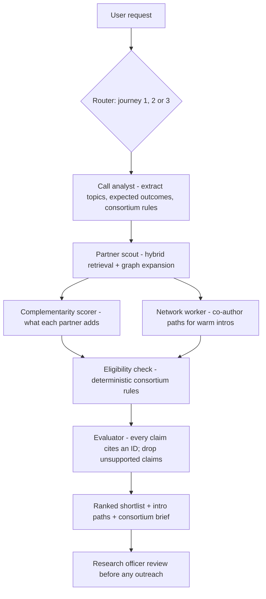

# Master Plan: Course Access Agent and Research Bridge

Two higher-ed products for Web Summit Lisbon, built in 4 weeks with Claude Code
agents, in the `Teamworxai/campus-ai` repo.

This repo is a clean build. It follows the same proven patterns as an
earlier graph-RAG academic advisor prototype (hybrid vector + fulltext
retrieval over Neo4j, graph expansion, RAGAS evaluation), but no code is
copied from it.

| | Course Access Agent | Research Bridge |
|---|---|---|
| Problem | Course materials (PDF, slides, docs, video) fail accessibility rules; accommodation requests pile up | BC researchers can now join Horizon Europe Pillar II, but finding the right EU partners is slow and network-dependent |
| Regulatory driver | Accessible British Columbia Act (post-secondary now covered), EU Web Accessibility Directive / EN 301 549, WCAG 2.2 AA | Canada's association to Horizon Europe Pillar II; consortium eligibility rules |
| Buyer | Accessibility services, teaching & learning centre | VP Research, research offices, international partnerships |
| Demo moment | Drop a messy lecture PDF, get an accessible version and a report in under 2 minutes | Pick a live Horizon call, get a ranked, evidence-backed EU partner shortlist and a consortium brief |
| Shared core used | LLM router, review UI, evaluation harness | LLM router, graph core (Neo4j writer, indexing, hybrid retriever), evaluation harness |

Status: draft for iteration. Open decisions are listed in section 8.

---

## 1. Design principles

1. **Workflows first, agents where they pay.** Deterministic code does what
   can be checked (accessibility checkers, eligibility rules, graph queries).
   LLMs handle judgement (alt text, reading order, partner fit rationale).
   This follows the "building effective agents" patterns: prompt chaining,
   routing, parallel workers, orchestrator-workers, evaluator-optimizer.
2. **Every output is verifiable.** Remediations are re-checked by the same
   checker that found the issue. Every partner recommendation cites a
   publication, project or call ID.
3. **Human approval at decision points.** The agent proposes; an instructor
   approves meaning-bearing alt text, a research officer approves outreach.
   Nothing is sent or published automatically.
4. **In-region by default.** Course materials and researcher data are
   processed in Canada for BC customers and in the EU for EU customers. Local
   models (Ollama) are the fallback for sensitive data.
5. **Evals before features.** Each product gets a gold set in week 1; every
   PR reports eval deltas.
6. **Capabilities exposed as MCP servers.** The same tools then work from
   the Streamlit demo, from Claude apps, and from the Teamworx HR assistant
   platform, with no extra integration work.
7. **Simple codebase.** Per `AGENTS.md`: build small shared modules in
   `campus_ai/core/` and add only what is strictly needed.

## 2. Shared platform (built once, used by both)

| Component | What | Where |
|---|---|---|
| LLM router | One interface with Claude (in-region cloud) and Ollama (local) backends; route by task (vision, reasoning, cheap classification) and by data region | `campus_ai/core/llm/` |
| Graph core | Neo4j writer, vector + fulltext indexing, hybrid retriever with graph expansion | `campus_ai/core/graph/` |
| Agent loop | Claude Agent SDK for the agentic steps (tool use, subagents, structured outputs); plain Python for deterministic steps | `campus_ai/<product>/agent.py` |
| Skills | Domain procedures as Agent Skills (`SKILL.md` + scripts): WCAG remediation playbook, Horizon call analysis | `.claude/skills/` and `campus_ai/<product>/skills/` |
| MCP servers | One per product, thin wrappers over the product's functions | `campus_ai/<product>/mcp_server.py` |
| Review queue | One approval UI pattern (Streamlit) for both products: item, proposed change, evidence, approve/edit/reject | `campus_ai/core/review_ui.py` |
| Evaluation | RAGAS + deterministic metrics, per-product gold sets | `campus_ai/core/eval/`, `evals/` |
| Tracing | Log every run: inputs, tool calls, model, tokens, cost, latency, outcome | `campus_ai/core/tracing.py` |

Hosting for Claude in-region: use Claude through a cloud provider's Canadian
and EU regions (for example AWS Bedrock `ca-central-1` and an EU region).
Confirm model availability per region in week 0 before committing.

Layout:

```text
campus_ai/
  core/                 # llm router, graph, eval, tracing, review UI, region config
  course_access/        # Course Access Agent
  research_bridge/      # Research Bridge
evals/                  # gold sets and eval reports per product
tests/                  # unittest, external services mocked
docs/plans/             # this plan and per-product specs
```

## 3. Product A: Course Access Agent

### 3.1 Scope for Lisbon
- Inputs: PDF, PPTX, DOCX. Video captions are a stretch goal.
- Outputs: (1) an accessible DOCX/HTML version, (2) an issue report mapped
  to WCAG 2.2 success criteria, (3) a short conformance statement.
- Simplification: produce an accessible DOCX/HTML version rather than
  re-tagging the original PDF. Full PDF/UA tagging is a post-Lisbon goal.
- Out of scope: LMS integration (Canvas) beyond a design note; braille.

### 3.2 Agent design



Patterns used: prompt chaining (parse, audit, fix, verify), routing by issue
type, parallel workers, evaluator-optimizer loop, human-in-the-loop gate.

Key rules for the workers:
- Never change academic content; only structure and descriptions.
- Alt text for STEM diagrams states what the figure shows and why it matters
  in this lecture, using surrounding text as context.
- Decorative images get marked decorative, not described.
- Each fix carries a confidence score; anything below threshold, and every
  chart, diagram or equation, goes to the review queue.

### 3.3 Tools (candidates, confirm in week 0)
- PDF parsing: `pymupdf`; PPTX/DOCX: `python-pptx`, `python-docx`.
- Checkers: `axe-core` (via Playwright) on the HTML output, `veraPDF` for
  PDF/UA reporting on inputs, plus custom rules for DOCX/PPTX structure.
- Math: convert to MathML where detectable.

### 3.4 Evaluation
- Gold set: 40 real course documents (mix of disciplines), with
  issues labelled by an accessibility specialist.
- Metrics: checker issues fixed (%), new issues introduced (target 0),
  alt-text quality (1-5 human rating, plus LLM judge agreement), share sent
  to human review, time and cost per document.
- Lisbon target: 90%+ of automatically checkable issues fixed, 0 content
  changes, alt-text average 4+/5 on the gold set.

## 4. Product B: Research Bridge

### 4.1 Scope for Lisbon
- BC side: researchers at 3 BC universities (start with SFU), from public
  profiles plus OpenAlex.
- EU side: Horizon Europe projects and participants (CORDIS open data), open
  calls (EU Funding & Tenders portal), EU author profiles (OpenAlex).
- Optional Canadian funding: NSERC/SSHRC award open data.
- Three user journeys:
  1. "Find EU partners for this call" (research office).
  2. "Which open calls fit this researcher or lab?" (researcher).
  3. "Draft a consortium for this call" (research office).

### 4.2 Graph schema (Neo4j)

```text
(Researcher)-[:AFFILIATED_WITH]->(Institution)-[:LOCATED_IN]->(Country)
(Researcher)-[:AUTHORED]->(Publication)-[:ABOUT]->(Topic)
(Researcher)-[:COAUTHORED_WITH {count}]->(Researcher)
(Organization)-[:PARTICIPATED_IN {role}]->(Project)-[:ABOUT]->(Topic)
(Project)-[:FUNDED_UNDER]->(Programme)
(Call)-[:TARGETS]->(Topic);  (Call)-[:PART_OF]->(Cluster)
```

Topics come from OpenAlex's topic taxonomy so both sides share one
vocabulary. Embeddings on Researcher, Project and Call text use the graph core's
indexing.

### 4.3 Agent design



Patterns used: routing, orchestrator-workers, graph-RAG (hybrid
retriever in the graph core), deterministic rule checks, evaluator-optimizer for
citations, human approval before outreach.

### 4.4 Privacy and fairness
- Public scholarly data only. EU researcher data falls under GDPR: keep only
  what is needed, honour removal requests, document the legitimate interest.
- Rank by fit to the call, never by personal attributes. Show the evidence
  for every match.
- No automated emails. The product drafts; people send.

### 4.5 Evaluation
- Back-test: take past Horizon projects with a Canadian participant, hide
  one EU partner, check whether it appears in the top 10 (recall@10).
- Call-fit: research officers rate 20 shortlists (1-5).
- Citation precision: share of claims backed by a valid ID (target 100%).
- RAGAS faithfulness metrics from the shared eval harness.

## 5. Four-week schedule

Assumes Web Summit Lisbon is in early November; week 4 ends about Oct 30.

| Week | Shared platform | Course Access Agent | Research Bridge |
|---|---|---|---|
| 0 (Oct 3-4) | Harness setup (section 6); confirm hosting and tools; decisions D1-D6 | Collect 40 gold documents | Download CORDIS and OpenAlex samples |
| 1 (Oct 5-9) | Skeleton, LLM router, graph core, eval harness; tracing; review UI skeleton | Parser + deterministic audit; WCAG report | Loaders and graph schema; ingest SFU + CORDIS |
| 2 (Oct 12-16) | MCP server template | Workers + rebuild; first end-to-end run | Router, call analyst, partner scout; first shortlist |
| 3 (Oct 19-23) | Eval dashboards in CI | Verify loop, review queue, eval tuning | Network worker, eligibility, evaluator; back-test |
| 4 (Oct 26-30) | Security review, cost check | Demo script, sample pack, one-pager | Demo script, live-call demo, one-pager |

Exit criteria per week are the eval targets above, measured on the gold
sets. A week is not done until its eval report is committed.

## 6. How we build: the Claude Code harness

### 6.1 One-time setup (week 0)
- `CLAUDE.md` at repo root pointing to `AGENTS.md` and this plan; one short
  `CLAUDE.md` per product folder with its spec and test commands.
- SessionStart hook so cloud sessions install dependencies and can run
  tests (`session-start-hook` skill).
- Project subagents in `.claude/agents/`:
  - `eval-runner`: runs a product's gold set and reports deltas.
  - `a11y-reviewer`: reviews diffs against WCAG rules.
  - `data-steward`: checks new loaders for licensing, PII and GDPR issues.
- Project skills in `.claude/skills/`: `wcag-remediation`,
  `horizon-call-analysis`, `add-graph-loader`.
- Permission allowlist for test and eval commands
  (`fewer-permission-prompts` skill).

### 6.2 Iteration loop for every task

```text
GitHub issue (task card from section 7)
  -> Claude Code cloud session on its own branch
  -> plan mode: agent proposes approach, you approve
  -> implement with unit tests (mock Neo4j, LLMs, network)
  -> eval-runner subagent: gold-set deltas
  -> /code-review, then /simplify
  -> PR with eval report; Claude watches CI and review comments
  -> merge
```

### 6.3 Running sessions on Max
- Run 2-3 heavy sessions at a time (one per workstream); use subagents for
  research and data collection so the main sessions keep clean context.
- Scheduled routines: nightly eval run on `main`, weekly CORDIS/calls refresh.
- Multi-agent workflows (fan-out over many documents or calls) only for eval
  sweeps, and only when you ask for them, since they use a lot of tokens.

## 7. Task cards (first wave)

Each card is sized for one cloud session and one PR.

| ID | Card | Depends on |
|---|---|---|
| P0 | Project skeleton: `pyproject.toml` (uv), `campus_ai/` package, unittest setup, SessionStart hook | - |
| P1 | LLM router with Claude (in-region) and Ollama backends, with tests | P0 |
| P5 | Graph core: Neo4j writer, vector + fulltext indexes, hybrid retriever | P0 |
| P6 | Eval harness: gold-set format, RAGAS + deterministic metrics, report | P0 |
| P2 | Tracing module: per-run JSONL log of tool calls, tokens, cost | P0 |
| P3 | Review queue Streamlit component (approve/edit/reject) | P0 |
| P4 | MCP server template wrapping a product's public functions | P1 |
| A1 | Document parser (PDF/PPTX/DOCX -> common structure) | P0 |
| A2 | Deterministic audit + WCAG-mapped report | A1 |
| A3 | Alt-text worker with vision model and confidence score | A1, P1 |
| A4 | Structure, table and text workers | A1 |
| A5 | Rebuild accessible DOCX/HTML + verify loop | A2-A4 |
| A6 | Gold set + eval metrics in `evals/course_access/` | A2, P6 |
| R1 | OpenAlex loader (BC institutions, authors, topics) | P5 |
| R2 | CORDIS loader (projects, participants) + calls loader | P5 |
| R3 | Graph schema + indexing for Researcher/Project/Call | R1, R2 |
| R4 | Router + call analyst + partner scout | R3, P1 |
| R5 | Network worker, eligibility rules, citation evaluator | R4 |
| R6 | Back-test eval (recall@10) | R3, P6 |

Kickoff prompt template for a card:

```text
Read AGENTS.md and docs/plans/higher_ed_master_plan.md.
Implement task card <ID>: <title>.
Start in plan mode and show me the plan before editing.
Reuse campus_ai/core modules; keep the change minimal.
Add unittest tests that mock external services.
Run the test suite and, if the card touches a product, its eval.
Commit, push to your branch, and open a PR with the eval results.
```

## 8. Open decisions

| ID | Decision | Recommendation |
|---|---|---|
| D1 | Same repo or new repo for the products | **Decided:** new private repo `Teamworxai/campus-ai`, clean build, no code copied from the SFU prototype |
| D2 | Model hosting | **Decided:** Claude via in-region cloud (Canada + EU) for reasoning and vision; Ollama for offline demo fallback. Confirm per-region model availability in week 0 |
| D3 | Pilot partner for gold data | SFU accessibility services (A) and SFU research office (R) |
| D4 | Product names | Working names here; Teamworx branding to decide |
| D5 | Demo hosting at Lisbon | Pre-loaded laptop with local fallback; do not rely on venue Wi-Fi |
| D6 | Who labels gold sets | One accessibility specialist (A); two research officers (R) |

## 9. Risks

| Risk | Mitigation |
|---|---|
| Alt text wrong on complex STEM figures | Always route charts, diagrams and equations to human review |
| PDF remediation harder than expected | Output accessible DOCX/HTML; PDF tagging later |
| Researcher name ambiguity across sources | Use OpenAlex/ORCID IDs as keys; never merge on name alone |
| Calls data changes or API limits | Cache snapshots; weekly refresh routine |
| GDPR complaints about profiling | Public data only, removal process, evidence shown for every match |
| Max usage limits slow the build | Cap parallel heavy sessions at 3; push bulk work to subagents and off-peak routines |
