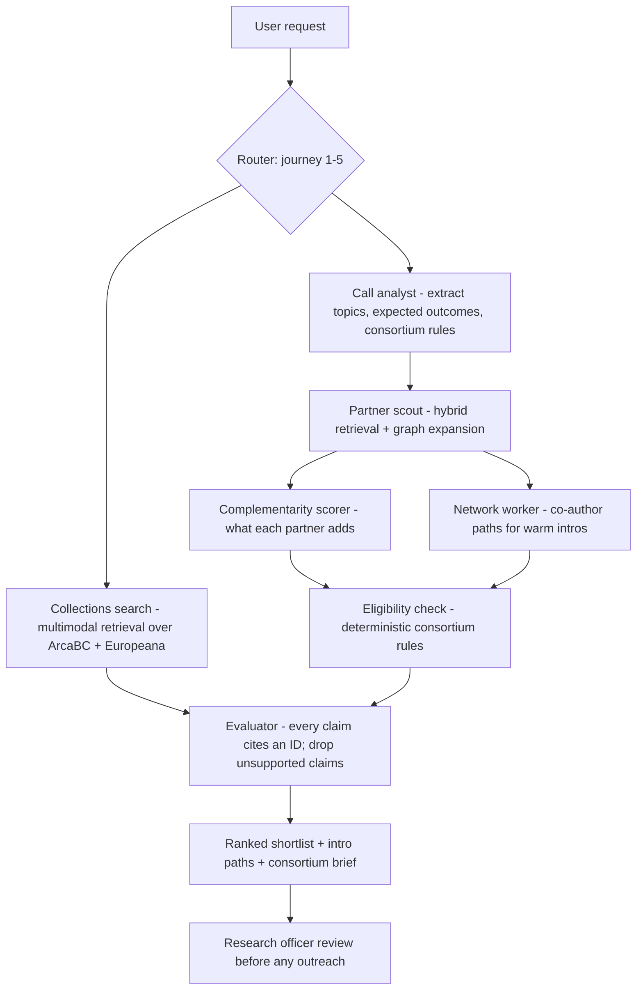

# Master Plan: Course Access Agent and Research Assistant

Two higher-ed products for Web Summit Lisbon, built in 4 weeks with Claude Code
agents, in the `Teamworxai/campus-ai` repo.

This repo is a clean build. It follows the same proven patterns as an
earlier graph-RAG academic advisor prototype (hybrid vector + fulltext
retrieval over Neo4j, graph expansion, RAGAS evaluation), but no code is
copied from it.

| | Course Access Agent | Research Assistant |
|---|---|---|
| Problem | Course materials (PDF, slides, docs, video) fail accessibility rules; accommodation requests pile up | BC researchers can now join Horizon Europe Pillar II, but finding the right EU partners is slow and network-dependent |
| Regulatory driver | Accessible British Columbia Act (post-secondary now covered), EU Web Accessibility Directive / EN 301 549, WCAG 2.2 AA | Canada's association to Horizon Europe Pillar II; consortium eligibility rules |
| Buyer | Accessibility services, teaching & learning centre | VP Research, research offices, international partnerships |
| Demo moment | Drop a messy lecture PDF, get an accessible version and a report in under 2 minutes | Pick a live Horizon call, get a ranked, evidence-backed EU partner shortlist and a consortium brief |
| Shared core used | LLM router, review UI, evaluation harness | LLM router, graph core (Neo4j writer, indexing, hybrid retriever), evaluation harness |

Status: draft for iteration. Open decisions are listed in section 8.

> ## Prime directives (standing orders; they override everything else)
>
> 1. **Open source only. No paid licences, ever.** All code we write, every
>    dependency, image, tool and model we ship or run must be under an
>    OSI-approved open-source licence (model weights included: a "community"
>    or usage-restricted licence does not qualify). Prefer permissive licences
>    (Apache-2.0, MIT, BSD); avoid AGPL. campus-ai itself is Apache-2.0. Two
>    named exceptions only: (a) free hardware-vendor drivers and runtimes
>    needed to use a GPU (e.g. NVIDIA CUDA), optional, with everything also
>    working on CPU; (b) Docker Desktop as a developer tool on Windows
>    workstations. Deployments need only the open-source Docker Engine.
> 2. **Everything runs offline.** Every model (embeddings, language, vision,
>    OCR) runs locally from open weights on hardware we control. No cloud
>    model APIs (no Claude, OpenAI, Gemini or Bedrock) in the product, and
>    nothing downloads at runtime. The only network steps are explicit,
>    one-time `fetch-*` jobs for weights and permitted data.
>
> Scope: these govern the products: what they are made of and how they run.
> Building them with Claude Code is the development process, outside the
> product. Any change that would break a directive is rejected, not traded off.

---

## 1. Design principles

1. **Workflows first, agents where they pay.** Deterministic code does what
   can be checked (accessibility checkers, eligibility rules, graph queries).
   LLMs handle judgement (alt text, reading order, partner fit rationale).
   This follows the "building effective agents" patterns: prompt chaining,
   routing, parallel workers, orchestrator-workers, evaluator-optimizer.
2. **Every output is verifiable.** Remediations are re-checked by the same
   checker that found the issue. Every partner recommendation cites a
   publication, project or call ID.
3. **Human approval at decision points.** The agent proposes; an instructor
   approves meaning-bearing alt text, a research officer approves outreach.
   Nothing is sent or published automatically.
4. **Offline and on-premises.** All models run locally from open weights
   (prime directive 2), so course materials and researcher data never leave
   the machine or the institution's own servers; data residency (Canada for
   BC, EU for EU) follows from where the institution runs it.
5. **Evals before features.** Each product gets a gold set in week 1; every
   PR reports eval deltas.
6. **Capabilities exposed as MCP servers.** The same tools then work from
   the Streamlit demo, from any MCP client, and from the Teamworx HR assistant
   platform, with no extra integration work.
7. **Portable and offline by default.** Everything runs in Docker and
   rebuilds from the repo on any machine. Models run in containers from
   local weights (a shared host directory), on an internal Docker network
   that reaches only Neo4j, never the internet.
8. **Simple codebase.** Per `AGENTS.md`: build small shared modules in
   `campus_ai/core/` and add only what is strictly needed.

## 2. Shared platform (built once, used by both)

| Component | What | Where |
|---|---|---|
| LLM router | One interface over **local open-weight models only** (prime directive 2), run in containers from local weights; route by task (vision, reasoning, cheap classification). No cloud backends | `campus_ai/core/llm/` |
| Graph core | Neo4j (`neo4j:2026.09.0-community` in compose) writer, vector + fulltext indexing, hybrid retriever with graph expansion. Every searchable node carries the `Entity` label, a 128-d vector (indexed, for candidates) and a 768-d vector (for reranking); vector and fulltext rankings are fused by reciprocal rank fusion | `campus_ai/core/graph/` |
| Embedder | EmbeddingGemma 2 (open, Apache 2.0, runs offline from local weights): text, images, audio and video in one vector space; 128-dim vectors for fast candidate search, 768-dim for reranking. Behind one interface so it can be swapped (decision D7) | `campus_ai/core/embed/` |
| Agent loop | Plain Python workflows calling local models through the LLM router (tool use and structured outputs with open-weight models); deterministic steps in plain Python. No hosted agent SDKs | `campus_ai/<product>/agent.py` |
| Skills | Domain procedures as plain files (`SKILL.md` + scripts) the local agent loop reads: WCAG remediation playbook, Horizon call analysis | `campus_ai/<product>/skills/` |
| MCP servers | One per product, thin wrappers over the product's functions | `campus_ai/<product>/mcp_server.py` |
| Review queue | One approval UI pattern (Streamlit) for both products: item, proposed change, evidence, approve/edit/reject | `campus_ai/core/review_ui.py` |
| Evaluation | RAGAS (Apache-2.0) + deterministic metrics, per-product gold sets; any LLM judge is a local model, never a hosted one | `campus_ai/core/eval/`, `evals/` |
| Tracing | Log every run: inputs, tool calls, model, tokens, cost, latency, outcome | `campus_ai/core/tracing.py` |

Hosting: everything, models included, runs in Docker on the institution's own
machines or a laptop (prime directives). There is no cloud model hosting. GPU
use is optional and needs only free vendor runtimes; the CPU path always works.

Layout:

```text
campus_ai/
  core/                 # llm router, graph, eval, tracing, review UI, region config
  course_access/        # Course Access Agent
  research_assistant/      # Research Assistant
evals/                  # gold sets and eval reports per product
tests/                  # unittest, external services mocked
docs/plans/             # this plan and per-product specs
```

## 3. Product A: Course Access Agent

### 3.1 Scope for Lisbon
- Inputs: PDF, PPTX, DOCX. Video captions are a stretch goal.
- Outputs: (1) an accessible DOCX/HTML version, (2) an issue report mapped
  to WCAG 2.2 success criteria, (3) a short conformance statement.
- Simplification: produce an accessible DOCX/HTML version rather than
  re-tagging the original PDF. Full PDF/UA tagging is a post-Lisbon goal.
- Out of scope: LMS integration (Canvas) beyond a design note; braille.

### 3.2 Agent design


Patterns used: prompt chaining (parse, audit, fix, verify), routing by issue
type, parallel workers, evaluator-optimizer loop, human-in-the-loop gate.

Key rules for the workers:
- Never change academic content; only structure and descriptions.
- Alt text for STEM diagrams states what the figure shows and why it matters
  in this lecture, using surrounding text as context.
- Decorative images get marked decorative, not described.
- Each fix carries a confidence score; anything below threshold, and every
  chart, diagram or equation, goes to the review queue.

### 3.3 Tools (candidates, confirm in week 0)
All tools must meet the prime directives: open source, no paid licences,
running offline.
- PDF parsing: `pdfplumber` on `pdfminer.six` (MIT; permissively licensed
  libraries only). **Not PyMuPDF**: it is AGPL-3.0 or
  commercially licensed, so A1 dropped it (decision D8).
  PPTX/DOCX: `python-pptx`, `python-docx` (MIT).
- Checkers: `axe-core` (via Playwright) on the HTML output, `veraPDF` for
  PDF/UA reporting on inputs, plus custom rules for DOCX/PPTX structure.
  Confirm each licence and that they run fully offline in the image.
- Vision (alt text): a local open-weight vision-language model under an
  OSI-approved licence, chosen by bake-off (decision D9). No hosted models.
- OCR for scanned PDFs: **next phase** (card A7), with an open-source offline
  engine (e.g. Tesseract, Apache-2.0).
- Math: convert to MathML where detectable.

### 3.4 Evaluation
- Gold set: 40 real course documents (mix of disciplines), with
  issues labelled by an accessibility specialist.
- Metrics: checker issues fixed (%), new issues introduced (target 0),
  alt-text quality (1-5 human rating, plus local model judge agreement), share sent
  to human review, time and cost per document.
- Lisbon target: 90%+ of automatically checkable issues fixed, 0 content
  changes, alt-text average 4+/5 on the gold set.

## 4. Product B: Research Assistant

### 4.1 Scope for Lisbon

**Pilot: AI-enable SFU's Research Expertise Engine (REE).** REE is SFU's
researcher directory: pre-populated faculty profiles, 46,000+ titles by SFU
authors, searchable by keyword, author, department or faculty. Faculty can
add a research statement, say whether they are accepting graduate students,
and tag the UN Sustainable Development Goals (SDGs) their work supports. It
is run by SFU's Research Intelligence team (RIO).

Research Assistant adds an AI layer on top of REE rather than replacing it:
- Ask in plain language ("who at SFU works on wildfire smoke and health?").
- Find EU partners and open Horizon Europe calls for an SFU researcher.
- Help prospective graduate students (including from the EU) find
  supervisors who are accepting students.
- Help industry, government and media find the right SFU expert.

REE's SDG tags map onto Horizon Europe clusters and missions, which gives a
ready-made bridge between the two sides.

Data sources:
- BC side: REE profiles and publications (through an agreement with RIO,
  not scraping), enriched with OpenAlex and ORCID. Other BC universities
  after the pilot.
- EU side: Horizon Europe projects and participants (CORDIS open data), open
  calls (EU Funding & Tenders portal), EU author profiles (OpenAlex).
- Optional Canadian funding: NSERC/SSHRC award open data.
- Four user journeys:
  1. "Find EU partners for this call" (research office).
  2. "Which open calls fit this researcher or lab?" (researcher).
  3. "Draft a consortium for this call" (research office).
  4. "Find an SFU expert or supervisor for this topic" (public, students,
     industry): natural-language search over REE.
  5. "Find sources on this topic across BC and European collections"
     (researchers, students, librarians): multimodal search over ArcaBC and
     Europeana (section 4.2b).

### 4.2 Graph schema (Neo4j)

```text
(Researcher {accepting_grad_students})-[:AFFILIATED_WITH]->(Institution)-[:LOCATED_IN]->(Country)
(Researcher)-[:CONTRIBUTES_TO]->(SDG)<-[:ALIGNS_WITH]-(Cluster)
(Researcher)-[:AUTHORED]->(Publication)-[:ABOUT]->(Topic)
(Researcher)-[:COAUTHORED_WITH {count}]->(Researcher)
(Organization)-[:PARTICIPATED_IN {role}]->(Project)-[:ABOUT]->(Topic)
(Project)-[:FUNDED_UNDER]->(Programme)
(Call)-[:TARGETS]->(Topic);  (Call)-[:PART_OF]->(Cluster)
```

Topics come from OpenAlex's topic taxonomy so both sides share one
vocabulary. Embeddings on Researcher, Project and Call text use the graph core's
indexing.

### 4.2b Content layer: ArcaBC and Europeana (multimodal)

The assistant also searches the scholarly and heritage record, not just
people:
- **ArcaBC** (BC, https://arcabc.ca): BC ELN's collection site, the BC
  counterpart of Europeana. It brings together the digital collections of BC
  post-secondary institutions, libraries, museums and archives (theses,
  images, books, newspapers, video and sound recordings) in one place, so it
  is one source with one loader and one data agreement, not a set of
  repositories harvested one by one.
  **Do not fetch, scrape or index anything from arcabc.ca until BC ELN grants
  permission (task card R0b).** Permission is being worked through.
- **Europeana** (EU): the EU's cultural-heritage aggregator, with an open
  API.

One question searches both, side by side, and links results to living
researchers in REE ("who at SFU works on this today?").

Pipeline:
1. Harvest metadata and media through each source's standard interfaces
   (for ArcaBC, the interface BC ELN agrees to in R0b; for Europeana, its
   API). Both loaders write the same JSONL records, so indexing, search and
   the UI are shared. Store each item's rights statement.
2. Split media into search units: text chunks up to 8K tokens, images,
   audio segments, video clips.
3. Embed every unit with EmbeddingGemma 2 into the shared vector space.
4. Graph links: `(Item)-[:IN]->(Collection)-[:HELD_BY]->(Institution)`,
   `(Item)-[:CREATED_BY]->(Creator)`, `(Item)-[:ABOUT]->(Topic)<-[:ABOUT]-(Publication)<-[:AUTHORED]-(Researcher)`.
5. Answers cite the item, with timestamps for audio and video and image
   regions for photos.

Lisbon scope: one ArcaBC collection plus one thematically matching Europeana
collection, if R0b is agreed in time; otherwise Europeana only, with ArcaBC
shown as pending. Full ArcaBC coverage after Lisbon.

Link to Course Access Agent: its alt-text and captioning workers draft
descriptions for ArcaBC items with thin metadata, for librarians to approve.

### 4.3 Agent design



Patterns used: routing, orchestrator-workers, graph-RAG (hybrid
retriever in the graph core), deterministic rule checks, evaluator-optimizer for
citations, human approval before outreach.

### 4.4 Privacy and fairness
- Public scholarly data only. EU researcher data falls under GDPR: keep only
  what is needed, honour removal requests, document the legitimate interest.
- Rank by fit to the call, never by personal attributes. Show the evidence
  for every match.
- No automated emails. The product drafts; people send.
- Collections: index only what each institution approves; honour every
  item's rights statement; exclude restricted items. Indigenous materials
  follow OCAP® principles and the holding community's protocols.

### 4.5 Evaluation
- Back-test: take past Horizon projects with a Canadian participant, hide
  one EU partner, check whether it appears in the top 10 (recall@10).
- Call-fit: research officers rate 20 shortlists (1-5).
- Citation precision: share of claims backed by a valid ID (target 100%).
- RAGAS faithfulness metrics from the shared eval harness.
- Collections search: recall@10 on 50 labelled queries across text, image,
  audio and video; cross-modal hits (text query finds a photo or clip).
- Embedder bake-off (week 1): EmbeddingGemma 2 vs a text-only baseline on
  the same queries, including French and other EU-language queries.

## 5. Four-week schedule

Assumes Web Summit Lisbon is in early November; week 4 ends about Oct 30.

| Week | Shared platform | Course Access Agent | Research Assistant |
|---|---|---|---|
| 0 (Oct 3-4) | Harness setup (section 6); confirm hosting and tools; decisions D1-D7 | Collect 40 gold documents | Download CORDIS and OpenAlex samples; contact BC ELN about ArcaBC |
| 1 (Oct 5-9) | Skeleton, LLM router, graph core, eval harness; tracing; review UI skeleton | Parser + deterministic audit; WCAG report | Loaders and graph schema; ingest SFU + CORDIS |
| 2 (Oct 12-16) | MCP server template | Workers + rebuild; first end-to-end run | Router, call analyst, partner scout; first shortlist |
| 3 (Oct 19-23) | Eval dashboards in CI | Verify loop, review queue, eval tuning | Network worker, eligibility, evaluator; back-test |
| 4 (Oct 26-30) | Security review, cost check | Demo script, sample pack, one-pager | Demo script, live-call demo, one-pager |

Exit criteria per week are the eval targets above, measured on the gold
sets. A week is not done until its eval report is committed.

## 6. How we build: the Claude Code harness

This section is about the development process. Claude Code helps write the
code; it is not part of either product, and nothing it uses ships. The prime
directives apply to everything that does ship and run.

### 6.1 One-time setup (week 0)
- `CLAUDE.md` at repo root pointing to `AGENTS.md` and this plan; one short
  `CLAUDE.md` per product folder with its spec and test commands.
- SessionStart hook so cloud sessions install dependencies and can run
  tests (`session-start-hook` skill).
- Project subagents in `.claude/agents/`:
  - `eval-runner`: runs a product's gold set and reports deltas.
  - `a11y-reviewer`: reviews diffs against WCAG rules.
  - `data-steward`: checks new loaders for licensing, PII and GDPR issues.
- Project skills in `.claude/skills/`: `wcag-remediation`,
  `horizon-call-analysis`, `add-graph-loader`.
- Permission allowlist for test and eval commands
  (`fewer-permission-prompts` skill).

### 6.2 Iteration loop for every task

```text
GitHub issue (task card from section 7)
  -> Claude Code cloud session on its own branch
  -> plan mode: agent proposes approach, you approve
  -> implement with unit tests (mock Neo4j, LLMs, network)
  -> eval-runner subagent: gold-set deltas
  -> /code-review, then /simplify
  -> PR with eval report; Claude watches CI and review comments
  -> merge
```

### 6.3 Running sessions on Max
- Run 2-3 heavy sessions at a time (one per workstream); use subagents for
  research and data collection so the main sessions keep clean context.
- Scheduled routines: nightly eval run on `main`, weekly CORDIS/calls refresh.
- Multi-agent workflows (fan-out over many documents or calls) only for eval
  sweeps, and only when you ask for them, since they use a lot of tokens.

## 7. Task cards (first wave)

Each card is sized for one cloud session and one PR.

| ID | Card | Depends on |
|---|---|---|
| P0 | Project skeleton: `pyproject.toml` (uv), `campus_ai/` package, unittest setup, SessionStart hook | - |
| P1 | LLM router over local open-weight models only, served in containers from local weights, with tests. PR #2 predates the prime directives and has Claude/Bedrock backends: those must be removed before merge | P0 |
| P8 | Licence guard: a test that lists every Python package, image and model weight in the stack and fails on any licence that is not OSI-approved (the two named exceptions listed: free GPU vendor runtimes, Docker Desktop for Windows development). **Built:** `tests/test_licences.py`, runs in both images | P0 |
| P5 | Graph core: Neo4j writer, vector + fulltext indexes, hybrid retriever | P0, P7 |
| P6 | Eval harness: gold-set format, RAGAS + deterministic metrics, report | P0 |
| P2 | Tracing module: per-run JSONL log of tool calls, tokens, cost | P0 |
| P3 | Review queue Streamlit component (approve/edit/reject) | P0 |
| P4 | MCP server template wrapping a product's public functions | P1 |
| A1 | Document parser (PDF/PPTX/DOCX -> common structure). Built on python-docx, python-pptx and pdfplumber (all MIT); the PyMuPDF version (PR #4) is superseded (D8) | P0 |
| A2 | Deterministic audit + WCAG-mapped report | A1 |
| A3 | Alt-text worker with a local open-weight vision model (D9) and confidence score | A1, P1 |
| A4 | Structure, table and text workers | A1 |
| A5 | Rebuild accessible DOCX/HTML + verify loop | A2-A4 |
| A6 | Gold set + eval metrics in `evals/course_access/` | A2, P6 |
| A7 | **Next phase:** OCR for scanned (image-only) PDFs with an open-source offline engine (e.g. Tesseract), feeding the same Document structure | A1 |
| R0 | REE integration spec with RIO: fields, access method, refresh, consent | - |
| R1 | OpenAlex loader (SFU authors, topics), REE loader once R0 is agreed | P5, R0 |
| R2 | CORDIS loader (projects, participants) + calls loader | P5 |
| R3 | Graph schema + indexing for Researcher/Project/Call | R1, R2 |
| R4 | Router + call analyst + partner scout + expert search (journey 4) | R3, P1 |
| R5 | Network worker, eligibility rules, citation evaluator | R4 |
| R6 | Back-test eval (recall@10) | R3, P6 |
| P7 | Embedder module with EmbeddingGemma 2 + bake-off vs text baseline (D7) | P0, P6 |
| R0b | Data agreement with BC ELN for ArcaBC (arcabc.ca): permission to ingest, the interface to use, rights handling, and the pilot collection. **In progress; until signed, no code or session touches arcabc.ca** | - |
| R7 | ArcaBC loader, the BC counterpart of R8: one fetch step through the interface agreed in R0b, writing the same JSONL records (items, media units, collections, holders, creators, rights statements). Blocked on R0b | P5, P7, R0b |
| R8 | Europeana loader for the matching collection. Pilot theme: salmon, as a subject (*Salmo*, *Oncorhynchus*, salmonids) or as salmon fishing in titles in 7 languages, without specimen photos: about 150 items, nearly all on topic (looser queries were half noise: people named Salmon, salmon-coloured fashion, herbarium sheets named after a botanist); open licences only (CC0, PDM, CC BY, CC BY-SA), until the ArcaBC collection (R0b) fixes the theme. Images use Europeana's 400 px thumbnails; full-size media, audio and video need each provider's host and come later | P5, P7 |
| R9 | Collections search: multimodal retrieval, citations with timestamps and image regions. First cut built: API (`campus_ai/research_assistant/api.py`) and web UI (`web/`) over Europeana; pictures and texts ranked separately; APA/Chicago/BibTeX citations. Timestamps and image regions wait on audio/video and region detection | R7, R8 |

Kickoff prompt template for a card:

```text
Read AGENTS.md and docs/plans/higher_ed_master_plan.md.
Implement task card <ID>: <title>.
Start in plan mode and show me the plan before editing.
Reuse campus_ai/core modules; keep the change minimal.
Add unittest tests that mock external services.
Run the test suite and, if the card touches a product, its eval.
Commit, push to your branch, and open a PR with the eval results.
```

## 8. Open decisions

| ID | Decision | Recommendation |
|---|---|---|
| D1 | Same repo or new repo for the products | **Decided:** new private repo `Teamworxai/campus-ai`, clean build, no code copied from the SFU prototype |
| D2 | Model hosting | **Decided (revised Oct 21, prime directive 2):** all models run locally from open weights, in Docker, on hardware we or the institution control. No cloud model APIs: Claude, OpenAI, Gemini, Bedrock and similar are out of the product. Replaces the earlier "Claude via in-region cloud" decision |
| D3 | Pilot partner for gold data | SFU accessibility services (A); SFU Research Intelligence team (RIO), owner of REE (R). Needs a data-sharing agreement for REE profiles before any REE data enters this repo |
| D4 | Product names | Working names here; Teamworx branding to decide |
| D5 | Demo hosting at Lisbon | Pre-loaded laptop with local fallback; do not rely on venue Wi-Fi |
| D6 | Who labels gold sets | One accessibility specialist (A); two research officers (R); one librarian for collections search |
| D7 | Default embedder | **Decided, pending bake-off:** EmbeddingGemma 2 (`google/embeddinggemma-2`, released Oct 6, 2026, Apache 2.0, not gated; Matryoshka dims 768/512/256/128), run offline in the `embed` Docker image from local weights, text, image, audio and video. vLLM (0.31.0) does not support it yet and Ollama lists only text and image, so neither serves it for now. Text baseline: `intfloat/multilingual-e5-small`. Keep the baseline if it loses on our gold set |
| D8 | Licences | **Decided (Oct 21, prime directive 1):** open source only, no paid licences. OSI-approved licences for all code, dependencies, images, tools and model weights; permissive preferred; no AGPL (so PyMuPDF is replaced). campus-ai is Apache-2.0. Two named exceptions: free GPU vendor runtimes (NVIDIA CUDA), optional, with a CPU path that always works; and Docker Desktop as a developer tool on Windows workstations (Oct 21). Deployments need only the open-source Docker Engine + Compose (or Podman), and nothing may depend on Desktop-only features |
| D9 | Vision model for alt text (A3) | **Open:** a local open-weight vision-language model under an OSI-approved licence (e.g. Apache-2.0 or MIT weights; "community" licences don't qualify), chosen by bake-off on the A6 gold set, running in a container from local weights |

## 9. Risks

| Risk | Mitigation |
|---|---|
| Alt text wrong on complex STEM figures | Always route charts, diagrams and equations to human review |
| PDF remediation harder than expected | Output accessible DOCX/HTML; PDF tagging later |
| Researcher name ambiguity across sources | Use OpenAlex/ORCID IDs as keys; never merge on name alone |
| Calls data changes or API limits | Cache snapshots; weekly refresh routine |
| GDPR complaints about profiling | Public data only, removal process, evidence shown for every match |
| REE data access not agreed in time | Build and demo on public OpenAlex/ORCID data for SFU authors; swap in REE data once RIO agrees. Respect REE profile choices (e.g. not accepting students) |
| ArcaBC permission not granted in time, or rights and cultural protocols block indexing | Demo on Europeana with ArcaBC shown as pending; start ArcaBC with one openly licensed collection agreed with BC ELN; rights checked per item |
| EmbeddingGemma 2 is brand new | Bake-off in week 1; embedder behind one interface so it can be swapped |
| Local open-weight models are weaker than hosted ones for alt text and reasoning | Bake-off (D9); confidence scores; every chart, diagram, equation and low-confidence fix goes to human review |
| Local models are slow on CPU-only machines | GPU optional via free vendor runtime; batch work (indexing, remediation) runs ahead of the demo; measured: pilot index 17 min on 4 CPU cores, 80 s on an RTX 2050 |
| A dependency or model changes to a non-open licence | Licence guard test (P8) on every build; pin versions |
| Max usage limits slow the build | Cap parallel heavy sessions at 3; push bulk work to subagents and off-peak routines |
