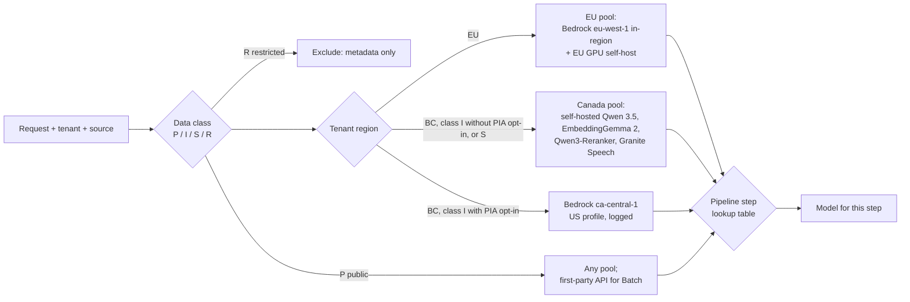
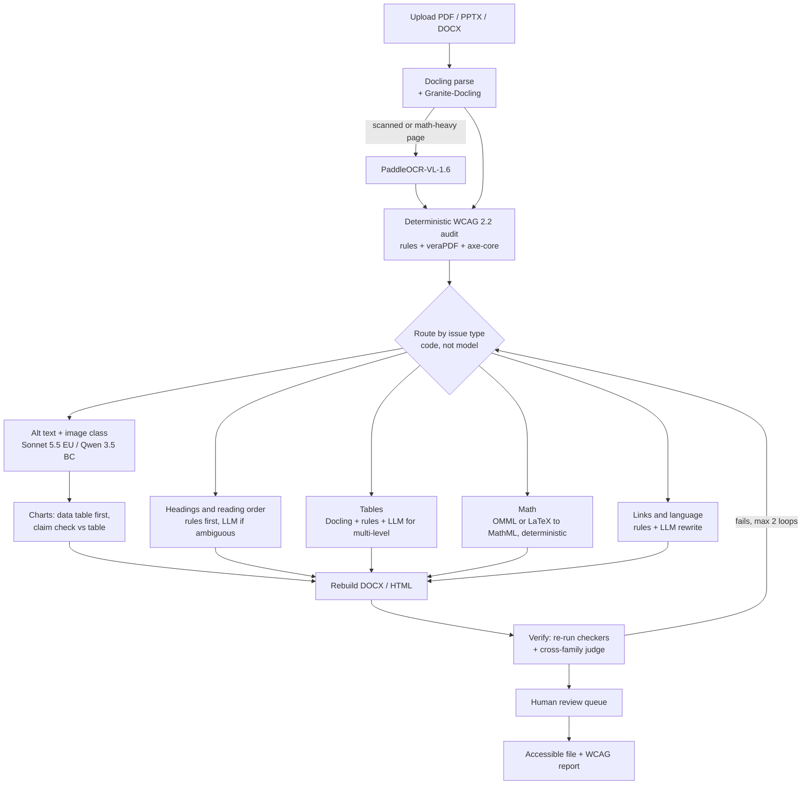
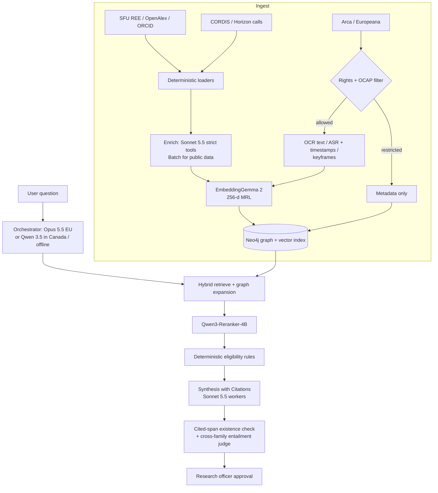

# Route by region, then ship six models

> **Status (Oct 22, 2026):** research snapshot from Oct 7. Since then the team decided
> to run local, OSI-licensed open-weight models only, with no cloud model APIs (D2 in
> `docs/plans/master_plan.md`). The Claude routing recommended below is therefore superseded;
> the open-model picks, bake-offs and rights rules still apply and feed the D8 model register.

campus-ai can build both Web Summit products on **six models plus deterministic tooling**. The six are Claude Sonnet 5.5, with Opus 5.5 only as the Research Assistant orchestrator; one open vision-language model (Qwen 3.5 35B-A3B) that serves as the in-Canada fallback, the offline demo model and a cross-family judge; EmbeddingGemma 2; Qwen3-Reranker-4B; Docling with Granite-Docling-258M (PaddleOCR-VL-1.6 handles hard pages); and Granite Speech 4.1 2B Plus for the captioning stretch goal. The landscape around EmbeddingGemma 2 is crowded. In October 2026 there are stronger text embedders (Qwen3-Embedding-8B at about 70.6 on MMTEB against 61.4 for EmbeddingGemma 2), stronger visual-document retrievers (nemotron-colembed tops ViDoRe V3), and stronger all-modality APIs (Gemini Embedding 2). None of them pairs an Apache 2.0 licence, audio support and a sub-1B footprint, and that combination is what lets one embedder run identically in Canada, in the EU and on a laptop in Lisbon. The finding that changes the plan is that **no verified official route gives Claude inference inside Canada**. The Anthropic API offers only `global`/`us`, Bedrock `ca-central-1` offers only Global and US profiles, and Vertex serves Claude 5.x only from `global`, `us` or `eu`. Decision D2 ("Claude via in-region cloud, Canada + EU") therefore cannot be met as written. The fix is a region-first routing policy. EU tenants use Claude on Bedrock EU in-region endpoints. BC tenants use self-hosted open models on Canadian GPUs by default, and their content goes to Claude via the US profile only where the customer's privacy impact assessment (PIA) allows it. Indigenous and other restricted material never goes to a cloud LLM. D7 (EmbeddingGemma 2 as default) should stand, provided it passes a two-day bake-off this week against Qwen3-Embedding-4B. Most benchmark figures below came from search-result snippets because egress to Hugging Face, arXiv and several vendor sites was blocked, so treat every number as "reported, verify on the primary page" unless marked otherwise.

## Nine model categories, but most of the leaders are not shippable here

The useful question for a four-week build is not "who tops the leaderboard" but "who tops it with a licence, a region and a footprint we can use". In almost every category a benchmark leader fails one of those tests. The tables below compress the landscape. "Verified" means the researcher read the primary page. "Snippet" means the figure came from a search summary and needs checking.

### Embeddings: EmbeddingGemma 2 is the only small, open, five-modality option

EmbeddingGemma 2 was released on **6 October 2026, one day before this report**. It is a **740M-parameter, Apache 2.0, Gemma-4-based model** that puts text, code, images, video frames and audio into one 768-d space, with Matryoshka truncation to 128 dimensions and an 8K context ([Google Developers Blog](https://developers.googleblog.com/google-ai-edge-with-embeddinggemma-2/); [The Next Web](https://thenextweb.com/news/embeddinggemma-2-on-device-europe)). Its modular design matters for campus-ai. Text-only workloads need only the **~270M text core**; the vision (~170M) and audio (~300M) encoders load only for media ([The Next Web](https://thenextweb.com/news/embeddinggemma-2-on-device-europe)). Its reported scores are **MTEB Multilingual 61.36, MTEB Code 78.68, MIEB-lite 64.64 and MAEB 49.39**. That is roughly flat with v1 on multilingual text, so the upgrade buys multimodality and context length, not better text retrieval ([cellcog summary of Google's developer guide](https://cellcog.ai/blog/embeddinggemma-2/); [officechai](https://officechai.com/ai/google-launches-embeddinggemma-2-for-multimodal-on-device-embeddings/)). The model card warns that **activations overflow float16** and must run in bf16 or fp32, that quality varies across its 100+ languages, and that omitting task prefixes degrades results ([HF model card](https://huggingface.co/google/embeddinggemma-2)).

| Model | Modalities | Licence / access | Region options | Quality evidence | Cost |
|---|---|---|---|---|---|
| **EmbeddingGemma 2** (740M) | text, code, image, video frames, audio | Apache 2.0, open | Self-host anywhere | MTEB-ML 61.36, MIEB-lite 64.64, MAEB 49.39 (snippet) | GPU/CPU only; ~191 MB RAM text-only quantized |
| Gemini Embedding 2 | text, image, PDF, audio, video | Proprietary API | Vertex `global`, `us`, **`eu`**; no Canada endpoint ([Vertex docs](https://docs.cloud.google.com/vertex-ai/generative-ai/docs/models/gemini/embedding-2)) | MTEB-ML ~69.9 (snippet, [arXiv 2605.27295](https://arxiv.org/pdf/2605.27295)) | $0.20/M text, $6.50/M audio, $12/M video ([tokencost](https://tokencost.app/blog/gemini-embedding-2-pricing), aggregator) |
| Qwen3-VL-Embedding 2B/8B | text, image, video (no audio) | Reported Apache 2.0 (unverified) | Self-host | MMEB-V2 77.8 for 8B, #1 at release ([arXiv 2601.04720](https://arxiv.org/abs/2601.04720)) | GPU; 4,096-d for 8B |
| Qwen3-Embedding 4B/8B | text only | Open (verify per checkpoint) | Self-host | MMTEB ~70.58 for 8B ([codesota](https://www.codesota.com/benchmarks/mteb), tracker) | GPU |
| Cohere Embed v4 | text, image, docs | Proprietary | Bedrock eu-west-1 in-region; ca-central-1 **global CRIS only** ([modelavailability](https://modelavailability.com/models/cohere/embed-v4)) | No 2026 numbers found | Per token; not verified |
| Amazon Nova MM Embeddings | text, image, video, audio, docs | Proprietary | **us-east-1 only** ([AWS](https://docs.aws.eu/bedrock/latest/userguide/model-card-amazon-amazon-nova-multimodal-embeddings.html)) | none found | ~$0.14/M (aggregator) |
| jina-embeddings-v5-omni | text, image, audio, video | **Non-commercial weights** by default ([Eden AI](https://www.edenai.co/post/best-multimodal-embeddings-apis)) | Self-host only with a commercial licence | none found | Licence fee |
| nemotron-colembed-vl-8b-v2 / ColQwen3.5 | page images, multi-vector | NVIDIA licence / per-checkpoint | Self-host | **ViDoRe V3 #1, 63.42 nDCG@10** ([HF](https://huggingface.co/nvidia/nemotron-colembed-vl-8b-v2)) | GPU plus a multi-vector store |

What follows for design is that EmbeddingGemma 2 should be the first-stage recall model, not the final ranker. Its text quality is several points below Qwen3-Embedding and Gemini Embedding 2, so pair it with a reranker. ColPali-style page retrievers would beat it on scanned theses and newspapers, but they need multi-vector storage that **Neo4j's vector index does not support** (the index caps at 4,096 dimensions on the vector-2.0 provider) ([Neo4j Cypher Manual](https://neo4j.com/docs/cypher-manual/current/indexes/semantic-indexes/vector-indexes/)). For Lisbon the simpler route is to run OCR, embed the resulting text, and leave ColPali out.

### Rerankers: run Qwen3-Reranker locally, skip the API leaders

On the Agentset ELO board the top rerankers are **Zerank 2 (1638), Cohere Rerank 4 Pro (1629) and Voyage rerank-2.5 (1544)**, all API-only, with no verified Canadian or EU region ([Agentset](https://agentset.ai/rerankers)). The self-hostable field is Qwen3-Reranker (0.6B/4B/8B, instruction-aware, 100+ languages), BGE-reranker-v2-m3 and mxbai-rerank-large-v2 ([FutureAGI](https://futureagi.com/blog/best-rerankers-for-rag-2026/); [QwenLM](https://github.com/QwenLM/Qwen3-Embedding)). For multimodal candidates there is **Qwen3-VL-Reranker**, which scores query/document pairs of any mix of text, image and video ([arXiv 2601.04720](https://arxiv.org/abs/2601.04720)). jina-reranker-m0 also handles page images but is reportedly non-commercial. **Qwen3-Reranker-4B** is the pick because one self-hosted model can serve both regions. No audio-native reranker exists, so audio candidates are reranked on their transcripts.

### Document parsing, OCR and math: small specialist VLMs beat frontier models

The official **OmniDocBench v1.6 leaderboard (updated 11 Sept 2026)**, read first-hand, is led by small document VLMs: **TeleOCR 96.91, OvisOCR2 96.47, PaddleOCR-VL-1.6 96.34 and MinerU2.5-Pro 95.75**. They sit well ahead of Gemini 3 Pro (92.91), GPT-5.2 (86.59), Mistral OCR (85.66) and Marker (78.44) ([OmniDocBench GitHub](https://github.com/opendatalab/OmniDocBench)). Formula CDM has reached **~97.5** for PaddleOCR-VL-1.6, OvisOCR2 and MinerU2.5-Pro, and table TEDS is 93–97 across the leaders ([OmniDocBench GitHub](https://github.com/opendatalab/OmniDocBench)). On olmOCR-bench, Chandra OCR 2 reports **85.8**. Its weights, however, use a **modified OpenRAIL-M licence that is free only below $2M revenue** ([Docsumo](https://www.docsumo.com/blog/best-ocr-models); [Chandra releases](https://github.com/datalab-to/chandra/releases)). Every system scores only **29–50 on olmOCR-bench's "old scans" subset** ([allenai/olmocr](https://github.com/allenai/olmocr)), so historical newspapers remain unsolved.

| Tool / model | Role | Licence | Region | Evidence | Cost |
|---|---|---|---|---|---|
| **Docling** + **Granite-Docling-258M** | Parse PDF/DOCX/PPTX into one document model; formulas to LaTeX, charts to tables | Granite-Docling Apache 2.0 ([HF](https://huggingface.co/ibm-granite/granite-docling-258M)); Docling MIT (unverified) | Self-host | FinTabNet TEDS 0.97 | CPU/GPU |
| **PaddleOCR-VL-1.6** | Escalation for scanned or math-heavy pages | Apache 2.0 for earlier versions; **1.6 unverified** | Self-host | OmniDocBench 96.34, CDM 97.53 | GPU |
| MinerU2.5-Pro (1.2B) | Alternative escalation | Own licence (verify) | Self-host | 95.75 overall | GPU |
| olmOCR 2 (7B) | Bulk OCR of theses | Apache 2.0 | Self-host | 82.4 olmOCR-bench; "<$200 per million pages" ([allenai](https://github.com/allenai/olmocr)) | GPU |
| Mistral OCR 3/4 | EU-hosted API fallback | Commercial | EU hosted; OCR 4 self-hostable ([TNW](https://thenextweb.com/news/mistral-ocr-4-document-ai-self-hosted)) | 85.66 overall | **$2 per 1,000 pages, $1 batch** ([PyImageSearch](https://pyimagesearch.com/2025/12/23/mistral-ocr-3-technical-review-sota-document-parsing-at-commodity-pricing/)) |
| Azure Document Intelligence | Canada-hosted API fallback | Commercial | **Canada Central / East** ([Microsoft Q&A](https://learn.microsoft.com/en-us/answers/questions/2128746/how-to-copy-azure-document-intelligence-custom-cla)) | none found | not verified |
| Kraken v5 / Transkribus | Historical print and handwriting | Open / commercial | Self-host / EU SaaS | CER below 1% on some 19th-century print (secondary) ([intuitionlabs](https://intuitionlabs.ai/articles/non-llm-ocr-technologies)) | — |

Most course materials are born-digital DOCX and PPTX, which store equations as OMML. Converting OMML to MathML is a deterministic job (Pandoc or Microsoft's XSL), and OCR is only needed for equations embedded as images or locked in PDFs. The remaining weak point is accessibility rather than OCR. **No benchmark scores header-cell identification (`<th scope>`) or MathML screen-reader quality**, so those need checks of our own.

### Alt text and chart description: a frontier VLM plus a claim check

There is no 2026 head-to-head ranking of vision-language models on STEM alt text. The peer-reviewed evidence supports two practices. First, guide frontier models with **structured prompts** (the STEMMA comparative study, [ACM 2026](https://doi.org/10.1145/3800424.3800457)). Second, give the model **surrounding context**: slide title, paragraph and course topic ([arXiv 2409.03054](https://arxiv.org/pdf/2409.03054)). A July 2026 paper examines whether multimodal-LLM chart descriptions make **claims the chart does not support** ([arXiv 2607.25021](https://arxiv.org/pdf/2607.25021)). The safe pattern is therefore to extract the chart's data into a table first, using Granite-Docling's chart-to-table training, then write the alt text from that table and check its claims against it. ASSETS 2026 released a dataset for **small models that validate whether alt text meets WCAG 1.1.1** ([Zenodo](https://zenodo.org/records/21359354)), which supports a cheap second-pass validator. Claude Sonnet 5.5 is the cloud default and Qwen 3.5 (natively text and image, with tool calling) is the local candidate ([TypingMind mirror of HF card](https://www.typingmind.com/guide/huggingface/Qwen-Qwen3.5-9B)). The week-1 bake-off decides whether the local model is good enough to draft alt text for BC tenants.

### Speech-to-text and diarization: 2B open models now lead

The Hugging Face Open ASR Leaderboard is led by **IBM Granite Speech 4.1 2B (5.33% average English WER, released 29 Apr 2026)**, then Cohere Transcribe 03-2026 (5.42%) and NVIDIA Canary-Qwen 2.5B (5.63%) ([Northflank](https://northflank.com/blog/best-open-source-speech-to-text-stt-model-in-2026-benchmarks); [MindStudio](https://www.mindstudio.ai/blog/ibm-granite-speech-4-1-asr-models-leaderboard)). The **2B Plus variant adds word timestamps and speaker diarization** and supports keyword biasing for course glossaries. It covers English and French among six languages ([MindStudio](https://www.mindstudio.ai/blog/ibm-granite-speech-4-1-asr-models-leaderboard)). Cohere Transcribe covers 14 languages under Apache 2.0, but the download is gated ([HF card](https://huggingface.co/coherelabs/cohere-transcribe-03-2026)). For diarization, the open **pyannote Community-1 (CC-BY-4.0)** pipeline is the default. An independent study put pyannoteAI at 11.2% DER across 196.6 h of multilingual audio, with Sortformer degrading as speaker count rises ([arXiv 2509.26177](https://arxiv.org/html/2509.26177v1)). For the long tail, **Meta Omnilingual ASR covers 1,600+ languages under Apache 2.0** ([arXiv 2511.09690](https://arxiv.org/pdf/2511.09690)). **No production ASR exists for BC Indigenous languages** ([NRC/COLING 2020](https://aclanthology.org/2020.coling-main.516.pdf); [Mila FLAIR](https://mila.quebec/en/ai4humanity/applied-projects/first-languages-ai-reality)). Managed APIs with regional residency exist: Google Chirp 3 in Montréal (preview) ([Google docs](https://docs.cloud.google.com/speech-to-text/docs/models/chirp-3?authuser=4)) and AssemblyAI EU at about $0.21 per hour ([AssemblyAI](https://www.assemblyai.com/blog/speech-recognition-cost)). Self-hosting a 2B model is simpler than either.

### Video understanding: a pipeline, not a video model

Gemini 3 Pro leads Video-MME (**88.4% with subtitles**), followed by Qwen3.6 Plus and Qwen3.5 397B. Adding subtitles or audio is worth up to about **9 points**, and long videos cost about 15 ([BenchLM](https://benchlm.ai/benchmarks/videoMmeWithSub); [benchmarklist](https://benchmarklist.com/benchmarks/videomme_with_sub/)). The production pattern is shot detection (PySceneDetect or TransNetV2), then per-shot keyframe captioning with a VLM, then alignment with the ASR transcript ([Trae AI course](https://learn.traeai.com/t/ai-engineering/phases/19-capstone-projects/12-video-understanding-pipeline)). This reuses the VLM and ASR already in the stack, so **no dedicated video model is needed**.

### Reasoning LLMs, routers and judges

Anthropic's verified price list is **Opus 5.5 $4/$20, Sonnet 5.5 $2/$10 and Haiku 4.5 $1/$5** per million tokens, with **Fable 5.1 at $10/$50**. The 5.x models have 1M context; batch is 50% off; and Claude 4.7+ tokenizers use about 30% more tokens for the same text ([Anthropic pricing](https://platform.claude.com/docs/en/about-claude/pricing)). The researcher could not obtain non-Claude frontier data from primary sources. Aggregators list GPT-5.5 at $5/$30, Gemini 3.1 Pro at $2/$12 and Mistral Large 3 at $0.50/$1.50 alongside unverifiable model names such as "GPT-6 Astra" ([benchlm](https://benchlm.ai/llm-pricing)). Treat those rows as rumours. Among open models, **Gemma 4 (2 Apr 2026, E2B to 31B, reportedly Apache 2.0)** and **Qwen 3.5 (from 16 Feb 2026; 9B to 397B-A17B; 262K context; image input; tool calling)** lead ([MindStudio](https://www.mindstudio.ai/blog/gemma-4-vs-qwen-3-5-open-weight-comparison); [MindStudio licence](https://www.mindstudio.ai/blog/gemma-4-apache-2-license-commercial-use)). Small routers in the 4B class score in the **mid-to-high 80s on BFCL v4** ([Ertas](https://www.ertas.ai/blog/on-device-tool-calling-2026-qwen3-gemma4-phi4)). LLM judges have well-measured biases. **20–40% of close pairwise verdicts flip when positions are swapped** ([tianpan.co](https://tianpan.co/blog/2026-04-27-llm-judge-bias-audit-length-position-format)), and judges favour their own family's text through perplexity familiarity ([arXiv 2410.21819](https://arxiv.org/pdf/2410.21819)). So the judge should come from a different family than the generator, and it should score against a rubric or reference rather than pick a preferred answer.

The routing literature argues against adding a router model. RouteLLM cut costs by **over 85% at 95% of GPT-4 quality** ([LMSYS](https://lmsys.org/blog/2024-07-01-routellm/)), but that was a 2024 result on chat benchmarks. Anthropic's current guidance is to **measure the top model at lower effort before building a cascade**, because caches are model-scoped and a cascade gives up cache reuse ([Building effective agents](https://www.anthropic.com/engineering/building-effective-agents)). Both campus-ai products are pipelines whose step already determines the task. Routing is therefore a lookup table in code, not a model.

## Region decides the endpoint before the task picks the model

The Claude residency picture, verified on Anthropic's own pages, is stark. The first-party API's `inference_geo` accepts **only `"global"` and `"us"`** ([Data residency](https://platform.claude.com/docs/en/manage-claude/data-residency)). On Bedrock, **`ca-central-1` routes only through Global or US profiles, `ca-west-1` only Global**, while **eu-west-1 and eu-north-1 offer "in-region only" routing** at a 10% premium ([Claude in Amazon Bedrock](https://platform.claude.com/docs/en/build-with-claude/claude-in-amazon-bedrock)). On Vertex, "specific regional endpoints support Claude Sonnet 4.6 and earlier; newer models use the global or multi-region endpoints", so Opus 5.5 and Sonnet 5.5 are reachable only via `global`, `us` or `eu` ([Claude on Google Cloud](https://platform.claude.com/docs/en/build-with-claude/claude-on-vertex-ai)). An AWS blog from November 2025 confirms the same behaviour for Canada: data at rest stays in Canada, but inference may run elsewhere ([AWS ML Blog](https://aws.amazon.com/blogs/machine-learning/accelerate-generative-ai-innovation-in-canada-with-amazon-bedrock-cross-region-inference)).

Legally, this is a disclosure-outside-Canada question, not an outright prohibition. Since the **November 2021 FIPPA amendments**, BC public bodies may disclose personal information outside Canada under s.33.1. They must still do a PIA, add a supplementary assessment where *sensitive* personal information is involved, and meet the s.30 security duty ([BC FOIPPA manual](https://www2.gov.bc.ca/gov/content/governments/services-for-government/policies-procedures/foippa-manual/disclosure-outside-canada); [OIPC BC](https://oipc.bc.ca/guidance-documents/3646); search summaries). Universities can therefore accept US processing for some content, but campus-ai cannot promise "processed in Canada" for any Claude call. Two kinds of content should never take that route by default. The first is accommodation-related student content. The second is Indigenous material governed by OCAP®, whose "Possession" principle points to Canadian, self-hosted processing ([FNIGC](https://fnigc.ca/ocap-training/)). Arca's TK Labels and access controls exist so that communities "determine if and how their content is accessible" ([Arca 2021 report](https://bceln.ca/sites/default/files/reports/Arca_Actions_Achievements_2021.pdf)).

In-Canada alternatives exist but each adds a vendor. Azure OpenAI regional deployments in Canada East keep processing in-region, though there is no Canada Data Zone ([Microsoft Q&A](https://learn.microsoft.com/en-us/answers/questions/5926885/azure-openai-data-residency-in-canada-east-quebec)). Google advertises ML-processing residency in Canada, with a secondary claim of Gemini 3.5 Flash in-region ([Google Canada](https://blog.google/intl/en-ca/company-news/technology/announcing-data-residency-at-rest-and-during-machine-learning-ml-processing/); [tech-insider](https://tech-insider.org/ca/cohere-vs-openai-vs-gemini-canada-data-residency-2026/)). Cohere is offered from **Bell's Merritt, BC data centre** ([Techcouver](https://techcouver.com/2026/06/19/canadian-tech-collaboration-power-sovereign-ai-data-centre/)). For a four-week build the simpler answer is the one already in the repo: the **Ollama path with an open model on Canadian GPUs**. A Canadian frontier API can be evaluated after Lisbon if BC pilots demand frontier quality on sensitive data.

### The routing policy

Routing happens in two steps. The data class and tenant region are looked up first, and they choose an endpoint pool. The pipeline step then chooses the model within that pool. Both lookups are deterministic code in the planned `campus_ai/core/llm/` router (card P1), so no routing LLM is involved.

| Data class | Examples | EU tenant pool | BC tenant pool | Never |
|---|---|---|---|---|
| **P – public, no personal data** | CORDIS projects, Horizon calls, OpenAlex works, Europeana metadata (CC0) | Any Claude route; first-party API allowed for Batch (50% off) | Any Claude route; first-party API allowed for Batch | — |
| **I – institutional, non-sensitive personal or unpublished** | Course PDFs/slides, SFU REE profiles, accepting-grad-students flags | Bedrock eu-west-1 / eu-north-1 **in-region only** | **Self-hosted in Canada by default**; Bedrock ca-central-1 US profile **only if the tenant's PIA approves** | First-party global API |
| **S – sensitive** | Accommodation letters, student-identifiable content | Bedrock EU in-region, or self-hosted in the EU, per DPA | **Self-hosted in Canada only** | Any US or global route |
| **R – restricted / community-governed** | Arca objects with access restrictions or TK Labels, OCAP-governed material | Excluded | **Excluded from embedding and LLM context by default**; metadata-only display | All model processing without community agreement |

The Bedrock EU path has gaps that the adapter must work around. **Structured outputs, Message Batches, the MCP connector, server tools and server-side refusal fallbacks are not supported** on the Bedrock Mantle endpoint. Prompt caching, thinking, tool use and citations are supported ([Claude in Amazon Bedrock](https://platform.claude.com/docs/en/build-with-claude/claude-in-amazon-bedrock)). Anthropic's own skill tables say structured outputs *do* work on Bedrock, which conflicts with the Mantle page, so test it. The portable choices are `strict: true` tools for JSON, client-side MCP, and client-side refusal fallback. Opus 5.5 and Sonnet 5.5 reject forced `tool_choice`, and Citations cannot be combined with structured output formats.

### What this means for D2 and D7

D2 should be rewritten as **"Claude via Bedrock EU in-region endpoints for EU tenants and public data; self-hosted open models in Canada for BC institutional and sensitive data, with Claude via the US profile as a per-tenant PIA opt-in; Ollama for the offline demo"**. Week 0 already called for confirming model availability per region before committing. The result of that check is negative for Canada, and the plan's hosting paragraph naming `ca-central-1` should change accordingly. Sales material must not claim "Claude processed in Canada".

D7 gets stronger under this policy. A **single Apache 2.0 embedder that runs on every route** avoids keeping separate vector indexes per region and per vendor. Vectors from different models cannot be compared, so each (model, dimension) pair needs its own index. Gemini Embedding 2 would split the world, since it has no Canadian endpoint. D7's risk is quality, not residency: EmbeddingGemma 2's text scores trail Qwen3-Embedding by roughly nine MMTEB points (reported). The decision rule for the bake-off is in the evaluation section below. EmbeddingGemma 2 is also one day old, and its v1 fallback carries the **Gemma Terms of Use rather than Apache 2.0** ([MindStudio](https://www.mindstudio.ai/blog/gemma-4-apache-2-license-commercial-use)). The contingency embedder should therefore be Qwen3-Embedding, not EmbeddingGemma v1.

## Course Access Agent: deterministic spine, two model calls

Most of the Course Access Agent should be deterministic code. Parsing, auditing, rebuilding and verification are all checkable, and models are needed only for alt text, structure judgement and the semantic part of verification. Checker tooling is mature for structure and weak for meaning. veraPDF covers PDF/UA-1, PDF/UA-2 and the machine-checkable WCAG 2.2 rules ([PDFix](https://pdfix.net/best-pdf-accessibility-checker-2025-validate-pdf-ua-with-verapdf-complete-guide/)). But all automated checkers "confirm that alt text exists but not that it is meaningful" and cannot judge reading order ([The LaTeX Lab](https://thelatexlab.com/blog/free-pdf-accessibility-checkers-compared/); [arXiv 2509.18965](https://arxiv.org/pdf/2509.18965)). That gap is where the judge and the human queue belong.

| # | Step | Primary | Fallback | EU route | BC route | Why |
|---|---|---|---|---|---|---|
| 1 | Parse PDF/PPTX/DOCX into one document model | **Docling** with Granite-Docling-258M for PDF pages | python-docx / python-pptx / PyMuPDF (current plan) | Self-host EU | Self-host Canada | Native Office formats, reading order, permissive licence; replaces three parsers with one |
| 1b | Hard pages (scanned, dense math or tables) | **PaddleOCR-VL-1.6** | MinerU2.5-Pro; Mistral OCR (EU) / Azure DI (Canada) | Self-host | Self-host | Formula CDM ~97.5, TEDS ~95 on OmniDocBench v1.6 |
| 2 | Audit against WCAG 2.2 AA | **Deterministic**: custom DOCX/PPTX rules, veraPDF on inputs, axe-core on HTML | — | Local | Local | Checkable, so no model |
| 3 | Classify image: decorative / photo / chart / diagram / equation | **Same VLM as step 4**, in the same call | Heuristics (size, position, repeated logos) | — | — | A separate classifier model adds nothing |
| 4 | Alt text and long description | **Claude Sonnet 5.5** with slide title, paragraph and course topic as context | Qwen 3.5 35B-A3B (local) | Bedrock eu-west-1 | **Qwen 3.5 local**; Sonnet via US profile only with PIA opt-in | Frontier VLM with structured prompt is the best-supported practice |
| 4b | Charts | Granite-Docling chart-to-table, then alt text from the table, then a claim check | Human authoring | Self-host + Sonnet | Self-host + Qwen | Guards against chart claims the chart does not support |
| 5 | Structure: headings, lists, reading order | **Deterministic first** (font/style heuristics from Docling); Sonnet 5.5 only for ambiguous cases | Qwen 3.5 | Bedrock EU | Local | Most heading problems are style errors that rules can find |
| 6 | Tables: header rows, scope, captions | Docling structure plus rules; Sonnet 5.5 for multi-level headers | Qwen 3.5 | Bedrock EU | Local | No benchmark scores header-cell correctness, so check it ourselves |
| 7 | Math to MathML | **Deterministic** OMML→MathML (Pandoc/XSL); LaTeX→MathML (MathJax/Temml) for OCR output | Human review | Local | Local | DOCX/PPTX equations are already structured |
| 8 | Link text, document language | Rules plus language ID; Sonnet 5.5 rewrites vague link text | Qwen 3.5 | Bedrock EU | Local | Mostly checkable |
| 9 | Rebuild accessible DOCX/HTML | **Deterministic** writer | — | Local | Local | — |
| 10 | Verify | Re-run step-2 checkers, **plus judge**: Qwen 3.5 judges Claude output, Sonnet judges Qwen output | Human | EU | Canada | Cross-family judging avoids self-preference |
| 11 | Human review queue | All charts, diagrams, equations and low-confidence fixes | — | — | — | Already in the plan |
| S | Stretch: lecture captions | **Granite Speech 4.1 2B Plus** (word timestamps, glossary biasing) | Whisper large-v3-turbo + WhisperX (MIT) | Self-host EU | Self-host Canada | Leaderboard #1, small enough to co-host |

The VLM cost is small. An alt-text call with one image, about 1K tokens of context and 300 tokens of output is roughly **one US cent on Sonnet 5.5** (my estimate, assuming ~1.5K image tokens and adding the 10% regional premium). A 40-slide deck with 30 images therefore costs about 30 cents in model spend. A single EU L40S at **$1.70–1.80/hour** ([computeprices Scaleway](https://computeprices.com/providers/scaleway/gpus/l40s); [computeprices OVH](https://computeprices.com/providers/ovhcloud/gpus/l40s)) can host Docling, PaddleOCR-VL, EmbeddingGemma 2, the reranker and Granite Speech. Qwen 3.5 35B-A3B probably needs its own card or an H100 (at **€2.73–$3.50/hour** in the EU), but that is a hardware estimate and not sourced. Canadian GPU prices were not found, so get quotes.

## Research Assistant: one embedder, one reranker, one orchestrator

The Research Assistant (called Research Bridge in the master plan) is a graph-RAG product. Its model needs are retrieval quality and faithful, cited synthesis. Neo4j already holds the graph. Its vector index takes EmbeddingGemma 2 at 256 or 768 dimensions easily, quantization has been on by default since 5.23, and Neo4j documents rescored binary search ([Neo4j Cypher Manual](https://neo4j.com/docs/cypher-manual/current/indexes/semantic-indexes/vector-indexes/); [Neo4j blog](https://neo4j.com/blog/genai/rescored-binary-vector-search-in-neo4j-search-more-with-less-memory/)). One practical pattern is to index MRL-truncated 256-d vectors, keep the full 768-d vector as an unindexed property for rescoring, and record the model id and version on every index.

Evidence handling should follow Anthropic's Citations feature. It returns `cited_text` with character or page locations and works on Bedrock and Vertex ([Claude in Amazon Bedrock](https://platform.claude.com/docs/en/build-with-claude/claude-in-amazon-bedrock)). A deterministic check then confirms that each cited span exists in the retrieved Neo4j, CORDIS or OpenAlex record. The judge is needed only for entailment, not for checking that a citation exists.

| # | Step | Primary | Fallback | EU route | BC route | Why |
|---|---|---|---|---|---|---|
| 1 | Ingest REE, OpenAlex/ORCID, CORDIS, calls | **Deterministic loaders**; IDs as keys | — | — | — | Already in plan (R1–R3) |
| 2 | Enrich: topics, SDGs, call outcomes extraction | **Sonnet 5.5** with strict tools; public data via first-party **Batch** at 50% off | Qwen 3.5 local | Public: any | REE profiles: local or PIA opt-in | Bulk, schema-bound |
| 3 | Embed text (profiles, works, projects, calls) | **EmbeddingGemma 2 text core**, 256-d MRL in Neo4j, task prefixes, bf16 | Qwen3-Embedding-4B if bake-off says so | Self-host | Self-host | One model on every route |
| 4 | Collections media: images, page scans, audio, video | Images and keyframes: **EmbeddingGemma 2 full**. Scans: OCR → text embed (olmOCR 2 / PaddleOCR-VL; reuse Europeana's own OCR text where present). Audio/video: **Granite Speech 4.1** transcript with timestamps; **pyannote Community-1** for multi-speaker; PySceneDetect keyframes | Qwen3-VL-Embedding-2B for images | EU GPU | Canada GPU | Text-first indexing makes timestamp and region citations easy |
| 5 | Rights and governance filter | **Deterministic**: `edm:rights` per Europeana item ([Europeana API FAQ](https://europeana.atlassian.net/wiki/spaces/EF/pages/2360508417/API+FAQ)); Arca access flags and TK Labels | — | — | — | Restricted objects never reach an embedder or LLM |
| 6 | Intent routing (partner match / call fit / brief / expert / collections) | **Orchestrator tool choice** plus UI buttons | Qwen 3.5 local tool use (offline) | — | — | No separate router model |
| 7 | Retrieve | Hybrid: Neo4j vector + full-text + graph expansion (existing `HybridRetriever`) | — | Local | Local | Reuse |
| 8 | Rerank | **Qwen3-Reranker-4B** on text; transcripts and captions stand in for media | Qwen3-VL-Reranker-2B for images, only if bake-off shows a gain | Self-host | Self-host | Closes EmbeddingGemma 2's text gap |
| 9 | Eligibility and consortium rules | **Deterministic** | — | — | — | Checkable |
| 10 | Synthesis: partner rationale, call fit, consortium brief | **Opus 5.5 at medium effort** as orchestrator with Citations; Sonnet 5.5 workers for per-call or per-researcher fan-out | Sonnet 5.5 alone if Opus-low does not win; Qwen 3.5 for BC-restricted or offline | Bedrock eu-west-1 | Public CORDIS/calls: any; SFU profile content: PIA opt-in or local | Judgement across many sources |
| 11 | Verify | Deterministic cited-span existence check, then **Qwen 3.5 entailment judge** on Claude output | Human | EU | Canada | Cross-family; drop unsupported claims |
| 12 | Human approval | Research officer before outreach | — | — | — | Already in plan |

## Five bake-offs settle the open choices this week

Today is Wednesday 7 October, mid-way through week 1 of the plan, so the bake-offs must be small enough to run in about two and a half days. They should reuse the gold sets the plan already calls for: the 40 Course Access documents, the Research back-test, and the existing `evaluation/sfu_rag_test_set_v1.json`. Anthropic's guidance and every routing paper reviewed agree that **in-house evals of 50–200 items beat public leaderboards** for domain tasks like these. The decision metric is **cost per completed task**, not cost per call.

| # | Bake-off | Candidates | Data | Metric | Decision rule | Effort |
|---|---|---|---|---|---|---|
| B1 | **Region and feature smoke test** (do first) | Bedrock eu-west-1 Opus 5.5 / Sonnet 5.5; ca-central-1 profile list; Vertex Montréal model list | 5 scripted calls | Pass/fail on strict tools, structured outputs, Citations, images, prompt caching (`cache_read_input_tokens`) | Lock the adapter feature set; record ca-central-1 result in D2 | 0.5 day |
| B2 | **Embedder (settles D7)** | EmbeddingGemma 2 at 768 and 256; Qwen3-Embedding-4B; Gemini Embedding 2 `eu` as a ceiling reference on public data only; Qwen3-VL-Embedding-2B on images only | 100 text queries (expert/partner/call fit, with French items) + 50 Europeana/Arca image queries | recall@50 and nDCG@10, **with Qwen3-Reranker-4B applied**; index throughput; VRAM | Keep EmbeddingGemma 2 if, after reranking, it is within **3 nDCG@10 points** of the best open model on text. Otherwise use Qwen3-Embedding for text indexes and EmbeddingGemma 2 for media only | 1.5 days |
| B3 | **Alt-text VLM** | Sonnet 5.5; Opus 5.5 at low effort; Qwen 3.5 35B-A3B local | 60 figures from the gold documents (≥20 charts/diagrams) | Blind specialist rating 1–5; factual-error count; cost and latency | Default Sonnet unless Opus-low wins by ≥0.3 at ≤1.5× cost. Local model is an acceptable BC drafter at **≥3.5**; below that, BC alt text is human-first with AI suggestions | 1 day (rating ~3 h) |
| B4 | **Parser** | Docling + Granite-Docling; PyMuPDF/python-docx baseline; PaddleOCR-VL-1.6 on PDF pages | The 40 gold documents | Heading recall, table header correctness, reading-order spot check, formula match on 30 formulas, pages/min | Adopt Docling if it beats the baseline on headings and tables; keep PaddleOCR-VL only if it fixes failures Docling has | 1 day |
| B5 | **Judge calibration** | Qwen 3.5 judging Claude output; Sonnet 5.5 judging Qwen output | 50 alt texts + 50 brief claims with human labels | Cohen's kappa against human labels; flip rate under position swap | Use a judge as a gate only if kappa ≥0.6; otherwise judge output only orders the human queue | 0.5 day, can slip to week 2 |
| B6 | Stretch: **ASR** | Granite Speech 4.1 2B Plus; Whisper large-v3-turbo + WhisperX | 3 SFU lectures (en, fr), 10 min each hand-corrected | WER, caption timing drift | Granite unless WER is worse or timestamps drift >300 ms | Week 2 |

B2 also tests the operational claims that matter for the offline demo. Does EmbeddingGemma 2 load in the `campus_ai/core/embed/` module (card P7) with bf16 and task prefixes? Does it run under Ollama on the demo laptop? Neither has been verified. If both fail by Friday, Qwen3-Embedding takes over as the text default for Lisbon, and the multimodal collection search falls back to caption and transcript text.

## Red flags: licences, sovereignty and numbers nobody has opened

The largest epistemic risk is that **most quantitative claims in this report were never read on their primary page**. The research proxy blocked huggingface.co, arxiv.org, blog.google, developers.googleblog.com, several AWS and BC government pages and multiple vendor blogs. The EmbeddingGemma 2 benchmark figures, the Gemini Embedding 2 score of 69.9, every Qwen3-VL licence and dimension claim, Granite Speech WERs, Video-MME scores, Chandra's figures, the Neo4j HFQ feature and all GPU prices came from search summaries or aggregators. Several aggregators listed implausible model names. The figures that *were* read first-hand are the Anthropic pricing and residency pages, the OmniDocBench GitHub leaderboard, the Granite-Docling card and the allenai/olmocr repo. Two figures have internal problems: one snippet dated the Qwen3-VL-Embedding ranking to "January 2025", and one source called jina-reranker-m0 "the only multimodal reranker".

| Area | Red flag | Action |
|---|---|---|
| Licence | **Chandra OCR 2 weights**: modified OpenRAIL-M, free only below $2M revenue | Do not ship without a licence |
| Licence | **jina-embeddings-v5-omni**, jina rerankers: non-commercial weights; a conflicting source claims Apache 2.0 ([blckalpaca](https://blckalpaca.at/en/knowledge-base/ai-agents/what-is-a-rag-system/embedding-modelle-vergleich)) | Exclude |
| Licence | **Marker/Surya** weights restricted; **Nougat** CC-BY-NC (training knowledge) | Exclude |
| Licence | **EmbeddingGemma v1 and Gemma 1–3**: Gemma Terms of Use with flow-down Prohibited Use Policy; only Gemma 4 / EmbeddingGemma 2 reportedly Apache 2.0 | Do not fall back to v1 |
| Licence | **Qwen** licences vary by checkpoint; Qwen 3.5, Qwen3-VL-Embedding/Reranker and PaddleOCR-VL-1.6 licences unverified | Check each HF licence field on day 1; Gemma 4 31B is the backup local LLM if Qwen 3.5 fails |
| Licence | **Llama** multimodal terms historically excluded EU-domiciled licensees (training knowledge) | Avoid Llama for EU tenants |
| Licence | **pyannote Community-1** CC-BY-4.0 needs attribution; **Cohere Transcribe** gated download; **nemotron-colembed** NVIDIA licence | Record in licence register |
| Sovereignty | Claude has **no verified in-Canada inference**; Vertex Montréal/Toronto Claude availability unconfirmed; Bedrock may have added Canada profiles since Nov 2025 | B1 re-checks; write regions into contracts |
| Sovereignty | Bedrock Mantle: **no Batch, no MCP connector, structured outputs disputed** | Strict tools, client-side MCP, Batch only on first-party API for public data |
| Governance | OCAP/TK-labelled Arca material; no Arca API terms found; Europeana content follows per-item `edm:rights` | Default-exclude restricted items; ask BC ELN for terms |
| Governance | No production ASR for BC Indigenous languages; Omnilingual quality and consent provenance unknown | Detect and skip; never auto-transcribe |
| Regulation | EU AI Act Annex III high-risk duties moved to **2 Dec 2027** by Regulation (EU) 2026/1744 (number seen only in secondary sources) ([CSA](https://labs.cloudsecurityalliance.org/research/csa-research-note-eu-ai-act-high-risk-deadline-omnibus-20260/)). Both products are likely outside Annex III, but Art. 50 transparency still applies | Label AI-generated alt text and briefs; avoid scope creep into grading |
| Technical | EmbeddingGemma 2 is one day old; fp16 NaNs; prefixes required; existing embedder passes no prompt name | Pin bf16; add prefix support in the adapter |
| Technical | Historical scans score 29–50 on old-scan subsets | Reuse Europeana OCR text; keep newspapers out of the demo |
| Quality | Judge biases: position flips, verbosity, self-preference | Cross-family judge, swapped positions, rubric scoring |

## Plan changes for the master plan

The master plan needs nine edits, each small. **First**, rewrite D2 as described above. In section 2, replace "AWS Bedrock `ca-central-1` and an EU region" with "Bedrock eu-west-1 in-region for EU; self-hosted in Canada for BC; ca-central-1 US profile only by tenant PIA opt-in". **Second**, add **D7** to the decisions table: "EmbeddingGemma 2 as default embedder, subject to bake-off B2; contingency Qwen3-Embedding-4B; never EmbeddingGemma v1". **Third**, add a **D8 model register**: the six models above, each with licence, version, hosting route and owner. The P1 router reads this table, so routing stays a lookup and needs no router model. **Fourth**, extend card **P1** with the data-class field (P/I/S/R), the region pools, `strict: true` tools in place of structured outputs on Bedrock, client-side refusal fallback, and tracing of the route taken for each call so PIAs can be evidenced. **Fifth**, change card **A1** from three parsers (`pymupdf`, `python-pptx`, `python-docx`) to Docling, provided B4 confirms it, and add OMML-to-MathML as a deterministic step in A4. **Sixth**, add a chart-to-table-then-claim-check rule to A3. **Seventh**, add **R0, a rights and governance filter** (Europeana `edm:rights`, Arca access flags and TK Labels) ahead of any collections indexing. **Eighth**, add the reranker and a model-id property on every index to card R3, and the cited-span existence check to R5. **Ninth**, make the Lisbon demo run on **EU-route Claude with public or sample data**, with the D5 laptop holding Qwen 3.5 35B-A3B and EmbeddingGemma 2 under Ollama. Ollama support for both models is unverified, so it needs a dry run in week 2, not week 4.

Five additions should stay off the roadmap: a separate routing model, a dedicated video model, a ColPali multi-vector store, a third LLM vendor for Canada, and Haiku 4.5 as a cascade tier. Each adds an integration and an evaluation burden without a demonstrated gain for these two products. Any of them can be reconsidered after Lisbon if the bake-offs or pilot data show a gap.

## Conclusion

The leaderboard winners matter less than expected. In almost every category the strongest option is either proprietary without a Canadian endpoint (Gemini Embedding 2, Cohere Rerank 4, Claude itself) or carries a licence that blocks commercial use (Chandra, jina, Marker). The models that survive are not the best in any single category, but they are good enough everywhere and legally usable everywhere: small, open, Apache-licensed models from Google, IBM and Alibaba, plus Claude where the region allows. EmbeddingGemma 2 fits this pattern well. Its value is not its benchmark rank; it is that one artefact runs identically in Vancouver, Frankfurt and on a laptop at the Lisbon venue.

The Canada finding also turns sovereignty into a product feature. Teamworx cannot sell "Claude in Canada", but it can sell a stack where every call's route is decided by the data's class, logged, and defensible in a PIA, and where OCAP-governed material never leaves community control. That is a stronger story for BC universities than a residency claim that the hyperscalers' own documentation contradicts. It also means the local Qwen 3.5 path is not a demo fallback but the production path for BC sensitive data. That raises the stakes of bake-off B3: if local alt text falls short of 3.5/5, the BC offering must be built around human-first review rather than automation.
