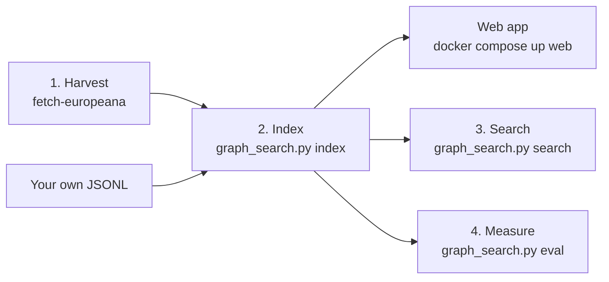

# User guide

How to load collections, search them and measure search quality. It assumes
the stack is built and the model weights are fetched; for that, see
[`build_guide.md`](build_guide.md).

All commands run from the repo root. In Claude Code cloud sessions, add
`-f compose.yaml -f .claude/compose.cloud.yaml` after `docker compose`.



## The web app

```bash
docker compose up -d web ollama   # starts neo4j, api, course-access, ollama and web; first start loads the model (~20 s)
# open http://localhost:8080          collections search (WEB_PORT in .env changes the port)
# open http://localhost:8080/review/  Course Access review queue
docker compose stop web api course-access ollama    # stop
```

**Experts, EU partners, Horizon calls.** The three research pages in the top
bar work once the OpenAlex and CORDIS graphs are indexed (sections 1b and
1c). *Experts* ranks researchers for a plain-language topic and lists the
topics and publications behind each match, with a link to the calls that
fit that researcher. *EU partners* takes a call topic or a project idea,
finds the Horizon Europe projects that match and ranks the organisations
that took part in them (coordinators count more), each with its projects
as evidence; only Horizon Europe member and associated countries are
listed, and never the asking side's own country. *Horizon calls* lists open
and forthcoming topics for a description or a lab's profile, with opening
dates, deadlines and the portal page. Everything is retrieval and graph
arithmetic over public records; no model writes any of it, and every item
links to its source.

**Analyse this call.** Each call on the Horizon calls page has *Analyse
this call*. The top panel comes straight from the funding records: action
type and the consortium rule it implies, whether a Canadian partner counts,
deadlines, budget, programme part, keywords and the topic's own eligibility
conditions. Below it the local model reads the topic's full description
(its "Expected outcome" and "Scope" sections, fetched once by
`fetch-cordis`) and lists the research topics, the expected outcomes and
the kinds of partner the call needs (a clinical partner, an SME for
exploitation, ...). Each item shows the passage of the topic text it rests
on; an item whose quoted passage is not in the text is dropped, and the
page says how many were. *Find partners for this call* runs the EU partners
search on those topics and that partner profile rather than on the call's
title. The first analysis of a call takes a minute or two on the laptop;
it is then kept until the `api` service restarts. A topic whose page was
not fetched (closed topics, or `--topics none`) is read from its title and
keywords only, and the page says so.

**What each adds.** When you reach *EU partners* from an analysed call,
the shortlist opens with *What each adds*: for every organisation, the
call's topics, expertise and keywords that its matching projects cover,
the roles from the partner profile it can fill (by its CORDIS type and
name: a public body as end user, an SME for exploitation, a clinical
partner...), its country and the projects it coordinated. Each claim cites
the project or organisation id it rests on. Below, *Complementary set of 3*
picks three partners one at a time, each the one that adds the most that
the set does not have yet (ties go to the higher-ranked partner), lists
what is still uncovered and checks the consortium rule with SFU as a
member. This part is plain arithmetic over the records; no model is asked.

**Ask.** The *Ask* page (top bar, or the link on *Experts*) takes one
question in plain words and sends it to the right journey: partners for a
call, calls for some work, a consortium, an SFU expert or sources in the
collections. Fixed rules decide first (a topic identifier such as
HORIZON-MISS-2027-03-OCEAN-01, "consortium", "which calls", "who works
on", "images"...); only when none fits does the local model pick, and when
its answer is unusable the question goes to expert search. The page says
where it went and why ("Routed to: journey 4 (rule: ...)") above the
results.

**Draft a consortium.** From a call on the Horizon calls page, *Draft a
consortium* builds the partner shortlist for that call, applies the Horizon
Europe consortium rule (three independent entities in three different
member or associated states with at least one member state for RIA and IA;
one entity for CSA and single-beneficiary actions; Canada counts as
associated in the Pillar II clusters only) and asks the local model for a
short brief. The brief must cite the ids of the partners and projects it
mentions; every sentence that cites anything else is dropped before you see
it, and sentences that cite nothing are counted so you can check them. It
is a draft for the research office, and nothing is sent from here. On the
laptop the model takes a few minutes; the `ollama` service must be running.

- **Words / By image.** Type a question in any language, or switch to *By
  image* and drop a picture to find similar ones. Image search only knows the
  indexed collections, so it always has *some* nearest pictures. The page shows
  your picture and says whether it is **in the collection** (similarity ≥ 0.98),
  has **similar pictures** (≥ 0.76), or has **no close match**, in which case
  the list is only the nearest of what the index holds. The thresholds were
  measured on the salmon pilot: unrelated pictures peaked at 0.68–0.72,
  salmon and fishing pictures from outside the index at 0.80–0.86
  (`SAME_PICTURE`, `CLOSE_PICTURE` in `collections.py`; recheck them when
  collections change).
- **Results.** Pictures and books, reports and film come as two lists: a text
  query always sits closer to text than to pictures, so one merged list would
  bury the pictures. Each card shows how it matched: *Picture*, *Meaning*,
  *Words*, or a combination.
- **Filters** (left) narrow by kind and licence without a new search.
- **Cite** opens APA, Chicago and BibTeX citations, built from the record:
  creator, title, holder, source URL and licence.
- **Item pages** show the record, its licence, linked records (creator,
  collection, holder) and similar pictures.
- **BC collections (ArcaBC)** and **SFU experts (REE)** have panels marked as
  not yet connected.

The same data is available as JSON:

| Endpoint | Returns |
|---|---|
| `GET /api/search?q=…&k=12` | `pictures` and `texts` lists of cards |
| `POST /api/search/image` (form field `file`) | `pictures` similar to the upload |
| `GET /api/items/{id}` | one card plus `citations` and `similar` |
| `GET /api/health` | status and item count |

## 1. Harvest from Europeana

You need `EUROPEANA_API_KEY` in `.env` (free key from
https://pro.europeana.eu/page/get-api).

```bash
docker compose run --rm fetch-europeana --rows 300
```

| Option | Default | Meaning |
|---|---|---|
| `--query` | the salmon pilot query (below) | Europeana query in its own syntax, e.g. `'title:("cod fishing" OR torskfiske)'` |
| `--qf` | none | Extra filter, repeatable: `--qf TYPE:IMAGE --qf LANGUAGE:en` |
| `--rows` | 300 | Maximum items to read (open-licence items with media) |
| `--name` | from the query | Output folder name under `data/europeana/` |

Output, which git ignores:

```text
data/europeana/salmon/
  items.jsonl        items, images, collections, institutions, creators and links
  media/*.jpg        400 px thumbnails
```

It prints `151 items (94 with thumbnails) -> data/europeana/salmon/items.jsonl`;
the default query has 151 matches in all.

**Write precise queries.** The default is salmon as a subject (`what:` *Salmo*,
*Oncorhynchus*, salmonids) or salmon fishing in titles in 7 languages, without
natural-history specimen photos (`NOT what:(specimen)`). By a full read of the
titles, about 95% of its items are on topic. Looser queries were about half
noise:

| Query | Typical noise |
|---|---|
| `salmon` | Works by people named Salmon |
| `what:(… OR lax …)` | The plant "lax hornpod" (Swedish *lax* = salmon) |
| `title:(salmon OR saumon …)` | Herbarium sheets named after the botanist C.E. Salmon; salmon-*coloured* fashion; people named Lax or Salmón |
| any species query | Hundreds of near-identical specimen photos from one museum |

Prefer subject fields and multi-word phrases over single words, and check a
sample of titles in `items.jsonl` before indexing.
Only items under CC0, the Public Domain Mark, CC BY or CC BY-SA are kept.
Re-running reuses thumbnails already downloaded.

## 1b. Harvest researchers from OpenAlex

For expert search (Research Assistant journey 4), harvest an institution's
recent works from OpenAlex, open scholarly metadata under CC0:

```bash
docker compose run --rm fetch-openalex                                  # SFU, since 2021, the 3000 most-cited works
docker compose run --rm fetch-openalex --ror 03rmrcq20 --name ubc --max-works 500
docker compose run --rm embed python scripts/graph_search.py index data/openalex/sfu/records.jsonl
docker compose run --rm embed python scripts/graph_search.py search "wildfire smoke and health" --label Researcher
```

`DATA_DIR/openalex/<name>/` gets `works.jsonl` (the trimmed API records) and
`records.jsonl`: one Researcher per author affiliated with the institution
(name, topics, recent titles: public facts from their publications, nothing
inferred about the person), one Publication per work with its abstract, the
OpenAlex Topics and UN SDG tags, the Institution, and the links between
them, including co-authorship counts. Papers with more than 30 authors are
left out. OpenAlex meters its API: without a key, one small daily budget is
shared by everyone behind your IP address (about one page of 200 works);
put a free key from https://openalex.org/settings/api in `OPENALEX_API_KEY`
in `.env` for a budget of your own. If the budget runs out mid-harvest, the
works collected so far are kept and mapped. REE's own profile fields (research statement, accepting students, SDG
tags) join the graph once SFU's Research Intelligence team agrees (R0).

## 1c. Harvest Horizon Europe projects and calls

For partner and call matching (journeys 1 to 3), download the EU side: every
Horizon Europe project with its participants (CORDIS, the Publications
Office's monthly bundle) and every call topic with its status and deadlines
(the Funding & Tenders portal's daily reference file). Both are EU open data
under CC BY 4.0 and need no key; together about 170 MB.

```bash
docker compose run --rm fetch-cordis                        # all 24k projects, 36k organisations
docker compose run --rm fetch-cordis --max-projects 3000    # the most recently started 3000, for a quick graph
docker compose run --rm embed python scripts/graph_search.py index data/cordis/horizon/records.jsonl
docker compose run --rm embed python scripts/graph_search.py search "wildfire smoke and health" --label Organization
```

`records.jsonl` holds one Project per funded project (acronym, title,
objective, dates, budget, participating countries), one Organization per
participant (name, country, type, the subject terms of its projects, its
recent project acronyms), the EuroSciVoc Topics, the Horizon Europe
programme parts (Clusters) and the CallTopics (open, forthcoming and closed,
with deadlines and keywords), with the links between them. The downloaded
files are kept; `--force` fetches them again.

## 2. Index

```bash
docker compose run --rm embed python scripts/graph_search.py index data/europeana/salmon/items.jsonl
```

This first runs the rights filter (R10): items that are not CC0, Public
Domain Mark, CC BY or CC BY-SA, have unknown rights, an access limit or a TK
Label (or other community-protocol marker) are class R and are never
embedded. Their images, and collections or creators linked only to them, go
with them. Each excluded record is listed with its source URL, then a line
such as:

```
rights filter: kept 5 items (8 nodes), excluded 5 items (7 nodes) as class R; 1 TK Label or community protocol; ...
```

To see that report without embedding anything (no Neo4j needed):

```bash
docker compose run --rm embed python scripts/graph_search.py rights data/europeana/salmon/items.jsonl
```

Indexing then starts Neo4j if needed, embeds every kept node with
EmbeddingGemma 2 and writes nodes and links. Indexing the same file again updates it in place.
On CPU, expect about 45 minutes for 300 items with images on 4 cores; a GPU
(see the build guide) is much faster.

### Index your own data

Write a JSONL file (format in [`design.md`](design.md#5-file-formats)) and
put it, with its media, under `data/`:

```json
{"id": "thesis:42", "label": "Item", "content": "Salmon farming and sea lice in BC", "props": {"url": "https://..."}}
{"id": "thesis:42#fig1", "label": "Image", "modality": "image", "content": "media/fig1.png"}
{"src": "thesis:42#fig1", "type": "PART_OF", "dst": "thesis:42"}
```

Records without a `source` prop count as your own data and need no rights
statement. Once a record names a `source` (a harvested collection), its
Items and Images need an open `rights` URI, or the filter excludes them.

## 3. Search

```bash
docker compose run --rm embed python scripts/graph_search.py search "salmon fishing boats"
```

| Option | Default | Meaning |
|---|---|---|
| `-k` | 10 | Number of results |
| `--label` | all | Keep only this node label; repeatable (`--label Image --label Item`) |
| `--modality` | `text` | For a media query, pass a file path as the query and its modality |
| `--backend` | `embeddinggemma-2` | Goes before the command (`graph_search.py --backend e5-small search …`); must match the backend the graph was indexed with |

### Reading results

Real output on the salmon pilot (ids shortened):

```text
$ graph_search.py search "salmon fishing on rivers" --label Image -k 3
 1. europeana:/2021012/_BBE3…#image [Image] 0.0164  (no caption)
      -> PART_OF europeana:/2021012/_BBE3…  Salmon Fishing Laxfiske Lohenpyynti technique: öljy puulle …
 2. europeana:/90402/RP_P_1954_64#image [Image] 0.0161  (no caption)
      -> PART_OF europeana:/90402/RP_P_1954_64  Zalmvisserij Salmon Fishing Jachtpartijen …
 3. europeana:/2021009/_00B6…#image [Image] 0.0159  (no caption)
      -> PART_OF europeana:/2021009/_00B6…  painokuva Gunnar Berndtsonin maalauksesta Lohenpyynti …

$ graph_search.py search "salmon in Canada" --label Item -k 2
 1. europeana:/08711/…_item_75914 [Item] 0.0328  Salmon-fishing in Canada
      -> IN europeana:collection:08711_Biodiversity_Heritage_Library  08711_Biodiversity_Heritage_Library
 2. europeana:/08711/…_item_116883 [Item] 0.0323  Salmon-fishing in Canada, by a resident
      -> CREATED_BY europeana:creator:adamson-w-agar-william-agar-1800-1868  Adamson, W. Agar …
```

- **Rank, id, [label], score, text.** The score is a reciprocal-rank-fusion
  score. About 0.033 means the node ranked first by both meaning and
  keywords; about 0.016 means it ranked first by one of them. Use it to
  order results, not as a confidence.
- **`(no caption)`** marks an image found by what it shows. Follow its
  `PART_OF` line to the item.
- **Indented lines** are linked nodes (evidence). `->` is an outgoing link,
  `<-` an incoming one.
- To cite an item, use its `url` and `rights` properties (section 5).

### Search tips

- To find sources rather than people or collections, add
  `--label Item --label Image`. Otherwise a creator whose name matches your
  words can rank high.
- Query in any language. Meaning-based matching works across languages, and
  keyword matching ignores common words such as "the", "de" or "und".
- Search pictures by what they show: `search "boats on a river" --label Image`.
- **Search pictures and texts separately.** In a mixed search, text items
  outrank pictures, because a text query is always closer to text than to an
  image. `--label Image` and `--label Item` give two good lists; a user
  interface should show them side by side rather than merged.
- Search by example image:
  `search data/europeana/salmon/media/<file>.jpg --modality image --label Image`.
- Lucene syntax (`AND`, quotes, `*`) is ignored on purpose. Just type words.

## 4. Measure quality

Add query lines to a JSONL file listing the ids that should be found:

```json
{"query": "saumon pêche", "lang": "fr", "relevant": ["europeana:/9200579/abc"]}
```

```bash
docker compose run --rm embed python scripts/graph_search.py eval my_queries.jsonl -k 10
# output shape (numbers depend on your queries):
```

To compare embedders before indexing (decision D7):

```bash
docker compose run --rm embed python scripts/embed_bakeoff.py evals/embed/sample_bakeoff.jsonl
```

## 5. Inspect the graph directly

Neo4j has no published ports. Open a Cypher shell inside it:

```bash
docker compose exec neo4j cypher-shell -u neo4j -p campus-ai-local
```

```cypher
// counts per label
MATCH (n:Entity) RETURN [l IN labels(n) WHERE l <> 'Entity'][0] AS label, count(*);
// an item with its evidence
MATCH (i:Item)-[r]-(m) WHERE i.id = 'europeana:/…' RETURN i.url, i.rights, type(r), m.text;
// items by licence
MATCH (i:Item) RETURN i.rights, count(*) ORDER BY count(*) DESC;
```

Use your `NEO4J_PASSWORD` if you set one.

## 6. Reset

| Goal | Command |
|---|---|
| Stop Neo4j, keep data | `docker compose stop neo4j` |
| Wipe the graph | `docker compose down -v` (deletes the `neo4j-data` volume) |
| Remove a harvest | delete `data/europeana/<name>/` |

## 7. Audit a course document (Course Access Agent)

Check a PDF, PPTX or DOCX against WCAG 2.2 AA. It runs offline, and the file
never leaves the machine:

```bash
docker compose run --rm -v "$PWD/samples:/samples:ro" test python scripts/audit_document.py /samples/week4.docx
```

Put the files in a folder (here `samples/`) and mount it read-only as shown.
The report lists each problem with its WCAG criterion, where it is and what
will fix it, then what the automatic checks can't judge (such as colour
contrast and whether existing alt text is accurate). Add `--json` for a
machine-readable report. Scanned PDF pages (images of text) are read with the
built-in offline OCR (Tesseract, English and French): the audit lists each as
a scanned page with the words recovered and the confidence, and a person must
check the recognised text, which can hold errors.

**Alt text proposals.** For the images the audit flags, the local vision
model proposes alt text (the `ollama` service must be running and the vision
model downloaded, see the build guide):

```bash
docker compose run --rm -v "$PWD/samples:/samples:ro" test python scripts/alt_text.py /samples/week4.pptx
```

The review sheet gives, per image, the kind (chart, diagram, photo...), the
proposed alt text, a long description where one is needed, and whether a
person must review it and why. Charts, diagrams, equations, images of text
and anything the model wants to mark decorative always go to review. Nothing
is written into the document: the rebuild step (A5) applies approved
proposals. Add `--json` for the proposals as data, and `--data-class` (P, I
or S; default I) to declare the document's class. The document and its
images never leave the machine.

**All proposed fixes.** The structure, table and text workers propose a fix
for every other issue the audit finds (typed lists, heading levels, repeated
slide titles, header rows, layout tables mistaken for data, the title, the
language, link text), each with a confidence, whether a person must review
it and the evidence:

```bash
docker compose run --rm -v "$PWD/samples:/samples:ro" test python scripts/propose_fixes.py /samples/week4.docx
docker compose run --rm -v "$PWD/samples:/samples:ro" test python scripts/propose_fixes.py /samples/week4.pptx --alt-text
```

Most proposals come from rules and need no model; the language of the
document and link text that the surrounding text does not give are asked of
the local model, so the `ollama` service must be running for those. Nothing
is written back by this step.

**The review queue (web).** http://localhost:8080/review/ is the same
pipeline with a person in the loop. Upload a document (tick *Also propose alt
text* to run the vision model); the page shows what the audit found and every
proposal with its evidence and confidence, grouped by worker, with the image
next to each alt-text proposal. Approve, edit the value first if needed, or
reject each one; rule-based proposals that need no review are applied unless
you reject them, and anything marked *needs review* is applied only when you
approve it. *Build the accessible version* writes the DOCX, HTML, report,
review sheet and statement, re-audits the DOCX and shows the before/after
numbers; the files download from the same page. Documents and outputs stay
in the `course-access-work` volume on this machine (`COURSE_ACCESS_WORK` in
`.env` points it at a folder); delete a job from the queue to remove them.

**The accessible version (command line).** `remediate.py` runs the whole
pipeline without the queue: parse, audit, propose, apply the approved
proposals, rebuild, audit again:

```bash
docker compose run --rm -v "$PWD/samples:/samples" test python scripts/remediate.py /samples/week4.pptx --out /samples/out
docker compose run --rm -v "$PWD/samples:/samples" test python scripts/remediate.py /samples/week4.pptx --out /samples/out --alt-text --approve-all
```

In the output folder: `week4.docx` and `week4.html` (the accessible
versions), `week4-report.md` (the audit of the original), `week4-review.md`
(the proposals still waiting for a person) and `week4-statement.md` (what was
found, applied, left and not checked, from re-auditing the rebuilt DOCX).
By default only proposals that need no review are applied; `--approve-all`
applies every proposal with a value and is for demos and evaluation, not for
publishing. `--alt-text` adds the alt-text worker. The rebuilt DOCX is
audited with the same checks as the original, so the statement's numbers
are comparable.

**A corpus of real course documents.** `fetch-course-docs` downloads openly
licensed lecture slides, lecture notes, course outlines and readings (CC BY
and CC BY-SA, from Canadian and UK open-education repositories) into
`DATA_DIR/course_access`, one folder per source, and records every file's
URL, authors, licence and checksum in `manifest.jsonl`. It is the Course
Access counterpart of the Europeana harvest: the one step that needs the
network. Then audit the whole corpus at once:

```bash
docker compose run --rm fetch-course-docs
docker compose run --rm test python evals/course_access/audit_corpus.py
```

The report (one row per document: pages, images, tables, issues by rule)
is the raw material for the gold set (A6), which still needs a specialist's
labels. The documents are evaluation input only and are never committed.

## 7b. MCP servers (any MCP client)

Both products are also MCP servers, so any MCP client (an IDE, a desktop
assistant, the Teamworx HR platform) can call their tools. Each server speaks
stdio: the client spawns the command below and talks to it over stdin/stdout.
Everything stays local; the tools call the same functions as the web app and
CLI, and every call is traced (tool, data class, latency, outcome; never
inputs or outputs) under `traces/`.

| Server | Command | Tools |
|---|---|---|
| Course Access | `docker compose run --rm -T -v "$PWD/samples:/samples" test python -m campus_ai.course_access.mcp_server` | `audit_document(path)`, `propose_fixes(path, with_alt_text)`, `remediate(path, out_dir, approve_all)` |
| Research Assistant | `docker compose run --rm -T embed python -m campus_ai.research_assistant.mcp_server` | `find_experts`, `find_partners`, `find_calls`, `get_call`, `check_consortium`, `draft_brief`, `search_collections` |

Paths are paths inside the container (so mount your documents, as above).
Every tool takes a `data_class` (default `I` for course documents, `P` for
the Research Assistant); `R` is refused. The Research Assistant loads its
model and connects to Neo4j on the first tool call, so listing the tools is
instant. Course Access proposals need `ollama` up (`docker compose up -d ollama`).

A client entry (`mcpServers` in the client's JSON config):

```json
{
  "mcpServers": {
    "campus-ai-course-access": {
      "command": "docker",
      "args": ["compose", "-f", "C:/path/to/campus-ai/compose.yaml", "run", "--rm", "-T",
               "-v", "C:/path/to/samples:/samples", "test",
               "python", "-m", "campus_ai.course_access.mcp_server"]
    },
    "campus-ai-research-assistant": {
      "command": "docker",
      "args": ["compose", "-f", "C:/path/to/campus-ai/compose.yaml", "run", "--rm", "-T", "embed",
               "python", "-m", "campus_ai.research_assistant.mcp_server"]
    }
  }
}
```

Each server also takes `--http PORT` to serve streamable HTTP instead (for a
client on the compose network); no compose service is defined for it yet.

## 8. Troubleshooting

| Symptom | Cause and fix |
|---|---|
| `set EUROPEANA_API_KEY in .env` | Add the key to `.env` in the repo root |
| `HTTP Error 401` / `403` from fetch-europeana | Invalid key, or a proxy or firewall blocks `api.europeana.eu` |
| `/models/google/embeddinggemma-2 not found` | Run `docker compose run --rm fetch-models`, or check `MODELS_DIR` in `.env` |
| `entity_vec holds 128-d vectors but … gives 384-d` | The graph was built with another backend. Use the same `--backend`, or wipe with `docker compose down -v` |
| `Neo.ClientError.Security.Unauthorized` | `NEO4J_PASSWORD` changed after Neo4j's first start. Restore it, or wipe the volume |
| `--label` returns nothing on a graph built before this version | Run any `index` command once: `ensure_schema` adds the `kind` filter to the old graph |
| `does not support 'image' inputs` | `--backend e5-small` is text only |
| Indexing is slow | Use a GPU (`compose.gpu.yaml`) or index fewer rows |
| `No Ollama at http://ollama:11434` | Start it: `docker compose up -d ollama` |
| `Ollama ... rejected the request (404)` | The task's model is not downloaded: `docker compose run --rm fetch-ollama <model>` |
| Containers try `127.0.0.1:11434` for Ollama | Your shell exports `OLLAMA_HOST` (a native Ollama install does this) and an older compose file passed it on. The stack reads `OLLAMA_URL` from `.env` instead; `git pull` |
