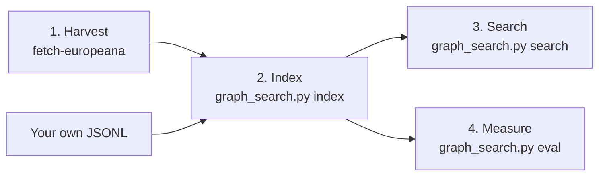

# User guide

How to load collections, search them and measure search quality. It assumes
the stack is built and the model weights are fetched; for that, see
[`build_guide.md`](build_guide.md).

All commands run from the repo root. In Claude Code cloud sessions, add
`-f compose.yaml -f .claude/compose.cloud.yaml` after `docker compose`.



## 1. Harvest from Europeana

You need `EUROPEANA_API_KEY` in `.env` (free key from
https://pro.europeana.eu/page/get-api).

```bash
docker compose run --rm fetch-europeana --query salmon --rows 300
```

| Option | Default | Meaning |
|---|---|---|
| `--query` | `salmon` | Europeana search query; supports its syntax, e.g. `"fishing OR fisheries"` |
| `--qf` | none | Extra filter, repeatable: `--qf TYPE:IMAGE --qf LANGUAGE:en` |
| `--rows` | 300 | Maximum items to read (open-licence items with media) |
| `--name` | from the query | Output folder name under `data/europeana/` |

Output, which git ignores:

```text
data/europeana/salmon/
  items.jsonl        items, images, collections, institutions, creators and links
  media/*.jpg        400 px thumbnails
```

It prints `300 items (280 with thumbnails) -> data/europeana/salmon/items.jsonl`.
Only items under CC0, the Public Domain Mark, CC BY or CC BY-SA are kept.
Re-running reuses thumbnails already downloaded.

## 2. Index

```bash
docker compose run --rm embed python scripts/graph_search.py index data/europeana/salmon/items.jsonl
```

This starts Neo4j if needed, embeds every node with EmbeddingGemma 2 and
writes nodes and links. Indexing the same file again updates it in place.
Indexing runs on the CPU unless you enable a GPU (see the build guide), and
is much faster on one.

### Index your own data

Write a JSONL file (format in [`design.md`](design.md#5-file-formats)) and
put it, with its media, under `data/`:

```json
{"id": "thesis:42", "label": "Item", "content": "Salmon farming and sea lice in BC", "props": {"url": "https://..."}}
{"id": "thesis:42#fig1", "label": "Image", "modality": "image", "content": "media/fig1.png"}
{"src": "thesis:42#fig1", "type": "PART_OF", "dst": "thesis:42"}
```

## 3. Search

```bash
docker compose run --rm embed python scripts/graph_search.py search "salmon fishing boats"
```

| Option | Default | Meaning |
|---|---|---|
| `-k` | 10 | Number of results |
| `--label` | all | Keep only this node label; repeatable (`--label Image --label Item`) |
| `--modality` | `text` | For a media query, pass a file path as the query and its modality |
| `--backend` | `embeddinggemma-2` | Must match the backend the graph was indexed with |

### Reading results

Output shape (ids shortened):

```text
 1. europeana:/<dataset>/<record> [Item] 0.0328  <title and description>
      -> IN europeana:collection:<dataset>  <dataset name>
      -> CREATED_BY europeana:creator:<name>  <creator>
      <- PART_OF europeana:/<dataset>/<record>#image  
 2. europeana:/<dataset>/<record>#image [Image] 0.0164  (no caption)
      -> PART_OF europeana:/<dataset>/<record>  <title of the item it belongs to>
```

- **Rank, id, [label], score, text.** The score is a reciprocal-rank-fusion
  score. About 0.033 means the node ranked first by both meaning and
  keywords; about 0.016 means it ranked first by one of them. Use it to
  order results, not as a confidence.
- **`(no caption)`** marks an image found by what it shows. Follow its
  `PART_OF` line to the item.
- **Indented lines** are linked nodes (evidence). `->` is an outgoing link,
  `<-` an incoming one.
- To cite an item, use its `url` and `rights` properties (section 5).

### Search tips

- Query in any language. Meaning-based matching works across languages, and
  keyword matching ignores common words such as "the", "de" or "und".
- Search pictures by what they show: `search "boats on a river" --label Image`.
- Search by example image:
  `search data/europeana/salmon/media/<file>.jpg --modality image --label Image`.
- Lucene syntax (`AND`, quotes, `*`) is ignored on purpose. Just type words.

## 4. Measure quality

Add query lines to a JSONL file listing the ids that should be found:

```json
{"query": "saumon pêche", "lang": "fr", "relevant": ["europeana:/9200579/abc"]}
```

```bash
docker compose run --rm embed python scripts/graph_search.py eval my_queries.jsonl -k 10
# embeddinggemma-2 hybrid: recall@10 all=0.900, en=0.950, fr=0.850 (40 queries)
```

To compare embedders before indexing (decision D7):

```bash
docker compose run --rm embed python scripts/embed_bakeoff.py evals/embed/sample_bakeoff.jsonl
```

## 5. Inspect the graph directly

Neo4j has no published ports. Open a Cypher shell inside it:

```bash
docker compose exec neo4j cypher-shell -u neo4j -p campus-ai-local
```

```cypher
// counts per label
MATCH (n:Entity) RETURN [l IN labels(n) WHERE l <> 'Entity'][0] AS label, count(*);
// an item with its evidence
MATCH (i:Item)-[r]-(m) WHERE i.id = 'europeana:/…' RETURN i.url, i.rights, type(r), m.text;
// items by licence
MATCH (i:Item) RETURN i.rights, count(*) ORDER BY count(*) DESC;
```

Use your `NEO4J_PASSWORD` if you set one.

## 6. Reset

| Goal | Command |
|---|---|
| Stop Neo4j, keep data | `docker compose stop neo4j` |
| Wipe the graph | `docker compose down -v` (deletes the `neo4j-data` volume) |
| Remove a harvest | delete `data/europeana/<name>/` |

## 7. Troubleshooting

| Symptom | Cause and fix |
|---|---|
| `set EUROPEANA_API_KEY in .env` | Add the key to `.env` in the repo root |
| `HTTP Error 401` / `403` from fetch-europeana | Invalid key, or a proxy or firewall blocks `api.europeana.eu` |
| `/models/google/embeddinggemma-2 not found` | Run `docker compose run --rm fetch-models`, or check `MODELS_DIR` in `.env` |
| `entity_vec holds 128-d vectors but … gives 384-d` | The graph was built with another backend. Use the same `--backend`, or wipe with `docker compose down -v` |
| `Neo.ClientError.Security.Unauthorized` | `NEO4J_PASSWORD` changed after Neo4j's first start. Restore it, or wipe the volume |
| Fewer results than `-k` with `--label` | The filter applies after the top 50 candidates. Raise `candidates` in code, or drop the filter |
| `does not support 'image' inputs` | `--backend e5-small` is text only |
| Indexing is slow | Use a GPU (`compose.gpu.yaml`) or index fewer rows |
